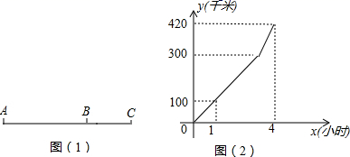

# Mathematics - 题目 2315

**ID**: bfa5fe0a97e8469f8c18f5e398d70878
**年级**: Grade 9
**难度**: Medium-Hard
**题型**: Calculation

## 题目
如图(1)，公路上有A、B、C三个车站，一辆汽车从A站以速度v_{1}匀速驶向B站，到达B站后不停留，以速度v_{2}匀速驶向C站，汽车行驶路程y(千米)与行驶时间x(小时)之间的函数图象如图(2)所示．(1)当汽车在A、B两站之间匀速行驶时，求y与x之间的函数关系式及自变量的取值范围；​​​​​​​‌(2)求出v_{2}的值；(3)若汽车在某一段路程内刚好用50分钟行驶了90千米，求这段路程开始时x的值．

## 解答

1. （1）根据图象可设汽车在A、B两站之间匀速行驶时，y与x之间的函数关系式为y=kx，
2. ∵图象经过（1，100），
3. ∴k=100，
4. ∴y与x之间的函数关系式为y=100x，（0＜x＜3）；
5. （2）当y=300时，x=3，
6. 4﹣3=1小时，420﹣300=120千米，
7. ∴v_{2}=120千米/小时；
8. （3）设汽车在A、B两站之间匀速行驶x小时，则在汽车在B、C两站之间匀速行驶（ $\frac {5}{6}$ ﹣x）小时，
9. 由题意得，100x+120（ $\frac {5}{6}$ ﹣x）=90，
10. 解得x=0.5，
11. 3﹣0.5=2.5小时．
12. 答：这段路程开始时x的值是2.5小时．

## 知识点

**中文**:
  - 行程问题

**English**:
  - Distance-Speed-Time Problems

---
