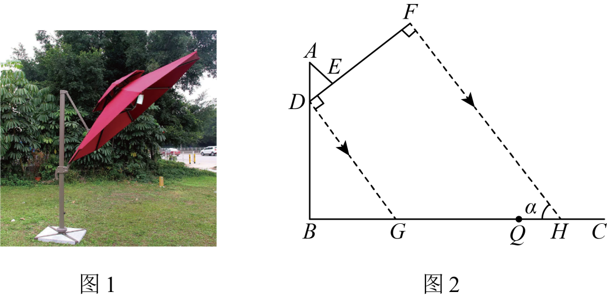

# Mathematics - 题目 895

**ID**: c130378d5f9147b68032976588ea4a93
**年级**: Grade 9
**难度**: Medium-Hard
**题型**: Calculation

## 题目
根据以下素材，探索完成任务．探究遮阳伞下的影子长度素材1（1）图1是某款自动旋转遮阳伞，伞面完全张开时张角呈 $180{}^\circ {\rm ，}$ 图2是其侧面示意图．（2）已知支架 $AB$ 长为2.​​​​​​​‌5米，且垂直于地面 $BC{\rm ，}$ 悬托架 $AE=DE=0.5$ 米，点 $E$ 固定在伞面上，且伞面直径 $DF$ 是 $DE$ 的4倍．当伞面完全张开时，点 $D，E，F$ 始终共线．（3）为实现遮阳效果最佳，伞面装有接收器可以根据太阳光线的角度变化，自动调整手柄 $D$ 沿着 $AB$ 移动，以保证太阳光线与 $DF$ 始终垂直．素材2某地区某天下午不同时间的太阳高度角 $α$  （太阳光线与地面的夹角）参照表：

## 解答

1. 解：任务1：①如图，作 $EI\bot AB$ 于 $I{\rm ，}$ 作 $GJ\bot FH$ 于 $J{\rm ，}$
2. ，
3. ∵ $AD=0.8$ 米 ${\rm ，}AE=DE=0.5$ 米，伞面直径 $DF$ 是 $DE$ 的4倍，
4. ∴ $AI=DI=\frac {1}{2}AD=0.4$ 米 ${\rm ，}DF=4DE=4\times 0.5=2$ 米，
5. ∴ $IE=\sqrt {DE{^{2}}-ID{^{2}}}=\sqrt {{\left({0.5}\right)^{2}}-{\left({0.4}\right)^{2}}}=0.3$ （米），
6. ∴ ${\tan}\angle ADE={\tan}\angle IDE=\frac {IE}{ID}=\frac {0.3}{0.4}=\frac {3}{4}$ ；
7. ②∵ $GJ\bot FH{\rm ，}$
8. ∴ $\angle GDF=\angle JFD=\angle GJF=90{}^\circ {\rm ，}$
9. ∴四边形 $DGJF$ 为矩形，
10. ∴ $GJ=DF=2$ 米 ${\rm ，}\angle DGJ=90{}^\circ {\rm ，}$  $DG\mathrm{/\mskip-4mu/}FH{\rm ，}$
11. ∴ $\angle ADE+\angle BDG=90{}^\circ {\rm ，}$  $\angle FHG=\angle DGB{\rm ，}$
12. ∵ $\angle DGB+\angle BDG=90{}^\circ {\rm ，}$
13. ∴ $\angle ADE=\angle DGB=\angle JHG{\rm ，}$
14. ∴ ${\tan}\angle JHG=\frac {GJ}{JH}={\tan}\angle ADE=\frac {3}{4}{\rm ，}$
15. ∴ $JH=\frac {8}{3}$ 米，
16. ∴ $GH=\sqrt {GJ{^{2}}+JH{^{2}}}=\sqrt {2{^{2}}+{\left({\frac {8}{3}}\right)^{2}}}=\frac {10}{3}$ 米；
17. 任务2：如图，作 $QP\bot BC$ 交 $HF$ 于 $P{\rm ，}$
18. ，
19. 由（1）得： $\angle IDE=\angle DGB=\angle α{\rm ，}$  $GJ=DF=2$ 米，
20. ∵ $\angle α=60{}^\circ {\rm ，}$
21. ∴在 ${\rm{R}}{\rm{t}}△IDE$ 中 ${\rm ，}DE=0.5$ 米 ${\rm ，}\angle IDE=60{}^\circ {\rm ，}$ 则 $DI=\frac {1}{2}DE=0.25$ 米，
22. ∴ $AD=2DI=0.5$ 米，
23. ∴ $BD=AB-AD=2.5-0.5=2$ 米，
24. 在 ${\rm{R}}{\rm{t}}\mathrm{△}DGB$ 中 ${\rm ，}BG=\frac {BD}{{\tan}60{}^\circ }=\frac {2}{\sqrt {3}}=\frac {2\sqrt {3}}{3}$ 米，
25. 在 ${\rm{R}}{\rm{t}}△GJH$ 中 ${\rm ，}GH=\frac {GJ}{\sin 60{}^\circ }=\frac {2}{\frac {\sqrt {3}}{2}}=\frac {4\sqrt {3}}{3}$ 米，
26. 在 ${\rm{R}}{\rm{t}}\mathrm{△}PQH$ 中，当 $PQ=1$ 时 ${\rm ，}QH=\frac {PQ}{{\tan}60{}^\circ }=\frac {1}{\sqrt {3}}=\frac {\sqrt {3}}{3}$ 米，
27. ∴小明刚好被照射到时离 $B$ 的距离为 $\frac {2\sqrt {3}}{3}+\frac {4\sqrt {3}}{3}-\frac {\sqrt {3}}{3}=\frac {5\sqrt {3}}{3}<3{\rm ，}$
28. ∴小明会被照到；
29. 任务3：由任务2得：当 $α=60{}^\circ $ 时 ${\rm ，}BQ=\frac {5\sqrt {3}}{3}$ 米，
30. 当 $α=45{}^\circ $ 时 ${\rm ，}\angle IDE=\angle DGB=\angle α=45{}^\circ {\rm ，}$  $GJ=DF=2$ 米，
31. ∴在 ${\rm{R}}{\rm{t}}△IDE$ 中 ${\rm ，}DE=0.5$ 米 ${\rm ，}\angle IDE=45{}^\circ {\rm ，}$ 则 $DI=DE{\cos}45{}^\circ =\frac {\sqrt {2}}{4}$ 米，
32. ∴ $AD=2DI=\frac {\sqrt {2}}{2}$ 米，
33. ∴ $BD=AB-AD=2.5-\frac {\sqrt {2}}{2}=\frac {5-\sqrt {2}}{2}$ 米，
34. 在 ${\rm{R}}{\rm{t}}\mathrm{△}DGB$ 中 ${\rm ，}BG=\frac {BD}{{\tan}45{}^\circ }=\frac {\frac {5-\sqrt {2}}{2}}{1}=\frac {5-\sqrt {2}}{2}$ 米，
35. 在 ${\rm{R}}{\rm{t}}△GJH$ 中 ${\rm ，}GH=\frac {GJ}{\sin 45{}^\circ }=\frac {2}{\frac {\sqrt {2}}{2}}=2\sqrt {2}$ 米，
36. 在 ${\rm{R}}{\rm{t}}\mathrm{△}PQH$ 中，当 $PQ=1$ 时 ${\rm ，}QH=\frac {PQ}{{\tan}45{}^\circ }=\frac {1}{1}=1$ 米，
37. 此时 ${\rm ，}BQ=BG+GH-QH=\frac {5-\sqrt {2}}{2}+2\sqrt {2}-1=\frac {3+3\sqrt {2}}{2}$ 米，
38. ∴ $\frac {5\sqrt {3}}{3}<BQ<\frac {3+3\sqrt {2}}{2}$ ．

## 知识点

**中文**:
  - 等腰三角形的性质
  - 解直角三角形
  - 解直角三角形的实际应用

**English**:
  - Properties of Isosceles Triangles
  - Solving Right Triangles
  - Applications of Solving Right Triangles

---
