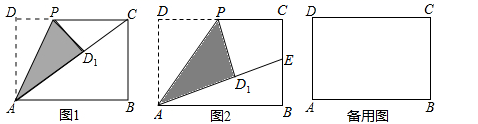

# Mathematics - 题目 3193

**ID**: c22432ad43e44fcfbd6e42b0f50c67c7
**年级**: Grade 9
**难度**: Medium-Hard
**题型**: Calculation

## 题目
如图，四边形 $ABCD$ 为一个矩形纸片， $AB=3$ ， $BC=2$ ．动点 $P$ 自 $D$ 点出发沿 $DC$ 方向运动至 $C$ 点后停止， $ΔADP$ 以直线 $AP$ 为轴翻折，点 $D$ 落在点 $D{{}_{1}}$ 的位置．设 $DP=x$ ， $\Delta AD{{}_{1}}P$ 与原纸片重叠部分的面积为 $y$ ．（1）当 $x$ 为何值时，直线 $AD{{}_{1}}$ 过点 $C$ ；​​​​​​​‌（2）当 $x$ 为何值时，直线 $AD{{}_{1}}$ 过 $BC$ 的中点 $E$ ；（3）求出 $y$ 与 $x$ 的函数表达式．

## 解答

1. （1）由题意得 $\Delta ADP\mathrm{≌}\Delta AD{{}_{1}}P$ ，
2. ∴ $AD=AD{{}_{1}}=2$ ， $PD=PD{{}_{1}}=x$ ， $\angle D=\angle AD{{}_{1}}P=90{}^\circ $ ．
3. ∵直线 $AD{{}_{1}}$ 过 $C$ ，
4. ∴ $PD{{}_{1}}\bot AC$ ．
5. 在 $Rt\Delta ABC$ 中， $AC=\sqrt {2{^{2}}+3{^{2}}}=\sqrt {13}$ ， $CD{{}_{1}}=\sqrt {13}-2$ ．
6. 在 $Rt\Delta PCD{{}_{1}}$ ，中， $PC{^{2}}=PD{{}_{1}^{2}}+CD{{}_{1}^{2}}$ ，
7. 即 $(3-x){^{2}}=x{^{2}}+(\sqrt {13}-2){^{2}}$ ，解得 $x=\frac {2\sqrt {13}-4}{3}$ ，
8. ∴当 $x=\frac {2\sqrt {13}-4}{3}$ 时，直线 $AD{{}_{1}}$ 过点 $C$ ．
9. （2）如图，连接 $PE$ ，
10. 
11. ∵ $E$ 为 $BC$ 的中点，
12. ∴ $BE=CE=1$ ．
13. 在 $Rt\Delta ABE$ 中， $AE=\sqrt {AB{^{2}}+BE{^{2}}}=\sqrt {10}$ ．
14. ∵ $AD{{}_{1}}=AD=2$ ， $PD=PD{{}_{1}}=x$ ，
15. ∴ $D{{}_{1}}E=\sqrt {10}-2$ ， $PC=3-x$ ．
16. 在 $Rt\Delta PD{{}_{1}}E$ 和 $Rt\Delta PCE$ 中，
17. $x{^{2}}+(\sqrt {10}-2){^{2}}=(3-x){^{2}}+1{^{2}}$ ，解得 $x=\frac {2\sqrt {10}-2}{3}$ ，
18. ∴当 $x=\frac {2\sqrt {10}-2}{3}$ 时，直线 $AD{{}_{1}}$ 过 $BC$ 的中点 $E$ ．
19. （3）如图3，当 $0<x\leqslant 2$ 时， $y=x$ ，
20. 
21. 如图4，当 $2<x\leqslant 3$ 时，点 $D{{}_{1}}$ 在矩形 $ABCD$ 的外部， $PD{{}_{1}}$ 交 $AB$ 于 $F$ ，
22. 
23. ∵AB∥CD，
24. ∴ $\angle 1=\angle 2$ ．
25. ∵ $\angle 1=\angle 3$ ，
26. ∴ $∠2=∠3$ ，
27. ∴ $AF=PE$ ．
28. 作 $PG\bot AB$ 于 $G$ ，设 $PF=AF=a$ ，
29. 由题意得 $AG=DP=x$ ， $FG=x-a$ ，
30. 在 $Rt\Delta PFG$ 中， ${\left({x-a}\right)^{2}}+2{^{2}}=a{^{2}}$ ，
31. 解得 $a=\frac {4+x{^{2}}}{2x}$ ，
32. ∴ $y=\frac {1}{2}\times 2\times \frac {4+x{^{2}}}{2x}=\frac {x{^{2}}+4}{2x}$ ．
33. 综合所述，当 $0<x\leqslant 2$ 时， $y=x$ ；当 $2<x\leqslant 3$ 时， $y=\frac {x{^{2}}+4}{2x}$ ．

## 知识点

**中文**:
  - 图形问题
  - 矩形的判定与性质综合
  - 折叠问题

**English**:
  - Geometric Problems
  - Determination and Properties of Rectangles
  - Folding Problems

---
