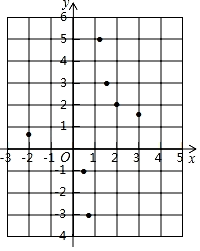

# Mathematics - 题目 2887

**ID**: c3a269f63bd34921b66dd98481bd7dff
**年级**: Grade 9
**难度**: Medium-Hard
**题型**: Calculation

## 题目
某班“数学兴趣小组”对函数y= $\frac {x}{x-1}$ ，的图象和性质进行了探究探究过程如下，请补充完成：（1）函数y= $\frac {x}{x-1}$ 的自变量x的取值范围是；​​​​​​​‌（2）下表是y与x的几组对应值．请直接写出m，n的值：m=；n=．x…﹣2﹣10$\frac {1}{2}$$\frac {3}{4}$$\frac {5}{4}$n234…y…$\frac {2}{3}$m0﹣1﹣3532$\frac {3}{2}$$\frac {4}{3}$…（3）如图，在平面直角坐标系xOy中，描出了以上表中各对对应值为坐标的点，根据描出的点，画出该函数的图象；（4）通过观察函数的图象，小明发现该函数图象与反比例函数y= $\frac {k}{x}$ （k＞0）的图象形状相同，是中心对称图形，且点（﹣1，m）和（3， $\frac {3}{2}$ ）是一组对称点，则其对称中心的坐标为．（5）当2⩽x⩽4时，关于x的方程kx+ $\frac {1}{2}$ = $\frac {x}{x-1}$ 有实数解，求k的取值范围．

## 解答

1. 解：（1）函数y= $\frac {x}{x-1}$ 的自变量x的取值范围是x≠1．
2. 故答案为x≠1．
3. （2）x=﹣1时，y= $\frac {1}{2}$ ，
4. ∴m= $\frac {1}{2}$ ．
5. 当y=3时，则3= $\frac {x}{x-1}$ ，解得x= $\frac {3}{2}$ ，
6. ∴n= $\frac {3}{2}$ ，
7. 故答案为 $\frac {1}{2}$ ， $\frac {3}{2}$ ；
8. （3）函数图像如图所示：
9. 
10. （4）该函数的图象关于点（1，1）成中心对称，
11. 故答案为（1，1）；
12. （5）当2⩽x⩽4时，函数y= $\frac {x}{x-1}$ 中， $\frac {4}{3}$ ⩽y⩽2，
13. 把x=4，y= $\frac {4}{3}$ 代入函数y=kx+ $\frac {1}{2}$ 得， $\frac {4}{3}$ =4k+ $\frac {1}{2}$ ，解得k= $\frac {5}{24}$ ，
14. 把x=2，y=2代入函数y=kx+ $\frac {1}{2}$ 得2=2k+ $\frac {1}{2}$ ，解得k= $\frac {3}{4}$ ，
15. ∴关于x的方程kx+ $\frac {1}{2}$ = $\frac {x}{x-1}$ 有实数解，k的取值范围是 $\frac {5}{24}$ ⩽k⩽ $\frac {3}{4}$ ．

## 知识点

**中文**:
  - 分式有意义的条件
  - 反比例函数的图象
  - 反比例函数解析式

**English**:
  - Conditions for Rational Expressions to be Defined
  - Graph of Inverse Proportionality Functions
  - Analytic Expression of Inverse Proportionality

---
