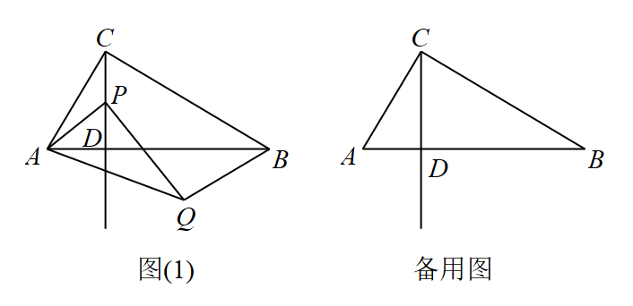

# Mathematics - 题目 3125

**ID**: c54fec972b0a446b8761fa4acf4b9689
**年级**: Grade 9
**难度**: Medium-Hard
**题型**: Calculation

## 题目
如图（1）， $\vartriangle ABC$ 中， $\angle ACB=90{}^\circ $ ，射线 $CD\bot AB$ 于点D．点P是射线 $CD$ 上一动点，连接 $AP$ 并在 $AP$ 边右侧作 $△APQ$ 使得 $\angle PAQ=\angle CAB$ ，且 $\frac {AC}{AP}=\frac {AB}{AQ}$ ，连接 $BQ$ ．(1)求证： $BA$ 平分 $\angle CBQ$ ；​​​​​​​‌(2)当 $AQ{\rm{/\mskip-4mu/}}BC$ 时，延长 $AP$ 交 $BC$ 边于点E，求证： $CE\cdot BC=AD\cdot AB$ ；(3)若 $AC=3$ ， $BC=4$ ，点P在运动的过程中，直线 $PQ$ 交边 $AB$ 于点F，当 $\mathrm{△}BQF$ 是等腰三角形时，求线段 $AP$ 的长．

## 解答

1. （1）证明：∵ $\angle PAQ=\angle CAB$ ，
2. ∴ $\angle PAQ-\angle PAB=\angle CAB-\angle PAB$ ，∴ $\angle BAQ=\angle CAP$ ；
3. 又∵ $\frac {AC}{AP}=\frac {AB}{AQ}$ ，∴ $\frac {AC}{AB}=\frac {AP}{AQ}$ ，∴ $\mathrm{△}CAP{\rm{∽}}\mathrm{△}BAQ$ ，
4. ∴ $\angle ACP=\angle ABQ$ ．
5. 又∵ $\angle ACB=90{}^\circ $ ， $CD\bot AB$ ，
6. ∴ $\angle ACP+\angle PCB=90{}^\circ =\angle ABC+\angle PCB$ ．
7. ∴ $\angle ACP=\angle ABC$ ，
8. ∴ $\angle ABQ=\angle ABC$ ，
9. ∴ $BA$ 平分 $\angle CBQ$ ．
10. 
11. （2）∵ $AQ{\rm{/\mskip-4mu/}}BC$ ，
12. ∴ $\angle QAB=\angle ABC$ ．
13. 又∵ $\angle QAB=\angle EAC$ ，
14. ∴ $\angle EAC=\angle ABC$ ；
15. 又∵ $\angle ECA=\angle ACB$ ，
16. ∴ $\mathrm{△}ECA{\rm{∽}}\mathrm{△}ACB$ ，
17. ∴ $\frac {CE}{CA}=\frac {CA}{CB}$ ，
18. ∴ $CA{^{2}}=CE\cdot CB$ ；
19. ∵ $\angle CAD=\angle BAC$ ，由（1）知 $\angle ACD=\angle ABC$ ，
20. ∴ $\mathrm{△}ACD\mathrm{∽}\mathrm{△}ABC$ ，
21. ∴ $\frac {AC}{AB}=\frac {AD}{AC}$ ，
22. ∴ $CA{^{2}}=AD\cdot AB$ ．
23. ∴ $CE\cdot CB=AD\cdot AB$ ．
24. （3）∵ $AC=3$ ， $BC=4$ ，∴ $AB=5$
25. 当 $BF=BQ$ 时，
26. ∵ $\angle PAQ=\angle CAB$ ，且 $\frac {AC}{AP}=\frac {AB}{AQ}$ ，则 $\frac {AC}{AB}=\frac {AP}{AQ}=\frac {3}{5}$
27. ∴ $\mathrm{△}ACB{\rm{∽}}\mathrm{△}APQ$ ，则 $\angle AQF=\angle ABC=\angle ABQ$ ， $\angle APQ=\angle ACB=90{}^\circ $ ，
28. ∵ $\angle AQF=\angle ABQ$ ， $\angle QAF=\angle BAQ$ ，
29. ∴ $\mathrm{△}QAF{\rm{∽}}\mathrm{△}BAQ$ ，
30. ∴ $\frac {AF}{AQ}=\frac {AQ}{AB}$ ，∴ $AQ{^{2}}=AF\cdot AB$ ，
31. 设 $AP=3a$ ， $AQ=5a$ ，∴ $AF=5a{^{2}}$ ， $BF=5-5a{^{2}}=BQ$ ；
32. ∴作 $QH\bot AB$ 于点H，则 $\mathrm{△}ACB{\rm{∽}}\mathrm{△}QHB$ ，
33. ∴ $BQ:HQ:BH=5:3:4$ ；
34. ∴ $QH=3-3a{^{2}}$ ， $BH=4-4a{^{2}}$ ， $FH=1-a{^{2}}$ ，∴ $FQ=\sqrt {10}\left ({1-a{^{2}}}\right )$ ．
35. 又∵ $\angle AFP=\angle QHF$ ， $\angle APF=\angle FHQ=90{}^\circ $ ，
36. ∴ $\mathrm{△}APF{\rm{∽}}\mathrm{△}QHF$ ；
37. ∴ $\frac {AP}{AF}=\frac {HQ}{FQ}=\frac {3}{\sqrt {10}}=\frac {3a}{5a{^{2}}}$ ．∴ $a=\frac {\sqrt {10}}{5}$ ，∴ $AP=\frac {3\sqrt {10}}{5}$ ．
38. 
39. 当 $BF=QF$ 时，
40. ∵ $\angle PAQ=\angle CAB$ ，且 $\frac {AC}{AP}=\frac {AB}{AQ}$ ，则 $\frac {AC}{AB}=\frac {AP}{AQ}=\frac {3}{5}$
41. ∴ $\mathrm{△}ACB{\rm{∽}}\mathrm{△}APQ$ ，则 $\angle AQF=\angle ABC=\angle ABQ$ ， $\angle APQ=\angle ACB=90{}^\circ $ ，
42. ∵ $\angle AQF=\angle ABQ$ ， $\angle QAF=\angle BAQ$ ，
43. ∴ $\mathrm{△}QAF{\rm{∽}}\mathrm{△}BAQ$ ，
44. ∴ $\frac {AF}{AQ}=\frac {AQ}{AB}$ ，
45. ∴ $AQ{^{2}}=AF\cdot AB$ ，
46. 设 $AP=3a$ ， $AQ=5a$ ， $QP=4a$ ，∴ $AF=5a{^{2}}$ ， $BF=5-5a{^{2}}=QF$ ，∴ $PF=5-5a{^{2}}-4a$ ；
47. 在 ${\rm{R}}{\rm{t}}\vartriangle APF$ 中， ${\left({5a{^{2}}}\right)^{2}}=(3a){^{2}}+{\left({5-5a{^{2}}-4a}\right)^{2}}$ ；
48. 化简得： $8a{^{3}}-5a{^{2}}-8a+5=0$ ，∴ $(8a-5)\left ({a{^{2}}-1}\right )=0$ ，得： $a=\frac {5}{8}$ （舍）；
49. ∴ $AP=\frac {15}{8}$
50. 综上， $AP=\frac {3}{5}\sqrt {10}$ 或 $\frac {15}{8}$ ．
51. 

## 知识点

**中文**:
  - 因式分解法解一元二次方程
  - 相似三角形的判定与性质综合

**English**:
  - Solving by Factorization
  - Determination and Properties

---
