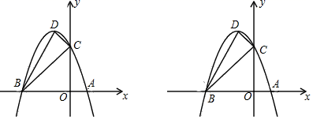

# Mathematics - 题目 829

**ID**: c587b2ec01d7462daec07e11b4cfa2e6
**年级**: Grade 9
**难度**: Medium-Hard
**题型**: Calculation

## 题目
如图，抛物线y＝ax^{2}+bx+3与x轴交于A(1，0)、B(﹣3，0)两点，与y轴交于点C，设抛物线的顶点为D．(1)求该抛物线的解析式与顶点D的坐标．(2)试判断△BCD的形状，并说明理由．(3)若点E在x轴上，点Q在抛物线上．是否存在以B、C、E、Q为顶点且以BC为一边的平行四边形？若存在，直接写出点Q的坐标；​​​​​​​‌若不存在，请说明理由．(4)探究坐标轴上是否存在点P，使得以P、A、C为顶点的三角形与△BCD相似？若存在，请直接写出点P的坐标；若不存在，请说明理由．

## 解答

1. (1)抛物线y＝ax^{2}+bx+3与x轴交于A(1，0)、B(﹣3，0)两点，
2. ∴ $\begin{cases}a+b+3=0\\9a-3b+3=0\end{cases}$ ，
3. 解得a＝﹣1，b＝﹣2，
4. ∴抛物线的解析式为y＝﹣x^{2}﹣2x+3，
5. ∵y＝﹣x^{2}﹣2x+3＝﹣(x+1)^{2}+4，
6. ∴顶点D的坐标为(﹣1，4)；
7. (2)△BCD是直角三角形．
8. 理由如下：如图1，过点D分别作x轴、y轴的垂线，垂足分别为E、F，
9. 
10. ∵在Rt△BOC中，OB＝3，OC＝3，
11. ∴BC^{2}＝OB^{2}+OC^{2}＝18，
12. 在Rt△CDF中，DF＝1，CF＝OF﹣OC＝4﹣3＝1，
13. ∴CD^{2}＝DF^{2}+CF^{2}＝2，
14. 在Rt△BDE中，DE＝4，BE＝OB﹣OE＝3﹣1＝2，
15. ∴BD^{2}＝DE^{2}+BE^{2}＝20，
16. ∴BC^{2}+CD^{2}＝BD^{2}
17. ∴△BCD为直角三角形；
18. (3)①当Q点的纵坐标为3时，
19. ∴把y＝3代入y＝﹣x^{2}﹣2x+3求得x＝0或﹣2，
20. ∴Q_{1}(﹣2，3)；
21. ②当Q点的纵坐标为﹣3时，
22. 把y＝﹣3代入y＝﹣x^{2}﹣2x+3求得x＝ $\sqrt {7}$ ﹣1或﹣ $\sqrt {7}$ ﹣1，
23. ∴Q_{2}( $\sqrt {7}$ ﹣1，﹣3)，Q_{3}(﹣ $\sqrt {7}$ ﹣1，﹣3)，
24. 综上，Q点的坐标为(﹣2，3)或( $\sqrt {7}$ ﹣1，﹣3)或(﹣ $\sqrt {7}$ ﹣1，﹣3)．
25. (4)由(2)知BC＝3 $\sqrt {2}$ ，CD＝ $\sqrt {2}$ ，BD＝2 $\sqrt {5}$ ，
26. ①∵ $\frac {CD}{BC}=\frac {\sqrt {2}}{3\sqrt {2}}=\frac {1}{3}$ ， $\frac {OA}{OC}=\frac {1}{3}$ ，故当P是原点O时，△ACP∽△DBC；
27. ②当AC是直角边时，若AC与CD是对应边，
28. 设P的坐标是(0，a)，则PC＝3﹣a， $\frac {AC}{CD}=\frac {PC}{BD}$ ，即 $\frac {\sqrt {10}}{\sqrt {2}}=\frac {3-a}{2\sqrt {5}}$ ，
29. 解得：a＝﹣9，
30. 则P的坐标是(0，﹣9)，三角形ACP不是直角三角形，则△ACP∽△CBD不成立；
31. ③当AC是直角边，若AC与BC是对应边时，
32. 设P的坐标是(0，b)，则PC＝3﹣b，则 $\frac {AC}{BC}=\frac {PC}{BD}$ ，即 $\frac {\sqrt {10}}{3\sqrt {2}}=\frac {3-b}{2\sqrt {5}}$ ，
33. 解得：b＝﹣ $\frac {1}{3}$ ，
34. 故P是(0，﹣ $\frac {1}{3}$ )时，则△ACP∽△CBD一定成立；
35. ④当P在x轴上时，AC是直角边，P一定在B的左侧，设P的坐标是(d，0)，
36. 则AP＝1﹣d，当AC与CD是对应边时， $\frac {AC}{CD}=\frac {AP}{BC}$ ，即 $\frac {\sqrt {10}}{\sqrt {2}}=\frac {1-d}{3\sqrt {2}}$ ，
37. 解得：d＝1﹣3 $\sqrt {10}$ ，此时，两个三角形不相似；
38. ⑤当P在x轴上时，AC是直角边，P一定在B的左侧，设P的坐标是(e，0)．
39. 则AP＝1﹣e，当AC与DC是对应边时， $\frac {AC}{CD}=\frac {AP}{BD}$ ，即 $\frac {\sqrt {10}}{\sqrt {2}}=\frac {1-e}{2\sqrt {5}}$ ，
40. 解得：e＝﹣9，符合条件．
41. 综上，符合条件的点P的坐标为：(0，0)或(0，﹣ $\frac {1}{3}$ )或(﹣9，0)．

## 知识点

**中文**:
  - 二次函数的综合
  - 相似三角形的判定与性质综合

**English**:
  - Comprehensive Quadratic Function Problems
  - Determination and Properties

---
