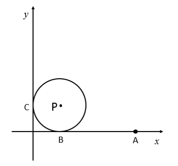
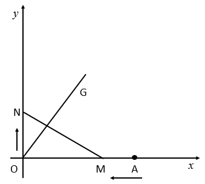

# Mathematics - 题目 3734

**ID**: c58a513189e548548a9b909757bc60c5
**年级**: Grade 9
**难度**: Medium-Hard
**题型**: Calculation

## 题目
（1）（操作）如图，请用尺规作图确定圆的圆心 $P$ ，保留作图痕迹，不要求写作法；​​​​​​​‌（2）（探究）如图，若（1）中的圆 $P$ 的半径为2，放入平面直角坐标系中，使它与 $x$ 轴， $y$ 轴分别切于点 $B$ 和 $C$ ，点 $A$ 的坐标为 $\left ({8,0}\right )$ ，过点 $A$ 的直线与圆 $P$ 有唯一公共点 $D$ （与 $B$ 不重合）时，求点 $D$ 的坐标；（3）（拓展）如图3，点 $M$ 从点 $A\left ({8,0}\right )$ 出发，以每秒1个单位的速度沿 $x$ 轴向点 $O$ 运动，同时，点 $N$ 从原点 $O$ 出发，以每秒1个单位的速度沿 $y$ 轴向上运动，设运动时间为 $t$ （ $0<t<8{\rm{s}}$ ），过点 $M$ ， $N$ ， $O$ 三点的圆，交第一象限角平分线 $OG$ 于点 $E$ ，当 $t$ 为何值时， $MN$ 有最小值，求出此时 $S{{}_{四边形OMEN}}$ ，并探索在变化过程中 $S{{}_{四边形OMEN}}$ 的值有变化吗？为什么？

## 解答

1. （1）如图，点P即为所作；
2. 
3. （2）如图，过点 $D$ 作 $DF\bot x$ 轴于点 $F$ ，连接 $PC$ ， $PB$ ，
4. 
5. 由题意得： $\odot P$ 与坐标轴相切，
6. ∴ $\angle OBP=\angle OCP=\angle COB=90{}^\circ $ ，
7. ∴四边形 $OBPC$ 是矩形，
8. ∵ $PC=PB=2$ ，
9. ∴四边形 $OBPC$ 是正方形，
10. ∴ $OC=OB=2$ ，则 $AB=6$ ，
11. 由题意得 $AE$ 与 $\odot P$ 相切于点 $D$ ，
12. ∴ $AB=AD=6$ ，
13. 设 $EC=ED=x$ ，
14. 在 ${\rm{R}}{\rm{t}}△OAE$ 中， $\angle AOE=90{}^\circ $ ，
15. $AO=8$ ， $EO=x+2$ ， $AE=x+6$ ，
16. 由勾股定理得： $OE{^{2}}+OA{^{2}}=AE{^{2}}$ ，
17. 即： ${\left({x+2}\right)^{2}}+8{^{2}}={\left({x+6}\right)^{2}}$ ，
18. 解得 $x=4$ ，
19. ∴ $AE=10$ ，
20. 由题意可得 $\mathrm{△}ADF∽\mathrm{△}AEO$ ，
21. ∴ $\frac {AD}{AE}=\frac {DF}{EO}=\frac {AF}{AO}$ ，
22. 即： $\frac {6}{10}=\frac {DF}{6}=\frac {AF}{8}$ ，
23. ∴ $DF=\frac {18}{5}$ ， $AF=\frac {24}{5}$ ，
24. 则 $OF=8-\frac {24}{5}=\frac {16}{5}$
25. ∴ $D\left ({\frac {16}{5}，\frac {18}{5}}\right )$ ；
26. （3）如图，在 ${\rm{R}}{\rm{t}}\mathrm{△}OMN$ 中， $\angle MON=90{}^\circ $ ， $OM=8-t$ ， $ON=t$ ，
27. 
28. 则 $MN{^{2}}={\left({8-t}\right)^{2}}+t{^{2}}$  $=2t{^{2}}-16t+64=2(t-4){^{2}}+32$ ，
29. 当 $t=4$ 时， $MN{^{2}}$ 有最小值，即 $MN$ 有最小值．
30. 此时， $OM=ON=4$ ，
31. ∵ $OG$ 平分第一象限，
32. ∴∠EON=∠EOM=45 ${}^\circ $ ，
33. ∴△EON$\cong $ △EOM，
34. ∴∠ENO=∠EMO，
35. ∵四边形 $OMEN$ 是圆内接四边形，
36. ∴∠ENO+∠EMO=180 ${}^\circ $ ，
37. ∴∠ENO=∠EMO=90 ${}^\circ $ ，
38. 又OM=ON，
39. ∴四边形 $OMEN$ 是正方形，
40. ∴ $S{{}_{四边形OMEN}}=4\times 4=16$ ；
41. 在这个变化过程中， $S{{}_{四边形OMEN}}=16$ 没有变化，理由如下：
42. ∵ $OG$ 平分第一象限，
43. ∴ $\vartriangle EMN$ 是等腰直角三角形，
44. ∴ $NE=ME$
45. 则 $NE{^{2}}=\frac {1}{2}MN{^{2}}=\frac {1}{2}\left ({OM{^{2}}+ON{^{2}}}\right )=\frac {1}{2}\left [{\left({8-t}\right)^{2}}+t{^{2}}\right ]$ ，
46. ∴ $S{{}_{四边形OMEN}}=S{{}_{\mathrm{△}MON}}+S{{}_{\mathrm{△}MEN}}$
47. $=\frac {1}{2}ON\cdot OM+\frac {1}{2}NE{^{2}}$
48. $=\frac {1}{2}t\left ({8-t}\right )+\frac {1}{2}\times \frac {1}{2}\left [{\left({8-t}\right)^{2}}+t{^{2}}\right ]$
49. $=16$ ．

## 知识点

**中文**:
  - 二次函数的最值
  - 切线长定理
  - 尺规作图——作线段垂直平分线

**English**:
  - Maximum/Minimum of Quadratic Functions
  - Tangent Length Theorem
  - Construction: Perpendicular Bisector

---
