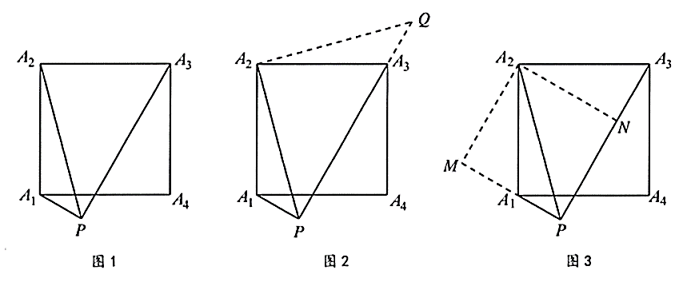
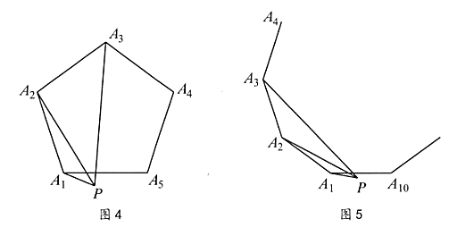

# Mathematics - 题目 975

**ID**: c6c5dc211dad4de3b467596c895108e4
**年级**: Grade 9
**难度**: Medium-Hard
**题型**: 解答题（本大题共8个小题，满分72分）

## 题目
【问题呈现】如图1，已知 $P$ 是正方形 $A{{}_{1}}A{{}_{2}}A{{}_{3}}A{{}_{4}}$ 外一点，且满足 $\angle PA{{}_{1}}A{{}_{2}}+\angle PA{{}_{3}}A{{}_{2}}=180{}\degree $ ，探究 $PA{{}_{1}}$ ， $PA{{}_{2}}$ ， $PA{{}_{3}}$ 三条线段的数量关系．小颖通过观察、分析、思考，形成了如下思路：思路一：如图2，构造 $\mathrm{△}QA{{}_{3}}A{{}_{2}}$ 与 $△PA{{}_{1}}A{{}_{2}}$ 全等，从而得出 $PA{{}_{1}}+PA{{}_{3}}$ 与 $PA{{}_{2}}$ 的数量关系；思路二：如图3，构造 $\vartriangle MA{{}_{1}}A{{}_{2}}$ 与 $\mathrm{△}NA{{}_{3}}A{{}_{2}}$ 全等，从而得出 $PA{{}_{1}}+PA{{}_{3}}$ 与 $PA{{}_{2}}$ 的数量关系．（1）请参考小颖的思路，直接写出 $PA{{}_{1}}+PA{{}_{3}}$ 与 $PA{{}_{2}}$ 的数量关系；【类比探究】（2）如图4，若 $P$ 是正五边形 $A{{}_{1}}A{{}_{2}}A{{}_{3}}A{{}_{4}}A{{}_{5}}$ 外一点，且满足 $\angle PA{{}_{1}}A{{}_{2}}+\angle PA{{}_{3}}A{{}_{2}}=180{}\degree $ ， $PA{{}_{1}}=11$ ， $PA{{}_{3}}=49$ ，求 $PA{{}_{2}}$ 的长度（结果精确到 $0.​​​​​​​‌1$ ，参考数据： $\sin 54{}\degree \approx 0.81$ ， $\sin 72{}\degree \approx 0.95$ ， ${\cos}54{}\degree \approx 0.59$ ， ${\cos}72{}\degree \approx 0.31$ ）；【拓展延伸】（3）如图5，若 $P$ 是正十边形 $A{{}_{1}}A{{}_{2}}\cdot \cdot \cdot A{{}_{10}}$ 外一点，且满足 $\angle PA{{}_{1}}A{{}_{2}}+\angle PA{{}_{3}}A{{}_{2}}=180{}\degree $ ，则 $PA{{}_{1}}$ ， $PA{{}_{2}}$ ， $PA{{}_{3}}$ 三条线段的数量关系为（结果用含有锐角三角函数的式子表示）．

## 解答

1. （1） $PA{{}_{1}}+PA{{}_{3}}=\sqrt {2}PA{{}_{2}}$
2. 如图2，在射线 $PA{{}_{3}}$ 上截取 $A{{}_{3}}Q=PA{{}_{1}}$ ，连接 $A{{}_{2}}Q$ ，
3. 
4. ∵ $\angle PA{{}_{1}}A{{}_{2}}+\angle PA{{}_{3}}A{{}_{2}}=180{}\degree $ ， $\angle QA{{}_{3}}A{{}_{2}}+\angle A{{}_{2}}A{{}_{3}}P=180$
5. ∴ $\angle A{{}_{2}}A{{}_{1}}P=\angle A{{}_{2}}A{{}_{3}}Q$
6. 又∵四边形 $A{{}_{1}}A{{}_{2}}A{{}_{3}}A{{}_{4}}$ 是正方形，
7. ∴ $A{{}_{2}}A{{}_{1}}=A{{}_{2}}A{{}_{3}}$ ，
8. ∴ $\mathrm{△}QA{{}_{3}}A{{}_{2}}≌△PA{{}_{1}}A{{}_{2}}$ ，
9. ∴ $\angle A{{}_{1}}A{{}_{2}}P=\angle A{{}_{3}}A{{}_{2}}Q$ ， $A{{}_{2}}P=A{{}_{2}}Q$
10. 又∵四边形 $A{{}_{1}}A{{}_{2}}A{{}_{3}}A{{}_{4}}$ 是正方形，
11. ∴ $∠A{{}_{1}}A{{}_{2}}A{{}_{3}}=90{}\degree $
12. ∴ $\angle PA{{}_{2}}Q=90{}\degree $ ，
13. ∴ $\mathrm{△}A{{}_{2}}PQ$ 是等腰直角三角形，
14. ∴ $PQ=PA{{}_{3}}+A{{}_{3}}Q=PA{{}_{3}}+PA{{}_{1}}=\sqrt {2}PA{{}_{2}}$
15. （2）解：正五边形的一个内角为 $\frac {\left ({5-2}\right )\times 180{}\degree }{5}=108{}\degree $
16. 如图4，在射线 $PA{{}_{3}}$ 上截取 $A{{}_{3}}Q=PA{{}_{1}}$ ，连接 $A{{}_{2}}Q$ ，过点 $A{{}_{2}}$ 作 $A{{}_{2}}T\bot PQ$ 于点 $T$
17. 
18. 同理可得 $\mathrm{△}QA{{}_{3}}A{{}_{2}}≌△PA{{}_{1}}A{{}_{2}}$ ，
19. ∴ $\angle PA{{}_{2}}Q=\angle A{{}_{1}}A{{}_{2}}A{{}_{3}}=108{}\degree $ ， $A{{}_{2}}P=A{{}_{2}}Q$
20. ∴ $\angle PA{{}_{2}}T=\frac {1}{2}\angle PA{{}_{2}}Q=54{}\degree $
21. ∵ $PA{{}_{1}}=11$ ， $PA{{}_{3}}=49$ ，
22. ∴ $PQ=PA{{}_{3}}+A{{}_{3}}Q=PA{{}_{3}}+PA{{}_{1}}$  $=60$
23. ∴ $PT=\frac {1}{2}PQ=30$
24. ∴ $PA{{}_{2}}=\frac {PT}{{\cos}54{}\degree }\approx \frac {30}{0.59}\approx 50.8$ ；
25. （3）如图，在射线 $PA{{}_{3}}$ 上截取 $A{{}_{3}}Q=PA{{}_{1}}$ ，连接 $A{{}_{2}}Q$ ，过点 $A{{}_{2}}$ 作 $A{{}_{2}}T\bot PQ$ 于点 $T$
26. 
27. 同理可得 $\angle PA{{}_{2}}Q=\angle A{{}_{1}}A{{}_{2}}A{{}_{3}}=\frac {\left ({10-2}\right )\times 180{}\degree }{10}=144{}\degree $
28. ∴ $\angle PA{{}_{2}}T=\frac {1}{2}\angle PA{{}_{2}}Q=72{}\degree $
29. ∴ $PA{{}_{2}}=\frac {PT}{{\cos}54{}\degree }\approx \frac {30}{0.59}\approx 50.8$
30. ∵ $PQ=PA{{}_{3}}+A{{}_{3}}Q=PA{{}_{3}}+PA{{}_{1}}$
31. ∴ $PT=\frac {1}{2}PQ=\frac {1}{2}\left ({PA{{}_{1}}+PA{{}_{3}}}\right )$
32. ∴ $PA{{}_{2}}=\frac {PT}{{\cos}72{}\degree }=\frac {\frac {1}{2}\left ({PA{{}_{1}}+PA{{}_{3}}}\right )}{{\cos}72{}\degree }$ 即 $PA{{}_{1}}+PA{{}_{3}}=2PA{{}_{2}}\cdot {\cos}72{}\degree $

## 知识点

**中文**:
  - 正多边形的概念和性质
  - 等腰三角形的判定与性质
  - 解直角三角形

**English**:
  - Regular Polygons Concepts
  - Determination and Properties
  - Solving Right Triangles

---
