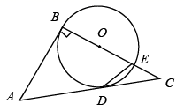

# Mathematics - 题目 198

**ID**: c91c4697324f4e0ba7fc372e84528812
**年级**: Grade 9
**难度**: Medium-Hard
**题型**: Calculation

## 题目
如图，在 $Rt\vartriangle ABC$ 中， $\angle ABC=90{}^\circ $ ， $O$ 为 $BC$ 边上一点，以 $O$ 为圆心， $OB$ 长为半径的 $\odot O$ 与 $AC$ 边相切于点 $D$ ，交 $BC$ 于点 $E$ ．（1）求证： $AB=AD$ ；​​​​​​​‌（2）连接 $DE$ ，若 ${\tan}\angle EDC=\frac {1}{2}$ ， $DE=2$ ，求线段 $EC$ 的长．

## 解答

1. （1）证明：
2. 
3. ∵ $\angle ABC=90{}^\circ $ ，
4. ∴ $AB\bot OB$ ，
5. 又∵ $AB$ 经过半径 $\odot O$ 的外端点 $B$ ，
6. ∴ $AB$ 切 $\odot O$ 于点 $B$ ，
7. $\because $  $\odot O$ 与 $AC$ 边相切于点 $D$ ，
8. ∴ $AB=AD$ ．
9. （2）解：连接 $BD$ ，∵ $BE$ 为 $\odot O$ 的直径，
10. ∴ $\angle BDE=90{}^\circ $ ，
11. ∴ $\angle CDE+\angle ADB=90{}^\circ $ ，
12. 又∵ $AB=AD$ ，
13. ∴ $\angle ADB=\angle ABD$ ，
14. ∴ $\angle CDE+\angle ABD=90{}^\circ $ ，
15. ∵ $\angle ABC=90{}^\circ $ ，
16. ∴ $\angle ABD+\angle EBD=90{}^\circ $ ，
17. ∴ $\angle EBD=\angle EDC$ ，
18. 又∵ ${\tan}\angle EDC=\frac {1}{2}$ ，
19. ∴ ${\tan}\angle EBD=\frac {1}{2}$ ，
20. 即 $\frac {DE}{BD}=\frac {1}{2}$ ，
21. ∵ $DE=2$ ，
22. ∴ $BD=4$ ， $BE=2\sqrt {5}$ ，
23. 又∵ $\angle C=\angle C$ ， $\angle EBD=\angle EDC$ ，
24. ∴ $ΔCDE∽ΔCBD$ ，
25. ∴ $\frac {CE}{DC}=\frac {DC}{BC}=\frac {DE}{BD}=\frac {1}{2}$ ，
26. 设 $CE=x$ ，则 $DC=2x$ ，
27. ∴ ${\left({2x}\right)^{2}}=x\left ({x+2\sqrt {5}}\right )$ ，
28. ∴ $x{{}_{1}}=0$ （舍去）， $x{{}_{2}}=\frac {2\sqrt {5}}{3}$ ．
29. 即线段 $EC$ 的长为 $\frac {2\sqrt {5}}{3}$ ．

## 知识点

**中文**:
  - 切线长定理
  - 圆的综合问题
  - 相似三角形的判定与性质综合
  - 正切

**English**:
  - Tangent Length Theorem
  - Comprehensive Circle Problems
  - Determination and Properties
  - Tangent

---
