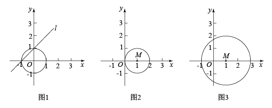

# Mathematics - 题目 3595

**ID**: cc87bb298d7141039d0838bd6609fe61
**年级**: Grade 9
**难度**: Medium-Hard
**题型**: Calculation

## 题目
在平面直角坐标系 $xOy$ 中，对于直线 $l:y\equiv kx+b$ ，给出如下定义：若直线 $l$ 与某个圆相交，则两个交点之间的距离称为直线 $l$ 关于该圆的“圆截距”．(1)如图1， $\odot O$ 的半径为1，当 $k=1,b=1$ 时，直接写出直线 $l$ 关于 $\odot O$ 的“圆截距”；​​​​​​​‌(2)点M的坐标为 $(1,0)$ ，①如图2，若 $\odot M$ 的半径为1，当 $b=1$ 时，直线 $l$ 关于 $\odot M$ 的“圆截距”小于 $\frac {4}{5}\sqrt {5}$ ，求k的取值范围；②如图3，若 $\odot M$ 的半径为2，当k的取值在实数范围内变化时，直线 $l$ 关于 $\odot M$ 的“圆截距”的最小值为2，直接写出b的值．

## 解答

1. （1）解：如图1，∵ $k=1,b=1$ ，
2. ∴直线 $l$ 的解析式为 $y=x+1$ ，
3. ∴直线与y轴的交点为 $A\left ({0,1}\right )$ ，与x轴的交点为 $B\left ({-1,0}\right )$ ，
4. ∵ $\odot O$ 的半径为1，
5. 
6. ∴圆O与y轴的正半轴交点为 $A\left ({0,1}\right )$ ，与x轴的负半轴交点为 $B\left ({-1,0}\right )$ ，
7. ∴直线 $l$ 关于该圆的“圆截距”为 $AB$ ，
8. ∵ $OA=OB=1$ ，
9. ∴ $AB=$  $\sqrt {1{^{2}}+1{^{2}}}=\sqrt {2}$ ．
10. （2）①如图2，设直线与y轴正半轴交点为A，且 $A\left ({0,1}\right )$
11. ∵点M的坐标为 $(1,0)$ ， $\odot M$ 的半径为1，
12. ∴圆与x轴正半轴交点为B(2，0)，
13. 当 $b=1$ 时，直线 $l$ 的解析式为 $y=kx+1$ ，
14. 当直线经过点B时， $2k+1=0$ ，
15. 解得 $k=$  $-\frac {1}{2}$ ；
16. 过点M作 $MF\bot AB$ ，垂足为F，
17. ∵ $OA=1$ ， $OB=2$ ，
18. ∴ $AB=$  $\sqrt {1{^{2}}+2{^{2}}}=\sqrt {5}$ ，
19. ∴ ${\rm{s}}{\rm{i}}{\rm{n}}∠ABO=$  $\frac {OA}{AB}=\frac {1}{\sqrt {5}}=\frac {\sqrt {5}}{5}$ ，
20. ∵ $MB=1$ ， ${\rm{s}}{\rm{i}}{\rm{n}}∠ABO=$  $\frac {MF}{MB}=\frac {\sqrt {5}}{5}$ ，
21. ∴ $MF=\frac {\sqrt {5}}{5}$ ， $BF=\sqrt {1{^{2}}-(\frac {\sqrt {5}}{5}){^{2}}}=\frac {2\sqrt {5}}{5}$ ，
22. 设直线 $AB$ 与圆M的另一个交点为C，
23. 则 $BC=2BF=$  $\frac {4\sqrt {5}}{5}$ ，
24. ∵关于 $\odot M$ 的“圆截距”小于 $\frac {4}{5}\sqrt {5}$ ，
25. ∴k的取值范围是 $-\frac {1}{2}<k\leqslant 0$ ；
26. 
27. 设直线 $AM$ 与圆的一个交点为N，
28. ∵点 $A\left ({0,1}\right )$ ，点M的坐标为 $(1,0)$ ，
29. ∴ $OA=OM$ ，
30. ∴ $∠AMO=45{}^\circ $ ，
31. ∴ $∠BMN=45{}^\circ $ ，
32. 根据圆的对称性，直线 $AB$ 和直线 $AD$ 关于直线 $AN$ 对称，此时 $ED=CB$ ，
33. ∴ $∠DMN=45{}^\circ $ ，
34. ∴ $∠DMB=90{}^\circ $ ，
35. ∴D的坐标为 $\left ({1,-1}\right )$ ，
36. ∴ $k+1=-1$ ，
37. 解得 $k=-2$ ，
38. 直线 $AD$ 的解析式为 $y=-2x+1$ ，
39. ∵关于 $\odot M$ 的“圆截距”小于 $\frac {4}{5}\sqrt {5}$ ，
40. ∴k的取值范围是 $k<-2$ ；
41. 综上所述，k的取值范围是 $k<-2$ 或 $-\frac {1}{2}<k\leqslant 0$ ．
42. ②当k的取值在实数范围内变化时，直线 $l$ 关于 $\odot M$ 的“圆截距”的最小值为2，
43. 设直线与y轴交点为点 $Q\left ({0,m}\right )$ ，则过Q点的“圆截距”的最小值为2，
44. 如图所示： $RT=2$ ， $MQ\bot RT$ ，
45. 
46. 由题意得， $△RMT$ 为等边三角形，
47. ∴ $∠MRQ=60{}^\circ $ ，
48. ∴ $QM=2\times {\rm{s}}{\rm{i}}{\rm{n}}60{}^\circ =\sqrt {3}$ ，
49. ∴ $OQ=\sqrt {{\left({\sqrt {3}}\right)^{2}}-1}=\sqrt {2}$ ，
50. ∴由对称性得 $b=\pm \sqrt {2}$ ．

## 知识点

**中文**:
  - 垂径定理及其推论
  - 等边三角形的判定与性质
  - 直线和圆的位置关系
  - 解直角三角形

**English**:
  - Perpendicular Chord Theorem
  - Determination and Properties
  - Line and Circle Relationship
  - Solving Right Triangles

---
