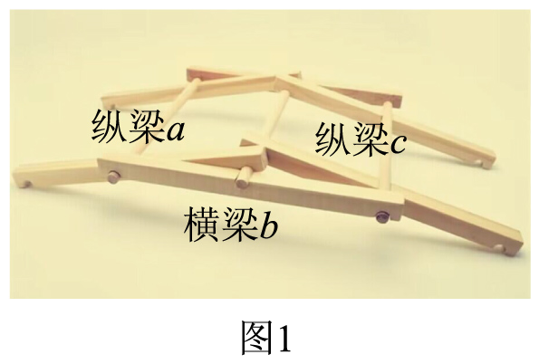
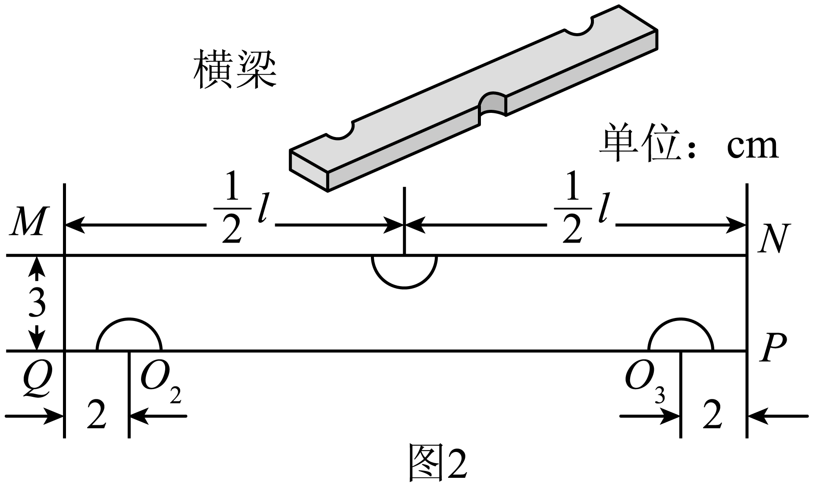
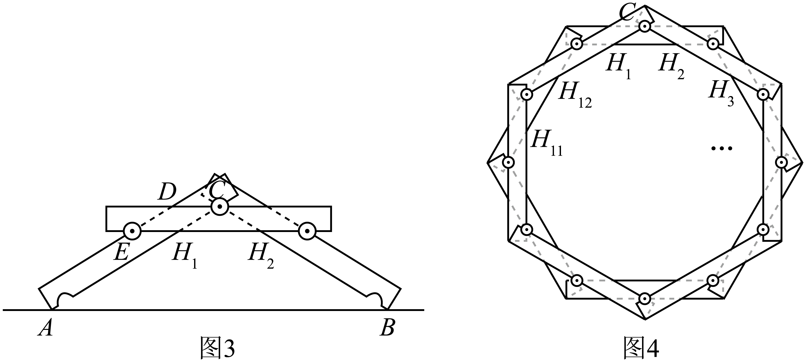

# Mathematics - 题目 334

**ID**: ce98377737e74cffb79759992778710c
**年级**: Grade 9
**难度**: Medium-Hard
**题型**: Calculation

## 题目
问题：如何设计“倍力桥”的结构？图1是搭成的“倍力桥”，纵梁 $a,c$ 夹住横梁 $b$ ，使得横梁不能移动，结构稳固．图 $2$ 是长为 $l\left ({{\rm{c}}{\rm{m}}}\right )$ ，宽为 $3{\rm{c}}{\rm{m}}$ 的横梁侧面示意图，三个凹槽都是半径为 $1{\rm{c}}{\rm{m}}$ 的半圆．圆心分别为 $O{{}_{1}},O{{}_{2}},O{{}_{3}},O{{}_{1}}M=O{{}_{1}}N,O{{}_{2}}Q=O{{}_{3}}P=2{\rm{c}}{\rm{m}}$ ，纵梁是底面半径为 $1{\rm{c}}{\rm{m}}$ 的圆柱体．用相同规格的横梁、纵梁搭“桥”，间隙忽略不计．探究 $1$ ：图 $3$ 是“桥”侧面示意图， $A,B$ 为横梁与地面的交点， $C,E$ 为圆心， $D,H{{}_{1}},H{{}_{2}}$ 是横梁侧面两边的交点．测得 $AB=32{\rm{c}}{\rm{m}}$ ，点 $C$ 到 $AB$ 的距离为 $12{\rm{c}}{\rm{m}}$ ，试判断四边形 $CDEH{{}_{1}}$ 的形状，并求 $l$ 的值；​​​​​​​‌探究2：若搭成的“桥”刚好能绕成环，其侧面示意图的内部形成一个多边形．①若有12根横梁绕成环，图4是其侧面示意图，内部形成十二边形 $H{{}_{1}}H{{}_{2}}H{{}_{3}}\cdots H{{}_{12}}$ ，求 $l$ 的值；②若有 $n$ 根横梁绕成的环（ $n$ 为偶数，且 $n\geqslant 6$ ），试用关于 $n$ 的代数式表示内部形成的多边形 $H{{}_{1}}H{{}_{2}}H{{}_{3}}\cdots H{{}_{n}}$ 的周长．

## 解答

1. 解：探究1：四边形 $CDEH{{}_{1}}$ 是菱形，理由如下：
2. 由图1可知， $CD{\rm{/\mskip-4mu/}}EH{{}_{1}}$ ， $ED{\rm{/\mskip-4mu/}}CH{{}_{1}}$ ，
3. $\therefore$  $CDEH{{}_{1}}$ 为平行四边形，
4. $\because$ 桥梁的规格是相同的，
5. ∴桥梁的宽度相同，即四边形 $CDEH{{}_{1}}$ 每条边上的高相等，
6. ∵ $▱CDEH{{}_{1}}$ 的面积等于边长乘这条边上的高，
7. $\therefore$  $CDEH{{}_{1}}$ 每条边相等，
8. $\therefore$  $CDEH{{}_{1}}$ 为菱形；
9. ②如图1，过点 $C$ 作 $CM\bot AB$ 于点 $M$ ，
10. 
11. 由题意，得 $CA=CB,CM=12$ ， $AB=32{\rm{c}}{\rm{m}}$ ，
12. ∴ $AM=\frac {1}{2}AB=16$ ，
13. 在 ${\rm{R}}{\rm{t}}△CAM$ 中， $CA{^{2}}=AM{^{2}}+CM{^{2}}$ ，
14. ∴ $CA=\sqrt {16{^{2}}+12{^{2}}}=\sqrt {400}=20$ ，
15. ∴ $l=CA+2=22{\rm{c}}{\rm{m}}$ ，
16. 故答案为： $l=22{\rm{c}}{\rm{m}}$ ；
17. 探究2：①如图2，过点 $C$ 作 $CN\bot H{{}_{1}}H{{}_{2}}$ 于点 $N$ ，
18. 
19. 由题意，得 $\angle H{{}_{1}}CH{{}_{2}}=120{}^\circ ,CH{{}_{1}}=CH{{}_{2}},CN=3$ ，
20. $\therefore \angle CH{{}_{1}}N=30{}^\circ$ ，
21. $\therefore CH{{}_{1}}=2CN=6,H{{}_{1}}N=\frac {CN}{{\tan}30{}^\circ }=\frac {3}{\frac {\sqrt {3}}{3}}=3\sqrt {3}$ ，
22. 又 $\because$ 四边形 $CDEH{{}_{1}}$ 是菱形，
23. ∴ $EH{{}_{{\rm{l}}}}=CH{{}_{1}}=6$ ，
24. ∴ $l=2\times \left ({2+6+3\sqrt {3}}\right )=\left ({16+6\sqrt {3}}\right ){\rm{c}}{\rm{m}}$ ，
25. 故答案为： $l=\left ({16+6\sqrt {3}}\right ){\rm{c}}{\rm{m}}$ ；
26. ②如图3，过点 $C$ 作 $CN\bot H{{}_{1}}H{{}_{2}}$ 于点 $N$ ，
27. 
28. 由题意，形成的多边形为正 $n$ 边形，
29. $\therefore$ 外角 $\angle CH{{}_{1}}H{{}_{2}}=\frac {360{}^\circ }{n}$ ，
30. 在 ${\rm{R}}{\rm{t}}\vartriangle CNH{{}_{1}}$ 中， $H{{}_{1}}N=\frac {CN}{{\tan}\angle CH{{}_{1}}H{{}_{2}}}=\frac {3}{{\tan}\frac {360{}^\circ }{n}}$ ，
31. 又 $\because CH{{}_{1}}=CH{{}_{2}},CN\bot H{{}_{1}}H{{}_{2}}$ ，
32. ∴ $H{{}_{1}}H{{}_{2}}=2H{{}_{1}}N=\frac {6}{{\tan}\frac {360{}^\circ }{n}}$ ，
33. $\therefore$ 形成的多边形的周长为 $\left ({\frac {6n}{{\rm{t}}{\rm{a}}{\rm{n}}\frac {360{}^\circ }{n}}}\right ){\rm{c}}{\rm{m}}$ ，
34. 故答案为： $\left ({\frac {6n}{{\rm{t}}{\rm{a}}{\rm{n}}\frac {360{}^\circ }{n}}}\right ){\rm{c}}{\rm{m}}$ ．

## 知识点

**中文**:
  - 菱形的判定与性质综合
  - 解直角三角形的实际应用

**English**:
  - Determination and Properties of Rhombuses
  - Applications of Solving Right Triangles

---
