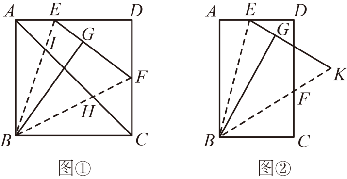

# Mathematics - 题目 2322

**ID**: d1d1641d08164019b3ca22e93e22d0c6
**年级**: Grade 9
**难度**: Medium-Hard
**题型**: Calculation

## 题目
折纸是我国传统的民间艺术，通过折纸不仅可以得到许多美丽的图形，折纸的过程还蕴含着丰富的数学知识，在综合与实践课上，老师让同学们准备了一张边长为 $6{\rm{c}}{\rm{m}}$ 的正方形纸片，以“正方形的折叠”为主题开展了数学探究活动．【操作判断】操作一：如图①，在正方形 $ABCD$ 的边 $AD$ 上任选一点 $E$ ，沿 $BE$ 折叠，使点 $\mathrm{A}$ 落在点 $G$ 处，把纸片展平，折痕 $BE$ 与对角线 $AC$ 交于点 $I$ ；​​​​​​​‌操作二：将边 $BC$ 折叠，使点 $C$ 落在射线 $BG$ 上，折痕交 $CD$ 于点 $F$ ，把纸片展平，折痕 $BF$ 与正方形的对角线 $AC$ 交于点 $H$ ．（1）根据以上操作，得 $\angle EBF$ 的度数为．【迁移探究】（2）经过多次操作，同学们发现 $EF$ 与 $HI$ 的比值不变，试求出该比值．【拓展提升】（3）小明在操作中不慎将正方形纸片撕破，得到一个矩形 $ABCD$ ，其中 $AB$ 为 $6{\rm{c}}{\rm{m}}$ ， $AD$ 为 $4{\rm{c}}{\rm{m}}$ ，如图②，经过上述操作一、二，得到折痕 $BE、BF，EG$ 的延长线与 $BF$ 的延长线交于点 $K$ ，当点 $E$ 在线段 $AD$ （ $E$ 不与 $\mathrm{A}$ 重合）上运动时，求点 $K$ 到直线 $AD$ 的最大距离．

## 解答

1. 解：（1） $\because $ 正方形 $ABCD$ ，
2. $\therefore \angle ABC=90{}\degree $ ，
3. 由折叠的性质得 $\angle ABE=\angle GBE$ ， $\angle GBF=\angle CBF$ ，
4. $\because $ 将边 $BC$ 折叠，点 $C$ 落在射线 $BG$ 上，
5. $\therefore \angle ABE+\angle GBE+\angle GBF+\angle CBE=\angle ABC=90{}\degree $ ，
6. $\therefore \angle EBF=\angle GBE+\angle GBF=\frac {1}{2}\angle ABC=45{}\degree $ .
7. （2）如图，连接 $EH$ ，
8. $\because $ 正方形 $ABCD$ ，
9. $\therefore \angle BAD=90{}\degree $ ， $\angle BAC=\angle DAC=45{}\degree $ ，
10. 由（1）知： $\angle EBF=45{}\degree =\angle EAH$ ，
11. $\therefore $ 点 $A,B,H,E$ 四点共圆，
12. $\therefore \angle BEH=\angle BAH=45{}\degree $ ，
13. $\therefore \angle BEH=\angle EBH=45{}\degree $ ，
14. $\therefore BH=EH$ ，
15. $\therefore \angle BHE=180{}\degree -\angle BEH-\angle EBH=90{}\degree $ ，
16. $\therefore BE=\sqrt {2}BH$ ，
17. $\because \angle FBI=\angle EBH=45{}\degree $ ， $\angle AIE=\angle BIH$ ，
18. $\therefore \angle AEI=\angle BHI$ ，
19. 由折叠的性质得 $\angle AEI=\angle BEF$ ，
20. $\therefore \angle BHI=\angle BEF$ ，
21. $\therefore \vartriangle BHI∽\vartriangle BEF$ ，
22. $\therefore \frac {EF}{HI}=\frac {BE}{BH}=\frac {\sqrt {2}BH}{BH}=\sqrt {2}$ ；
23. 
24. （3）作 $KM\bot BC$ 于 $M$ ，交 $AD$ 的延长线于 $N$ ，
25. 
26. $\therefore \angle BGK=\angle M=90{}\degree $ ，
27. $\because AD\parallel BC$ ，
28. $\therefore MN\bot AD$ ，
29. $\therefore MN=AB=6$ ，
30. $\because \angle GBK=\angle MBK$ ， $BK=BK$ ，
31. $\therefore \vartriangle GBK≌\vartriangle MBK\left ({{\rm{A}}{\rm{A}}{\rm{S}}}\right )$ ，
32. $\therefore BG=BM$ ， $GK=MK$ ，
33. $\because AB=BG=6$ ，
34. $\therefore BM=6$ ，
35. $\therefore $ 当 $E$ 在线段 $AD$ 上移动时， $K$ 在直线 $MN$ 上，且 $E$ 接近点 $D$ 时， $K$ 接近点 $M$ ，
36. $\therefore E、D$ 重合时， $KN$ 最大，如图所示：
37. 
38. 设 $GK=MK=x$ ， $EK=4+x$ ，  $KN=6-x$ ，
39. $\therefore {\left({4+x}\right)^{2}}=2{^{2}}+{\left({6-x}\right)^{2}}$ ，
40. $\therefore x=\frac {6}{5}$ ，
41. $\therefore NK=6-\frac {6}{5}=\frac {24}{5}$ ．

## 知识点

**中文**:
  - 圆周角定理
  - 相似三角形的判定与性质综合
  - 折叠问题

**English**:
  - Inscribed Angle Theorem
  - Determination and Properties
  - Folding Problems

---
