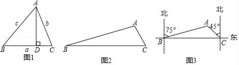

# Mathematics - 题目 1058

**ID**: d221341aeb6642b1b21a998c7ba84b32
**年级**: Grade 9
**难度**: Medium-Hard
**题型**: Calculation

## 题目
阅读下列材料：如图1.​​​​​​​‌在△ABC中，∠A、∠B、∠C所对的边分别为a、b、c，可以得到：$S{{}_{ΔABC}}=\frac {1}{2}ab{\rm{s}}{\rm{i}}{\rm{n}}C=\frac {1}{2}ac{\rm{s}}{\rm{i}}{\rm{n}}B=\frac {1}{2}bc{\rm{s}}{\rm{i}}{\rm{n}}A$证明：过点A作AD⊥BC，垂足为D．在Rt△ABD中， ${\rm{s}}{\rm{i}}{\rm{n}}B=\frac {AD}{c}$∴ $AD=c•{\rm{s}}{\rm{i}}{\rm{n}}B$∴ $S{{}_{ΔABC}}=\frac {1}{2}a•AD=\frac {1}{2}ac{\rm{s}}{\rm{i}}{\rm{n}}B$同理： $S{{}_{ΔABC}}=\frac {1}{2}ab{\rm{s}}{\rm{i}}{\rm{n}}C$$S{{}_{ΔABC}}=\frac {1}{2}bc{\rm{s}}{\rm{i}}{\rm{n}}A$∴ $S{{}_{ΔABC}}=\frac {1}{2}ab{\rm{s}}{\rm{i}}{\rm{n}}C=\frac {1}{2}ac{\rm{s}}{\rm{i}}{\rm{n}}B=\frac {1}{2}bc{\rm{s}}{\rm{i}}{\rm{n}}A$（1）通过上述材料证明：$\frac {a}{{\rm{s}}{\rm{i}}{\rm{n}}A}=\frac {b}{{\rm{s}}{\rm{i}}{\rm{n}}B}=\frac {c}{{\rm{s}}{\rm{i}}{\rm{n}}C}$（2）运用（1）中的结论解决问题：如图2，在 $ΔABC$ 中， $\angle B=15{}^\circ ，\angle C=60{}^\circ ，AB=20\sqrt {3}$ ，求AC的长度．（3）如图3，为了开发公路旁的城市荒地，测量人员选择A、B、C三个测量点，在B点测得A在北偏东75°方向上，沿笔直公路向正东方向行驶18km到达C点，测得A在北偏西45°方向上，根据以上信息，求A、B、C三点围成的三角形的面积．（本题参考数值：sin15°≈0.3，sin120°≈0.9， $\sqrt {2}$ ≈1.4，结果取整数）

## 解答

1. （1）∵ $\frac {1}{2}$absinC$=\frac {1}{2}$acsinB，∴bsinC=csinB，∴ $\frac {b}{\sin B}=\frac {c}{\sin C}$ ，：同理得： $\frac {a}{\sin A}=\frac {c}{\sin C}$ ，∴ $\frac {a}{\sin A}=\frac {b}{\sin B}=\frac {c}{\sin C}$ ；
2. （2）由题意得：∠B=15°，∠C=60°，AB=20 $\sqrt {3}$ ，∴ $\frac {AB}{\sin C}=\frac {AC}{\sin B}$ ，即 $\frac {20\sqrt {3}}{\sin 60{}^\circ }=\frac {AC}{\sin 15{}^\circ }$ ，∴ $\frac {20\sqrt {3}}{\frac {\sqrt {3}}{2}}=\frac {AC}{0.3}$ ，∴AC=40×0.3=12；
3. （3）由题意得：∠ABC=90°﹣75°=15°，∠ACB=90°﹣45°=45°，∠A=180°﹣15°﹣45°=120°，由 $\frac {a}{\sin A}=\frac {b}{\sin B}=\frac {c}{\sin C}$ 得： $\frac {18}{\sin 120{}^\circ }=\frac {AC}{\sin 15{}^\circ }$ ，∴AC=6，∴S_{△}_{ABC}$=\frac {1}{2}$AC×BC×sin∠ACB$=\frac {1}{2}\times $ 6×18×0.7≈38．

## 知识点

**中文**:
  - 三角函数综合
  - 直角三角形的性质
  - 比例的性质

**English**:
  - Comprehensive Trig Problems
  - Properties of Right Triangles
  - Properties of Proportions

---
