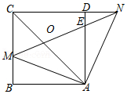

# Mathematics - 题目 1193

**ID**: d2fa5e461d854e2988ea61ec7c6c3726
**年级**: Grade 9
**难度**: Medium-Hard
**题型**: 解答题（本题共3小题，其中24，25题各11分，26题12分，共34分）

## 题目
如图，在正方形 $ABCD$ 中，点 $M$ 是边 $BC$ 上的一点（不与 $B$ 、 $C$ 重合），点 $N$ 在边 $CD$ 延长线上，且满足 $\angle MAN=90{}^\circ $ ，联结 $MN$ ， $AC$ ， $MN$ 与边 $AD$ 交于点 $E$ ．（1）求证： $AM=AN$ ；​​​​​​​‌（2）如果 $\angle CAD=2\angle NAD$ ，求证： $AM{^{2}}=\sqrt {2}AB\cdot AE$ ；（3） $MN$ 交 $AC$ 点 $O$ ，若 $\frac {CM}{BM}=k$ ，则 $\frac {OM}{ON}=$（直接写答案、用含 $k$ 的代数式表示）．

## 解答

1. 证明（1） $\because $ 四边形 $ABCD$ 是正方形，
2. $\therefore AB=AD$ ， $\angle CAD=\angle ACB=45{}^\circ $ ， $\angle BAD=\angle CDA=\angle B=90{}^\circ $ ，
3. $\therefore \angle BAM+\angle MAD=90{}^\circ $ ，
4. $\because \angle MAN=90{}^\circ $ ，
5. $\therefore \angle MAD+\angle DAN=90{}^\circ $ ，
6. $\therefore \angle BAM=\angle DAN$ ，
7. $\because AD=AB$ ， $\angle ABC=\angle ADN=90{}^\circ $ ，
8. $\therefore ΔABM\cong ΔADN(ASA)$ ，
9. $\therefore AM=AN$ ．
10. （2） $\because AM=AN$ ， $\angle MAN=90{}^\circ $ ，
11. $\therefore \angle MNA=45{}^\circ $ ，
12. $\because \angle CAD=2\angle NAD=45{}^\circ $ ，
13. $\therefore \angle NAD=22.5{}^\circ $
14. $\therefore \angle CAM=\angle MAN-\angle CAD-\angle NAD=22.5{}^\circ $
15. $\therefore \angle CAM=\angle NAD$ ， $\angle ACB=\angle MNA=45{}^\circ $ ，
16. $\therefore ΔAMC∽ΔAEN$ ，
17. $\therefore $  $\frac {AM}{AE}=\frac {AC}{AN}$ ，
18. $\therefore AM\cdot AN=AC\cdot AE$ ，
19. $\because AN=AM$ ， $AC=\sqrt {2}AB$ ，
20. $\therefore AM{^{2}}=\sqrt {2}AB\cdot AE$ ；
21. （3） $\frac {OM}{ON}=\frac {k}{k+2}$ ．
22. 理由：如图，
23. 
24. 在 ${\rm{R}}{\rm{t}}Δ{\rm{A}}{\rm{B}}{\rm{M}}$ 中，若 $\frac {CM}{BM}=k$ ，则 $BC=k+1$ ，
25. 根据勾股定理得， $AM=\sqrt {1{^{2}}+(1+k){^{2}}}=\sqrt {k{^{2}}+2k+2}$ ，
26. 过点 $A$ 作 $AF\bot MN$ 于 $F$ ，
27. $\therefore \angle OFA=\angle B=90{}^\circ $ ，
28. 由（1）知， $AM=AN$ ，
29. $\because \angle MAN=90{}^\circ $ ，
30. $\therefore FA=NF=MF=\frac {AM}{\sqrt {2}}=\frac {\sqrt {k{^{2}}+2k+2}}{\sqrt {2}}$ ， $\angle MAF=45{}^\circ $ ，
31. $\because AC$ 是正方形 $ABCD$ 的对角线，
32. $\therefore \angle BAC=45{}^\circ =\angle MAF$ ，
33. $\therefore \angle BAM=\angle FAO$ ，
34. $\therefore ΔBAM∽ΔFAO$ ，
35. $\therefore $  $\frac {AB}{AF}=\frac {BM}{OF}$ ，
36. $\therefore OF=\frac {AF\cdot BM}{AB}=\frac {\sqrt {k{^{2}}+2k+2}}{\sqrt {2}(k+1)}$ ，
37. $\therefore OM=MF-FO=\frac {k\cdot \sqrt {k{^{2}}+2k+2}}{\sqrt {2}(k+1)}$ ， $ON=NF+FO=\frac {(k+2)\cdot \sqrt {k{^{2}}+2k+2}}{\sqrt {2}(k+1)}$ ，
38. $\therefore $  $\frac {OM}{ON}=\frac {k}{k+2}$ ．
39. 故答案为： $\frac {k}{k+2}$ ．
40. 【点评】此题是相似形综合题，主要考查了正方形的性质，全等三角形的判定和性质，相似三角形的判定和性质，勾股定理，判断出 $ΔBAM∽ΔFAO$ 是解本题的关键．

## 知识点

**中文**:
  - 正方形的性质
  - 角边角(ASA)
  - 相似三角形的判定
  - 相似三角形的综合问题

**English**:
  - Properties of Squares
  - ASA (Angle-Side-Angle)
  - Determination of Similar Triangles
  - Comprehensive Similar Triangle Problems

---
