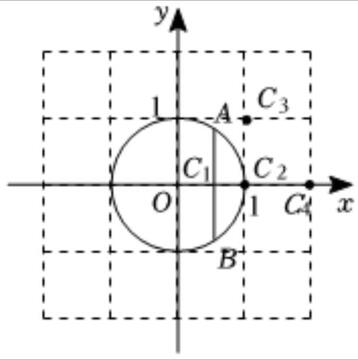

# Mathematics - 题目 2828

**ID**: d4938053f65046d791ce63b268043d29
**年级**: Grade 9
**难度**: Medium-Hard
**题型**: Calculation

## 题目
在平面直角坐标系 $xOy$ 中， $\odot O$ 的半径为1，对于 $\odot O$ 的弦 $AB$ 和 $\odot O$ 外一点C给出如下定义：若点C关于弦 $AB$ 中点的对称点恰好在 $\odot O$ 上，则称点C是弦 $AB$ 的“关联点”．（1）如图，点 $A\left ({\frac {1}{2},\frac {\sqrt {3}}{2}}\right )$ ， $B\left ({\frac {1}{2},-\frac {\sqrt {3}}{2}}\right )$ ，弦 $AB$ 的中点为P．在点 $C{{}_{1}}\left ({1,-1}\right ),C{{}_{2}}\left ({\frac {3}{2},\frac {1}{2}}\right )$ ， $C{{}_{3}}\left ({2,0}\right )$ ， $C{{}_{4}}\left ({2,1}\right )$ 中，弦 $AB$ 的“关联点”是；​​​​​​​‌（2）如果 $\odot O$ 的弦 $AB=\sqrt {3}$ ，直线 $y=x$ 上存在弦 $AB$ 的“关联点”Q，直接写出点Q的横坐标 $x{{}_{Q}}$ 的取值范围；（3）已知点 $M\left ({0，2}\right )$ ， $N\left ({\frac {4\sqrt {5}}{5}，0}\right )$ ．对于线段 $MN$ 上一点S，存在 $\odot O$ 的弦 $AB$ ，使得点S是弦 $AB$ 的“关联点”．若对于每一点S，将其对应的弦 $AB$ 的长度的最大值记为d，则当点S在线段 $MN$ 上运动时，d的取值范围是多少？直接写出你的答案．

## 解答

1. （1）解：∵点 $A\left ({\frac {1}{2},\frac {\sqrt {3}}{2}}\right )$ ， $B\left ({\frac {1}{2},-\frac {\sqrt {3}}{2}}\right )$ ，
2. ∴弦 $AB$ 的中点为P的坐标为 $\left ({\frac {1}{2}，0}\right )$ ，
3. ∴ $C{{}_{1}}\left ({1,-1}\right )$ 关于点P的对称点坐标为 $\left ({0，1}\right )$ ，
4. ∵点 $\left ({0，1}\right )$ 在 $\odot O$ 上，
5. ∴ $C{{}_{1}}\left ({1,-1}\right )$ 是弦 $AB$ 的“关联点”；
6. 同理 $C{{}_{2}}\left ({\frac {3}{2},\frac {1}{2}}\right )$ 关于点P的对称点坐标为 $\left ({-\frac {1}{2}，-\frac {1}{2}}\right )$ ， $C{{}_{3}}\left ({2,0}\right )$ 关于点P的对称点坐标为 $\left ({-1，0}\right )$ ， $C{{}_{4}}\left ({2,1}\right )$ 关于点P的对称点坐标为 $\left ({-1，-1}\right )$ ，
7. ∵ $\sqrt {{\left({-\frac {1}{2}-0}\right)^{2}}+{\left({-\frac {1}{2}-0}\right)^{2}}}=\frac {\sqrt {2}}{2}\ne 1$ ， $\sqrt {{\left({-1}\right)^{2}}+{\left({-1}\right)^{2}}}=\sqrt {2}\ne 1$ ，
8. ∴点 $\left ({-\frac {1}{2}，-\frac {1}{2}}\right )$ ， $\left ({-1，-1}\right )$ 都不在 $\odot O$ 上，而点 $\left ({-1，0}\right )$ 在 $\odot O$ 上，
9. ∴只有 $C{{}_{1}}\left ({1,-1}\right )$ ， $C{{}_{3}}\left ({2,0}\right )$ 是弦 $AB$ 的“关联点”；
10. 故答案为： $C{{}_{1}}，C{{}_{3}}$ ；
11. （2）解：如图2-1所示，过点O作 $OP\mathrm{⊥}AB$ 于P，连接 $OA$ ，
12. ∴ $AP=BP=\frac {1}{2}AB=\frac {\sqrt {3}}{2}$ ，
13. ∴ $OP=\sqrt {OA{^{2}}-AP{^{2}}}=\frac {1}{2}$ ，
14. ∴弦 $AB$ 的中点到原点的距离为 $\frac {1}{2}$ ，
15. ∴弦 $AB$ 的中点在以O为圆心，半径为 $\frac {1}{2}$ 的圆上；
16. 设点Q关于弦 $AB$ 的中点对称的点为R，
17. ∵Q、R关于弦 $AB$ 的中点对称，
18. ∴ $QR$ 的垂直平分线一定与半径为 $\frac {1}{2}$ 的 $\odot O$ 有交点；
19. 
20. 如图2-2所示，点Q在x轴上方，当点R恰好在直线 $y=x$ 上时，设直线 $y=x$ 与半径为 $\frac {1}{2}$ 的 $\odot O$ 交于T，与半径为1的 $\odot O$ 交于H，
21. 此时点Q与点R关于点T对称，
22. ∴ $RT=QT=1+\frac {1}{2}=\frac {3}{2}$ ；
23. ∴ $QO=2$ ，
24. ∴ $x{{}_{Q}}=\sqrt {2}$ ，
25. ∵ $OH=1$ ，
26. ∴ $x{{}_{H}}=\frac {\sqrt {2}}{2}$ ；
27. ∵点Q到半径为 $\frac {1}{2}$ 的 $\odot O$ 的最小距离 $QT$ ，
28. 当点Q的横坐标增大时，点Q到半径为 $\frac {1}{2}$ 的 $\odot O$ 的最小距离 $QT$ 逐渐增大，则点R到半径为 $\frac {1}{2}$ 的 $\odot O$ 的最大距离逐渐增大，故当点Q继续运动时，点R不可能在半径为1的 $\odot O$ 上，
29. ∴当 $\frac {\sqrt {2}}{2}<x{{}_{Q}}\leqslant \sqrt {2}$ 时，直线 $y=x$ 上存在弦 $AB$ 的“关联点”Q，
30. 同理，在x轴下方，当 $-\sqrt {2}\leqslant x{{}_{Q}}<-\frac {\sqrt {2}}{2}$ 时，直线 $y=x$ 上存在弦 $AB$ 的“关联点”Q；
31. 综上所述， $-\sqrt {2}\leqslant x{{}_{Q}}<-\frac {\sqrt {2}}{2}$ 或 $\frac {\sqrt {2}}{2}<x{{}_{Q}}\leqslant \sqrt {2}$ ；
32. 
33. （3）解：如图3-1所示，设点S关于弦 $AB$ 中点对称的点为K，
34. ∵要使弦 $AB$ 最大，
35. ∴弦 $AB$ 到圆心的距离要最小，即 $OP$ 最小，
36. ∵ $OP\geqslant \left |{KP-OK}\right |$ ，
37. ∴当 $O、P、K$ 三点共线时， $OP\geqslant \left |{KP-OK}\right |$ ，
38. ∴此时 $KS$ 一定经过圆心
39. 
40. 如图3-2所示，当 $OS\bot MN$ 时，
41. ∵ $M\left ({0，2}\right )$ ， $N\left ({\frac {4\sqrt {5}}{5}，0}\right )$ ，
42. ∴ $OM=2，ON=\frac {4\sqrt {5}}{5}$ ，
43. ∴ $MN=\sqrt {OM{^{2}}+ON{^{2}}}=\frac {6\sqrt {5}}{5}$ ，
44. ∵ $S{{}_{△OMN}}=\frac {1}{2}OM\cdot ON=\frac {1}{2}OS\cdot MN$ ，
45. ∴ $OS=\frac {2\times \frac {4\sqrt {5}}{5}}{\frac {6\sqrt {5}}{5}}=\frac {4}{3}$ ，
46. ∴ $KS=\frac {7}{3}$ ，
47. 
48. ∴ $SP=KP=\frac {1}{2}KS=\frac {7}{6}$ ，
49. ∴ $OP=\frac {1}{6}$ ，
50. ∴ $AP=\sqrt {OA{^{2}}-OP{^{2}}}=\frac {\sqrt {35}}{6}$ ，
51. ∴ $AB=\frac {\sqrt {35}}{3}$ ；
52. 同理当点S运动到点M时，可得 $AB=\sqrt {3}$ ，
53. ∴ $\sqrt {3}\leqslant d\leqslant \frac {\sqrt {35}}{3}$ ．

## 知识点

**中文**:
  - 三角形三边关系
  - 两点间的距离公式
  - 勾股定理
  - 点和圆的位置关系

**English**:
  - Relationship Between Sides
  - Distance Formula
  - Pythagorean Theorem
  - Point and Circle Relationship

---
