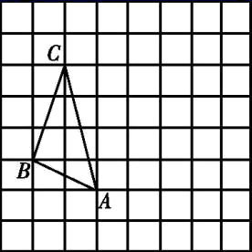

# Mathematics - 题目 985

**ID**: d5f3bfde9ea94a01b2122ed2ed637425
**年级**: Grade 9
**难度**: Medium-Hard
**题型**: Calculation

## 题目
如图，在由边长为1个单位长度的小正方形组成的8×8网格中，已知格点三角形ABC(顶点为网格线的交点)．(1)将△ABC绕点A顺时针旋转90°得到△AB_{1}C_{1}(点B，C的对应点分别为点B_{1}，C_{1})，画出△AB_{1}C_{1}；​​​​​​​‌(2)将△ABC平移，使得点A与点C_{1}重合，得到△A_{2}B_{2}C_{2}(点A，B，C的对应点分别为点A_{2}，B_{2}，C_{2}，画出△A_{2}B_{2}C_{2})并说明平移过程；(3)填空：sin∠B_{1}C_{1}B_{2}=．

## 解答

1. 解：(1)△AB_{1}C_{1}如图(1)所示．
2. (2)△A_{2}B_{2}C_{2}如图(1)所示．
3. 平移过程：将△ABC先向上平移1个单位长度，再向右平移4个单位长度或先向右平移4个单位长度，再向上平移1个单位长度．
4. 
5. (3) $\frac {\sqrt {2}}{10}$
6. 如图(2)，过点B_{2}作B_{2}D⊥B_{1}C_{1}于点D．
7. 由题意可得，B_{1}B_{2}=1，B_{2}C_{1}= $\sqrt {5}$ ，B_{1}C_{1}= $\sqrt {10}$ ，
8. ∵ ${\rm{S}}{{}_{\vartriangle B{{}_{1}}C{{}_{1}}B{{}_{2}}}}$ = $\frac {1}{2}$ ×1×1= $\frac {1}{2}$ × $\sqrt {10}$ ×B_{2}D，
9. ∴B_{2}D= $\frac {\sqrt {10}}{10}$ ，
10. ∴sin∠B_{1}C_{1}B_{2}= $\frac {B{{}_{2}}D}{B{{}_{2}}C{{}_{1}}}=\frac {\sqrt {2}}{10}$ ．
11. 故答案为： $\frac {\sqrt {2}}{10}.$

## 知识点

**中文**:
  - 作图——平移
  - 画旋转图形
  - 解直角三角形

**English**:
  - Construction: Translation
  - Drawing Rotated Figures
  - Solving Right Triangles

---
