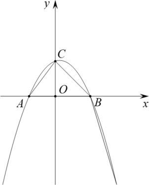

# Mathematics - 题目 3790

**ID**: d6236b7680634832b8c7c925268f8b3f
**年级**: Grade 9
**难度**: Medium-Hard
**题型**: Calculation

## 题目
如图，已知二次函数 $y=-\frac {1}{3}x{^{2}}+bx+c$ 的图像与x轴交于A、B两点，与y轴交于点C，其中点A的坐标为 $(-3，0)$ ，对称轴是直线 $x=\frac {1}{2}$ ．（1）求该二次函数的表达式；​​​​​​​‌（2）如图，连接AC，若点P是该抛物线上一点，且 $\angle PAB=\frac {1}{2}\angle ACO$ ，求点P的坐标；（3）如图，点P是该抛物线上一点，点Q为射线CB上一点，且P、Q两点均在第四象限内，线段AQ与BP交于点M，当 $\angle PBQ＝\angle AQB$ ，且△ABM与△PQM的面积相等时，请问线段PQ的长是否为定值？如果是，请求出这个定值；如果不是，请说明理由．

## 解答

1. （1）∵点A的坐标为 $(-3，0)$ ，对称轴是直线 $x=\frac {1}{2}$ ．
2. ∴ $\begin{cases}{\rm{-}}\frac {1}{3}\times {\left({{\rm{-}}3}\right)^{2}}{\rm{-}}{\rm{3}}b+c=0\\x=-\frac {b}{2\times \left ({-\frac {1}{3}}\right )}=\frac {1}{2}\end{cases}$
3. ∴ $\begin{cases}b=\frac {1}{3}\\c=4\end{cases}$
4. ∴ $y=-\frac {1}{3}x{^{2}}+\frac {1}{3}x+4$
5. （2）设P（x， $-\frac {1}{3}x{^{2}}+\frac {1}{3}x+4$ ），
6. 当x=0时， $y=4$
7. ∴C（0，4）
8. ∵A(-3，0)C（0．4）
9. ∴OA=4,OC=4
10. ∴AC=5
11. 在y轴上C的上方取点D，使CD=CA=5，
12. 
13. ∴OD=OC+CD=4+5=9
14. ∴D（0，9），
15. 连结AD，
16. ∵CD=CA=5，
17. ∴∠DAC-∠ADC
18. ∴∠ACO=2∠ADO，
19. ∴∠ADO=∠PAB，
20. ∴tan∠ADO=tan∠PAB，
21. ∴ $\frac {\left |{-\frac {1}{3}x{^{2}}+\frac {1}{3}x+4}\right |}{x+3}=\frac {1}{3}$ ，
22. ∴ $x{{}_{1}}=3，x{{}_{2}}=5$
23. ∴P（3，2）或（5， $-\frac {8}{3}$ ）
24. （3）线段PQ的长是定值，为7．
25. 连接AP
26. 
27. ∵△ABM与△PQM的面积相等
28. ∴△ABP与△PQA的面积相等
29. ∴BQ∥AP
30. ∴∠BQA=∠PAQ，∠PBQ=∠APB，
31. ∵∠PBQ＝∠AQB，
32. ∴∠BQA=∠PAQ=∠PBQ=∠APB，
33. ∴AM=PM,BM=QM
34. ∴AM=PM,BM=QM
35. ∴AM+MQ=PM+BM
36. ∴AQ=PB
37. ∵∠QAP＝∠BPA，AP=AP
38. ∴△ABP≌△PQA
39. ∴PQ=AB=7．

## 知识点

**中文**:
  - 三角函数综合
  - 二次函数的综合
  - 等腰三角形的判定与性质
  - 全等三角形的判定与性质

**English**:
  - Comprehensive Trig Problems
  - Comprehensive Quadratic Function Problems
  - Determination and Properties
  - Determination and Properties

---
