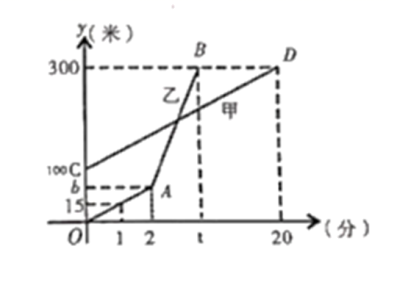

# Mathematics - 题目 3454

**ID**: d812df7fab594c94b9786f0a85b9c1ef
**年级**: Grade 9
**难度**: Medium-Hard
**题型**: Calculation

## 题目
甲乙两人同时登同一座山，甲乙两人距地面的高度 $y$ （米）与登山时间 $x$  （分）之间的函数图象如图所示，根据图象所提供的信息解答下列问题：（1）乙在提速前登山的速度是米／分钟，乙在 $A$  地提速时距地面的高度 $b$ 为米．（2）若乙提速后，乙比甲提前了9分钟到达山顶，请求出乙提速后 $y$  和 $x$  之间的函数关系式．（3）登山多长时间时，乙追上了甲，此时甲距 $C$  地的高度为多少米？​​​​​​​‌

## 解答

1. （1）乙在提速前登山的速度是 $15\div 1=$ 15（米／分钟），乙在 $A$  地提速时距地面的高度 $b$ 为 $15\times 2=$ 30 （米）；
2. （2）t=20-9=11，
3. 设乙提速后的函数关系式为： $y=kx+b$ ，图象经过   $（2，30）{\rm{\;}}（11,300）$
4. 则 $\begin{cases}30=2k+b\\300=11k+b\end{cases}$
5. 解得： $k=30,b=-30$
6. 所以乙提速后的关系式： $y=30x-30$  ．
7. （3）设甲的函数关系式为： $y=mx+n$  ，将点 $（0，100）$ 和点 $（20，300）$  代入，则  $\begin{cases}{\rm{n}}=100\\20m+n=300\end{cases}$ ，
8. 解得： $m=10,n=100$
9. 甲的函数关系式为： $y=10x+100$ ； 由题意得：
10. $\begin{cases}{\rm{y}}=30x-30\\y=10x+100\end{cases}$
11. 解得： $x=6.5{\rm{\;}},y=165$ ，
12. 相遇时甲距 $C$  地的高度为： $165﹣100=65$  （米）
13. 答：登山6.5分钟，乙追上了甲，此时甲距C地的高度为65米.

## 知识点

**中文**:
  - 行程问题

**English**:
  - Distance-Speed-Time Problems

---
