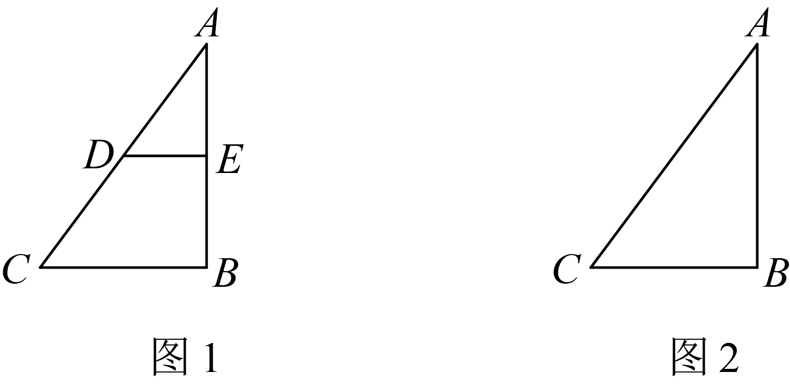
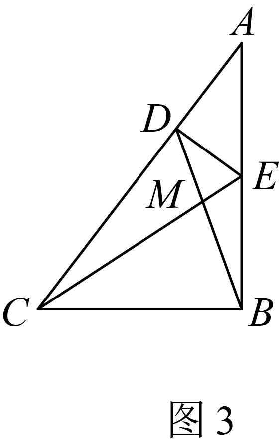
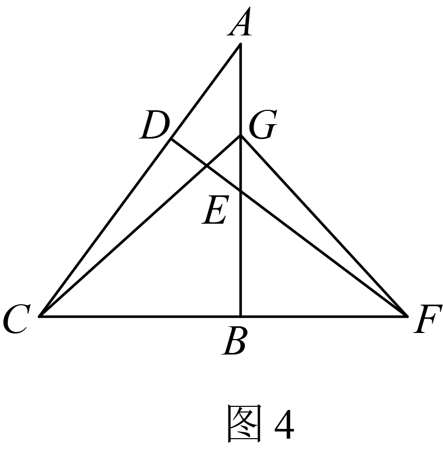

# Mathematics - 题目 470

**ID**: d9d6fa766e9448b6a214521e4745396a
**年级**: Grade 9
**难度**: Medium-Hard
**题型**: Calculation

## 题目
综合实践课上，老师让同学们以“三角形的折叠”为主题开展数学活动．【初步思考】一张三角形纸片 $ABC$ ，其中 $\angle B=90{}\degree $ ， $AB>BC$ ．（1）操作一：折叠三角形纸片，使点A落在边 $BC$ 上，展开后折痕为 $DE$ ，使 $\vartriangle ADE$ 与 $\vartriangle ABC$ 相似．如图1，小明通过折叠，使点A与点B重合，很快得到两个相似的三角形．你还有其他的折法吗？如果有，请你在图2中直接画出折痕 $DE$ ，并证明 $\vartriangle ADE$ 与 $\vartriangle ABC$ 相似；​​​​​​​‌如果没有，请说明理由．【迁移探索】（2）操作二：如图3，小君将纸片折叠，使点A落在边 $AC$ 上（不与点C重合），折痕为 $DE$ ，连接 $CE$ ， $BD$ 相交于点M，求证： $DM\cdot BM=CM\cdot EM$ ；【延伸应用】（3）如图4，延长操作二中的折痕 $DE$ ，交 $CB$ 延长线于点F，点G在 $AB$ 上，且 $BG{^{2}}=AB\cdot BE$ ，连接 $CG$ ， $FG$ ，求证： $CG\bot FG$ ．

## 解答

1. 解：（1）如图， $DE$ 即为折痕．
2. 
3. 证明：由折叠得， $DE\mathrm{⊥}AC$ ．
4. ∴ $∠ADE=\angle B=90{}\degree $ ．
5. ∵ $\angle A=\angle A$ ，
6. ∴ $\mathrm{△}ADE\mathrm{∽}\mathrm{△}ABC$ ．
7. （2）同（1）理可证： $\mathrm{△}ADE\mathrm{∽}\mathrm{△}ABC$ ，
8. 
9. 则 $\frac {AD}{AB}=\frac {AE}{AC}$ ，
10. ∴ $\frac {AD}{AE}=\frac {AB}{AC}$ ．
11. ∵ $\angle A=\angle A$ ，
12. ∴ $\mathrm{△}ADB∽\mathrm{△}AEC$ ．
13. ∴ $\angle ABD=\angle ACE$ ．
14. ∵ $\angle BME=\angle CMD$ ，
15. ∴ $\vartriangle BME∽\vartriangle CMD$ ，
16. ∴ $\frac {BM}{CM}=\frac {EM}{DM}$ ，
17. ∴ $DM\cdot BM=CM\cdot EM$ ．
18. （3）∵ $\angle ABC=\angle CDF=90{}\degree $ ，
19. 
20. ∴ $\angle A+\angle ACB=\angle CFD+\angle ACB=90{}\degree $ ，
21. ∴ $\angle A=\angle CFD$ ．
22. ∵ $\angle FBE=\angle ABC=90{}\degree $ ，
23. ∴ $\vartriangle ABC∽\vartriangle FBE$ ，
24. ∴ $\frac {AB}{FB}=\frac {BC}{BE}$ ，
25. ∴ $AB\cdot BE=FB\cdot BC$ ．
26. ∵ $BG{^{2}}=AB\cdot BE$ ，
27. ∴ $BG{^{2}}=FB\cdot BC$ ，
28. ∴ $\frac {BG}{FB}=\frac {BC}{BG}$ ．
29. ∵ $\angle CBG=\angle GBF=90{}\degree $ ，
30. ∴ $\vartriangle CBG{\rm{∽}}\vartriangle GBF$ ．
31. ∴ $\angle BCG=\angle BGF$ ．
32. ∵ $\angle BCG+\angle CGB=90{}\degree $ ，
33. ∴ $\angle BGF+\angle CGB=90{}\degree $ ，
34. ∴ $\angle CGF=90{}\degree $ ，
35. ∴ $CG\bot FG$ ．

## 知识点

**中文**:
  - 余角和补角
  - 相似三角形的判定与性质综合
  - 折叠问题

**English**:
  - Complementary and Supplementary Angles
  - Determination and Properties
  - Folding Problems

---
