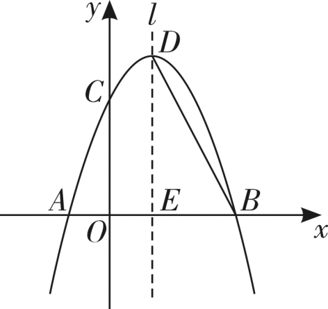

# Mathematics - 题目 2098

**ID**: dab715a406ae497ba6e8340600dfc4d6
**年级**: Grade 9
**难度**: Medium-Hard
**题型**: Calculation

## 题目
如图，已知抛物线 $C{{}_{1}}∶y=ax{^{2}}+bx+3$ （ $a$ 、 $b$ 为常数，且 $a\ne 0$ ）与 $x$ 轴交于 $\mathrm{A}$ 、 $B$ 两点（点 $\mathrm{A}$ 在点 $B$ 的左侧），与 $y$ 轴交于点 $C$ ，点 $D\left ({1,4}\right )$ 为该抛物线的顶点，点 $E$ 为该抛物线的对称轴 $l$ 与 $x$ 轴的交点，连接 $BD$ ．(1)求抛物线 $C{{}_{1}}$ 的函数表达式；​​​​​​​‌(2)将抛物线 $C{{}_{1}}$ 向下平移 $m(m>0)$ 个单位，得到抛物线 $C{{}_{2}}$ ，若点 $F$ 为抛物线 $C{{}_{2}}$ 的顶点，请问在平移过程中，是否存在 $m$ ，使得 $\mathrm{△}AEF$ 与 $\vartriangle BDE$ 相似（包含全等）？若存在，请求出所有符合条件的 $m$ 的值；若不存在，请说明理由．

## 解答

1. （1）解：∵拋物线 $C{{}_{1}}$ 的顶点坐标为 $D\left ({1，4}\right )$ ，
2. ∴抛物线 $C{{}_{1}}$ 的对称轴 $l$ 为直线 $x=1$ ，即 $-\frac {b}{2a}=1$ ，
3. ∴ $b=-2a$ ，
4. ∴抛物线 $C{{}_{1}}∶y=ax{^{2}}-2ax+3$ ．
5. 将点 $D\left ({1，4}\right )$ 代入，得 $4=a-2a+3$ ，
6. 解得 $a=-1$ ，
7. $\therefore b=2$ ，
8. ∴抛物线 $C{{}_{1}}$ 的函数表达式为 $y=-x{^{2}}+2x+3$ ；
9. （2）解：在 $y=-x{^{2}}+2x+3$ 中，令 $y=0$ ，得 $x{{}_{1}}=-1，x{{}_{2}}=3$ ，
10. ∴ $A\left ({-1，0}\right )，B\left ({3，0}\right )$ ．
11. ∵顶点 $D\left ({1，4}\right )$ ，
12. ∴ $E\left ({1，0}\right )，DE=4，BE=2，AE=2$ ．
13. ∵抛物线 $C{{}_{1}}$ 向下平移 $m(m>0)$ 个单位得到抛物线 $C{{}_{2}}$ ，
14. ∴点 $F$ 在直线 $l$ 上，
15. ∴ $\angle BED=\angle AEF=90{}\degree $ ，
16. 分类讨论：①当 $\mathrm{△}AEF∽\mathrm{△}BED$ 时，
17. ∴ $\frac {EF}{DE}=\frac {AE}{BE}$ ，即 $\frac {EF}{4}=\frac {2}{2}，$
18. ∴ $EF=4$ ，
19. ∴ $F\left ({1,4}\right )$ （与点D重合，舍）或 $F\left ({1,-4}\right )$ ．
20. ∴此时 $4-\left ({-4}\right )=8$ ；
21. ②当 $\vartriangle AEF∽\vartriangle DEB$ 时，
22. ∴ $\frac {EF}{BE}=\frac {AE}{DE}$ ，即 $\frac {EF}{2}=\frac {2}{4}$ ，
23. $\therefore EF=1$ ，
24. ∴ $F\left ({1,1}\right )$ 或 $F\left ({1,-1}\right )$ ，
25. ∴此时 $m=4-1=3$ 或 $m=4-\left ({-1}\right )=5$ ．
26. 综上可知，存在 $m$ ，使得 $\mathrm{△}AEF$ 与 $\vartriangle DEB$ 相似， $m$ 的值为3或5或8．

## 知识点

**中文**:
  - 二次函数图象的平移
  - 二次函数的综合
  - 相似三角形的性质
  - 待定系数法求二次函数解析式

**English**:
  - Translation of Quadratic Graphs
  - Comprehensive Quadratic Function Problems
  - Properties of Similar Triangles
  - Finding Quadratic Expressions by Undetermined Coefficients

---
