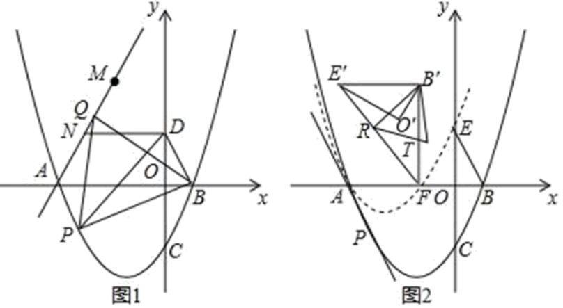

# Mathematics - 题目 2120

**ID**: dad1c7c5807540ea9f69141f690c795f
**年级**: Grade 9
**难度**: Medium-Hard
**题型**: Calculation

## 题目
如图，在平面直角标系中，抛物线C：y＝ $\frac {\sqrt {3}}{3}x{^{2}}+\frac {2\sqrt {3}}{3}x-\sqrt {3}$ 与x轴交于A、B两点（点A在点B的左侧），与y轴交于点C，点D为y轴正半轴上一点．且满足OD＝ $\frac {2}{3}$ OC，连接BD，（1）如图1，点P为抛物线上位于x轴下方一点，连接PB，PD，当S_{△PBD}最大时，连接AP，以PB为边向上作正△BPQ，连接AQ，点M与点N为直线AQ上的两点，MN＝2且点N位于M点下方，连接DN，求DN+MN+ $\frac {\sqrt {3}}{2}$ AM的最小值（2）如图2，在第（1）问的条件下，点C关于x轴的对称点为E，将△BOE绕着点A逆时针旋转60°得到△B′O′E′，将抛物线y＝ $\frac {\sqrt {3}}{3}x{^{2}}+\frac {2\sqrt {3}}{3}x-\sqrt {3}$ 沿着射线PA方向平移，使得平移后的抛物线C′经过点E，此时抛物线C′与x轴的右交点记为点F，连接E′F，B′F，R为线段E’F上的一点，连接B′R，将△B′E′R沿着B′R翻折后与△B′E′F重合部分记为△B′RT，在平面内找一个点S，使得以B′、R、T、S为顶点的四边形为矩形，求点S的坐标．​​​​​​​‌

## 解答

1. 解：（1）如图1，过点D作DD'∥MN，且DD'＝MN＝2，连接D'M；过点D'作D'J⊥y轴于点J；
2. 作直线AP，过点M作MH⊥AP于点H，过点D'作D'K⊥AP于点K
3. ∵y＝ $\frac {\sqrt {3}}{3}x{^{2}}+\frac {2\sqrt {3}}{3}x-\sqrt {3}$ ＝0
4. 解得：x_{1}＝﹣3，x_{2}＝1
5. ∴A（﹣3，0），B（1，0）
6. ∵x＝0时，y＝ $\frac {\sqrt {3}}{3}x{^{2}}+\frac {2\sqrt {3}}{3}x-\sqrt {3}$ ＝﹣ $\sqrt {3}$
7. ∴C（0，﹣ $\sqrt {3}$ ），OC＝ $\sqrt {3}$
8. ∴OD＝ $\frac {2}{3}$ OC＝ $\frac {2\sqrt {3}}{3}$ ，D（0， $\frac {2\sqrt {3}}{3}$ ）
9. 设P（t， $\frac {\sqrt {3}}{3}$  t^{2}+ $\frac {2\sqrt {3}}{3}$ t﹣ $\sqrt {3}$ ）（﹣3＜t＜1）
10. 设直线PB解析式为y＝kx+b，与y轴交于点G
11. ∴ $\begin{cases}k+b=0\\kt+b=\frac {\sqrt {3}}{3}t{^{2}}+\frac {2\sqrt {3}}{3}t-\sqrt {3}\end{cases}$   解得： $\begin{cases}k=\frac {\sqrt {3}}{3}t+\sqrt {3}\\b=\frac {\sqrt {3}}{3}t-\sqrt {3}\end{cases}$
12. ∴直线PB：y＝（ $\frac {\sqrt {3}}{3}$ t+ $\sqrt {3}$ ）x﹣ $\frac {\sqrt {3}}{3}$ t﹣ $\sqrt {3}$ ，G（0，﹣ $\frac {\sqrt {3}}{3}$ t﹣ $\sqrt {3}$ ）
13. ∴DG＝ $\frac {2\sqrt {3}}{3}$ ﹣（﹣ $\frac {\sqrt {3}}{3}$ t﹣ $\sqrt {3}$ ）＝ $\frac {\sqrt {3}}{3}$ t+ $\frac {5\sqrt {3}}{3}$
14. ∴S_{△BPD}＝S_{△BDG}+S_{△PDG}＝ $\frac {1}{2}$ DG•x_{B}+ $\frac {1}{2}$ DG•|x_{P}|＝ $\frac {1}{2}$ DG•（x_{B}﹣x_{P}）＝ $\frac {1}{2}$ （ $\frac {\sqrt {3}}{3}$ t+ $\frac {5\sqrt {3}}{3}$ ）（1﹣t）＝﹣ $\frac {\sqrt {3}}{6}$ （t^{2}+4t﹣5）
15. ∴t＝﹣ $\frac {4}{2}$ ＝﹣2时，S_{△BPD}最大
16. ∴P（﹣2，﹣ $\sqrt {3}$ ），直线PB解析式为y＝ $\frac {\sqrt {3}}{3}$ x﹣ $\frac {\sqrt {3}}{3}$ ，直线AP解析式为y＝﹣ $\sqrt {3}$ x﹣3 $\sqrt {3}$
17. ∴tan∠ABP＝ $\frac {\left |{y{{}_{P}}}\right |}{\left |{x{{}_{B}}-x{{}_{P}}}\right |}$ ＝ $\frac {\sqrt {3}}{1+2}=\frac {\sqrt {3}}{3}$
18. ∴∠ABP＝30°
19. ∵△BPQ为等边三角形
20. ∴∠PBQ＝60°，BP＝PQ＝BQ
21. ∴BA平分∠PBQ
22. ∴PQ⊥x轴，PQ与x轴交点I为PQ中点
23. ∴Q（﹣2， $\sqrt {3}$ ）
24. ∴Rt△AQI中，tan∠QAI＝ $\frac {QI}{AI}=\frac {\sqrt {3}}{-2-(-3)}=\sqrt {3}$
25. ∴∠QAI＝∠PAI＝60°
26. ∴∠MAH＝180°﹣∠PAI﹣∠QAI＝60°
27. ∵MH⊥AP于点H
28. ∴Rt△AHM＝90°，sin∠MAH＝ $\frac {MH}{AM}=\frac {\sqrt {3}}{2}$
29. ∴MH＝ $\frac {\sqrt {3}}{2}$ AM
30. ∵DD'∥MN，DD'＝MN＝2
31. ∴四边形MNDD'是平行四边形
32. ∴D'M＝DN
33. ∴DN+MN+ $\frac {\sqrt {3}}{2}$ AM＝2+D'M+MH
34. ∵D'K⊥AP于点K
35. ∴当点D'、M、H在同一直线上时，DN+MN+ $\frac {\sqrt {3}}{2}$ AM＝2+D'M+MH＝2+D'K最短
36. ∵DD'∥MN，D（0， $\frac {2\sqrt {3}}{3}$ ）
37. ∴∠D'DJ＝30°
38. ∴D'J＝ $\frac {1}{2}$ DD'＝1，DJ＝ $\frac {\sqrt {3}}{2}$ DD'＝ $\sqrt {3}$
39. ∴D'（1， $\frac {5\sqrt {3}}{3}$ ）
40. ∵∠PAI＝60°，∠ABP＝30°
41. ∴∠APB＝180°﹣∠PAI﹣∠ABP＝90°
42. ∴PB∥D'K
43. 设直线D'K解析式为y＝ $\frac {\sqrt {3}}{3}$ x+d，
44. 把点D'代入得： $\frac {\sqrt {3}}{3}$  +d＝ $\frac {5\sqrt {3}}{3}$
45. 解得：d＝ $\frac {4\sqrt {3}}{3}$
46. ∴直线D'K：y＝ $\frac {\sqrt {3}}{3}$ x+ $\frac {4\sqrt {3}}{3}$
47. 把直线AP与直线D'K解析式联立得：
48. $\begin{cases}y=-\sqrt {3}x-3\sqrt {3}\\y=\frac {\sqrt {3}}{3}x+\frac {4\sqrt {3}}{3}\end{cases}$    解得： $\begin{cases}x=-\frac {13}{4}\\y=\frac {\sqrt {3}}{4}\end{cases}$
49. ∴K（﹣ $\frac {13}{4}$ ， $\frac {\sqrt {3}}{4}$ ）
50. ∴D'K＝
51. ∴DN+MN+ $\frac {\sqrt {3}}{2}$ AM的最小值为 $\frac {12+17\sqrt {3}}{6}$
52. （2）连接B'A、BB'、EA、E'A、EE'，如图2
53. ∵点C（0，﹣ $\sqrt {3}$ ）关于x轴的对称点为E
54. ∴E（0， $\sqrt {3}$ ）
55. ∴tan∠EAB＝ $\frac {0E}{OA}=\frac {\sqrt {3}}{3}$
56. ∴∠EAB＝30°
57. ∵抛物线C'由抛物线C平移得到，且经过点E
58. ∴设抛物线C'解析式为：y＝ $\frac {\sqrt {3}}{3}$ x^{2}+mx+ $\sqrt {3}$
59. ∵抛物线C'经过点A（﹣3，0）
60. ∴ $\frac {\sqrt {3}}{3}$ ×9﹣3m+ $\sqrt {3}$ ＝0
61. 解得：m＝ $\frac {4\sqrt {3}}{3}$
62. ∴抛物线C'解析式为：y＝ $\frac {\sqrt {3}}{3}$ x^{2}+ $\frac {4\sqrt {3}}{3}$ x+ $\sqrt {3}$
63. ∵ $\frac {\sqrt {3}}{3}$ x^{2}+ $\frac {4\sqrt {3}}{3}$ x+ $\sqrt {3}$ ＝0，解得：x_{1}＝﹣3，x_{2}＝﹣1
64. ∴F（﹣1，0）
65. ∵将△BOE绕着点A逆时针旋转60°得到△B′O′E′
66. ∴∠BAB'＝∠EAE'＝60°，AB'＝AB＝1﹣（﹣3）＝4，AE'＝AE＝ $\sqrt {0A{^{2}}+0E{^{2}}}=\sqrt {3{^{2}}+(\sqrt {3}){^{2}}}=2\sqrt {3}$
67. ∴△ABB'、△AEE'是等边三角形
68. ∴∠E'AB＝∠E'AE+∠EAB＝90°，点B'在AB的垂直平分线上
69. ∴E'（﹣3，2 $\sqrt {3}$ ），B'（﹣1，2 $\sqrt {3}$ ）
70. ∴B'E'＝2，∠FB'E'＝90°，E'F＝ $\sqrt {(-1+3){^{2}}+(2\sqrt {3}){^{2}}}=4$
71. ∴∠B'FE'＝30°，∠B'E'F＝60°
72. ①如图3，点T在E'F上，∠B'TR＝90°
73. 过点S作SW⊥B'E'于点W，设翻折后点E'的对应点为E''
74. ∴∠E'B'T＝30°，B'T＝ $\frac {\sqrt {3}}{2}$ B'E'＝ $\sqrt {3}$
75. ∵△B′E′R翻折得△B'E''R
76. ∴∠B'E''R＝∠B'E'R＝60°，B'E''＝B'E'＝2
77. ∴E''T＝B'E''﹣B'T＝2﹣ $\sqrt {3}$
78. ∴Rt△RTE''中，RT＝ $\sqrt {3}$ E''T＝2 $\sqrt {3}$ ﹣3
79. ∵四边形RTB'S是矩形
80. ∴∠SB'T＝90°，SB'＝RT＝2 $\sqrt {3}$ ﹣3
81. ∴∠SB'W＝∠SB'T﹣∠E'B'T＝60°
82. ∴B'W＝ $\frac {1}{2}$ SB'＝ $\sqrt {3}$ ﹣ $\frac {3}{2}$ ，SW＝ $\frac {\sqrt {3}}{2}$ SB'＝3﹣ $\frac {3\sqrt {3}}{2}$
83. ∴x_{S}＝x_{B}'﹣B'W＝ $\frac {1}{2}-\sqrt {3}$ ，y_{S}＝y_{B}'+SW＝3+
84. ∴S（ $\frac {1}{2}-\sqrt {3}$ ，3+ $\frac {\sqrt {3}}{2}$ ）
85. ②如图4，点T在E'F上，∠B'RT＝90°
86. 过点S作SX⊥B'F于点X
87. ∴E'R＝ $\frac {1}{2}$ B'E'＝1，点E'翻折后落在E'F上即为点T
88. ∴B'S＝RT＝E'R＝1
89. ∵∠SB'X＝90°﹣∠RB'F＝30°
90. ∴XS＝ $\frac {1}{2}$ B'S＝ $\frac {1}{2}$ ，B'X＝ $\frac {\sqrt {3}}{2}$ B'S＝ $\frac {\sqrt {3}}{2}$
91. ∴x_{S}＝x_{B}'+XS＝﹣ $\frac {1}{2}$ ，y_{S}＝y_{B}'﹣B'X＝ $\frac {3\sqrt {3}}{2}$
92. ∴S（﹣ $\frac {1}{2}$ ， $\frac {3\sqrt {3}}{2}$ ）
93. ③如图5，点T在B'F上，∠B'TR＝90°
94. ∴RE''∥E'B'，∠E''＝∠B'E'R＝60°
95. ∴∠E'BE''＝∠E'RE''＝120°
96. ∴四边形B'E'RE''是平行四边形
97. ∵E'R＝E''R
98. ∴▱B'E'RE''是菱形
99. ∴B'E'＝E'R
100. ∴△B'E'R是等边三角形
101. ∵∠B'SR＝90°，即RS⊥B'E'
102. ∴点S为B'E'中点
103. ∴S（﹣2，2 $\sqrt {3}$ ）
104. 综上所述，使得以B′、R、T、S为顶点的四边形为矩形的点S坐标为（ $\frac {1}{2}-\sqrt {3}$ ，3+ $\frac {\sqrt {3}}{2}$ ）或（﹣ $\frac {1}{2}$ ， $\frac {3\sqrt {3}}{2}$ ）或（﹣2，2 $\sqrt {3}$ ）．
105. 

## 知识点

**中文**:
  - 三角函数综合
  - 二次函数的综合
  - 等边三角形的性质
  - 几何变换——旋转综合题

**English**:
  - Comprehensive Trig Problems
  - Comprehensive Quadratic Function Problems
  - Properties of Equilateral Triangles
  - Rotation Comprehensive Problems

---
