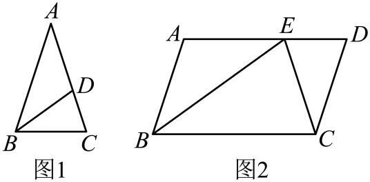

# Mathematics - 题目 2475

**ID**: db7c9b073cd2474cad4068dda3dc3aa2
**年级**: Grade 9
**难度**: Medium-Hard
**题型**: Calculation

## 题目
追本溯源题（1）是来自课本中的习题，请你完成解答，提炼方法并完成题（2）．（1）如图1，在 $\vartriangle ABC$ 中， $AB=AC$ ， $BD$ 平分 $\angle ABC$ ，交 $AC$ 于点 $D$ ．若 $BD=BC$ ，则 $\angle A$ 等于多少度？方法应用（2）如图2，四边形 $ABCD$ 为平行四边形， $\angle ABC$ 的平分线交 $AD$ 于点 $E$ ，连接 $CE$ ，若 $BC=BE$ ， $CE=CD$ ．①求 $\angle D$ 的度数；​​​​​​​‌②已知 $DE=2$ ，求 $BC$ 的长．

## 解答

1. （1）解：∵ $BD=BC$ ，
2. ∴ $\angle C=\angle BDC$ ，
3. ∵ $AB=AC$ ，
4. ∴ $\angle ABC=\angle C$ ，
5. ∵ $BD$ 平分 $\angle ABC$ ，
6. ∴ $\angle ABD=\angle CBD$ ，
7. ∵ $\angle A+\angle ABC+\angle C=\angle A+2\angle C=180{}\degree ，\angle CBD+\angle C+\angle BDC=\angle CBD+2\angle C=180{}\degree $ ，
8. ∴ $\angle CBD=\angle A$ ，
9. ∴ $\angle CBD=\angle A=\angle ABD$ ，
10. 又∵ $\angle BDC=\angle A+\angle ABD$ ，
11. ∴ $\angle C=\angle BDC=2\angle A$ ，
12. 又∵ $\angle A+\angle ABC+\angle C=180{}\degree $ ，
13. ∴ $\angle A+2\angle C=180{}\degree $ ，
14. ∴ $\angle A+2\times 2\angle A=180{}\degree $ ，
15. 解得 $\angle A=36{}\degree $ ；
16. （2）解：①设 $\angle ABE=x$ ，
17. ∵ $BE$ 平分 $\angle ABC$ ，
18. ∴ $\angle CBE=\angle ABE=x$ ，
19. ∴ $\angle ABC=2x$ ，
20. ∵四边形 $ABCD$ 为平行四边形，
21. ∴ $AB\mathrm{/\mskip-4mu/}CD，AD\mathrm{/\mskip-4mu/}BC$ ，
22. ∴ $\angle A+\angle ABC=\angle A+\angle D=180{}\degree $ ，
23. ∴ $\angle ABC=\angle D$ ，
24. ∴ $\angle D=2x$ ，
25. ∵ $CE=CD$ ，
26. ∴ $\angle CED=2x$ ，
27. ∴ $\angle BCE=\angle CED=2x$ ，
28. ∵ $BC=BE$ ，
29. ∴ $\angle BCE=\angle BEC=2x$ ，
30. ∴ $\angle CBE+\angle BCE+\angle BEC=x+2x+2x=5x=180{}\degree $ ，
31. 解得 $x=36{}\degree $ ，
32. ∴ $\angle D=72{}\degree $  ；
33. ②由①可得 $\angle CBE=\angle DCE=36{}\degree $ ， $\angle BCE=\angle D=72{}\degree $ ，
34. ∴ $\mathrm{△}BCE∽\mathrm{△}CDE$ ，
35. ∴ $\frac {DE}{CE}=\frac {CD}{BC}$ ，
36. 设 $AB=a$ ，
37. ∴ $CE=CD=AB=a$ ，
38. 由①可得 $\angle CBE=\angle ABE$ ，
39. ∵ $AD\mathrm{/\mskip-4mu/}BC$ ，
40. ∴ $\angle AEB=\angle CBE$ ，
41. ∴ $\angle AEB=\angle ABE$ ，
42. ∴ $AE=AB=a$ ，
43. ∴ $BC=AE+DE=a+2$ ，
44. ∴ $\frac {2}{a}=\frac {a}{a+2}$ ，
45. 解得 $a=1+\sqrt {5}$ （负值舍去），
46. ∴ $BC=3+\sqrt {5}$ ．

## 知识点

**中文**:
  - 平行四边形的对角相等
  - 平行四边形的对边平行且相等
  - 相似三角形的判定与性质综合

**English**:
  - Opposite Angles Equal
  - Opposite Sides Parallel and Equal
  - Determination and Properties

---
