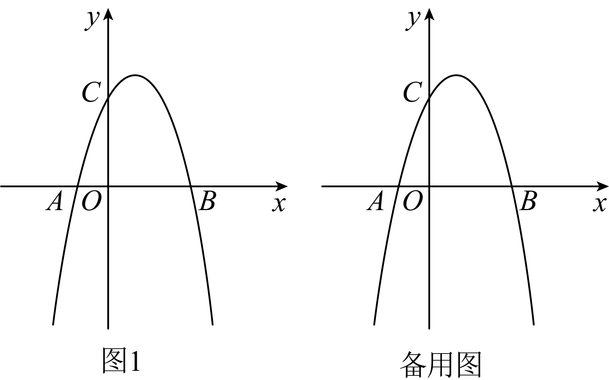

# Mathematics - 题目 2190

**ID**: dc0a8551126e4218af503f3d2598397c
**年级**: Grade 9
**难度**: Medium-Hard
**题型**: Calculation

## 题目
如图1所示，平面直角坐标系中，抛物线 $y=ax{{}^{2}}-2ax+3$ 交x轴于A、B两点，与y轴交于点C，已知点A坐标为 $\left ({-1，0}\right )$ ．(1)求抛物线解析式及其顶点坐标．(2)若将抛物线向右平移m个单位，得新抛物线“V”，若“V”与坐标轴仅有两个交点，求m值．(3)若点M为线段 $AB$ 上一动点，过点M作y轴平行线，该平行线与“V”交点为N，请直接写出点N的纵坐标 $y{{}_{N}}$ 的取值范围．​​​​​​​‌

## 解答

1. （1）解：将 $A\left ({-1,0}\right )$ 代入抛物线的解析式 $y=ax{{}^{2}}-2ax+3$ 得： $0=a+2a+3$ ，
2. 解得 $a=-1$ ，
3. ∴抛物线解析式为 $y=-x{{}^{2}}+2x+3$ ，
4. 把抛物线解析式化为顶点式得： $y=-\left ({x-1}\right ){{}^{2}}+4$ ，
5. ∴顶点坐标为 $\left ({1，4}\right )$ ；
6. （2）解： $\because $ 抛物线 $y=-\left ({x-1}\right ){{}^{2}}+4$ 向右平移m个单位得新抛物线“V”，
7. $\therefore $ 抛物线“V”的函数解析式为 $y=-\left ({x-1-m}\right ){{}^{2}}+4$ ，
8. $\because $ 抛物线“V”的开口向下，顶点坐标在x轴上方，
9. ∴抛物线“V”与x轴必有2个交点，且与y轴有1个交点，
10. ∵抛物线“V”与坐标轴有且仅有两个交点，
11. $\therefore $ 抛物线“V”必过原点，
12. 将原点坐标 $\left ({0,0}\right )$ ，代入 $y=-\left ({x-1-m}\right ){{}^{2}}+4$ 中得： $0=-\left ({0-1-m}\right ){{}^{2}}+4$ ，
13. 解得 $m=1$ 或 $m=-3$ （舍去）；
14. （3）解：由（2）得抛物线“V”的函数解析式为 $y=-\left ({x-2}\right ){{}^{2}}+4$ ，
15. 在 $y=-x{{}^{2}}+2x+3$ 中，令 $y=0$ ，则 $-x{{}^{2}}+2x+3=0$ ，
16. 解得 $x{\rm{=}}-{\rm{1}}$ 或 $x=3$ ，
17. ∴ $B\left ({3，0}\right )$ ，
18. ∵点M在线段 $AB$ 上运动，
19. ∴ $-1\leqslant x{{}_{M}}\leqslant 3$ ，
20. ∵ $MN/\mskip-4mu/y$ 轴，
21. ∴ $x{{}_{N}}=x{{}_{M}}$ ，
22. ∴ $-1\leqslant x{{}_{N}}\leqslant 3$ ，
23. 在 $y=-\left ({x-2}\right ){{}^{2}}+4$ 中，当 $x{\rm{=}}-{\rm{1}}$ 时， $y=-5$ ，当 $x=3$ 时， $y{\rm{=}}-{\rm{3}}$ ，当 $x=2$ 时， $y=4$ ，
24. ∴在 $y=-\left ({x-2}\right ){{}^{2}}+4$ 中，当 $-1\leqslant x\leqslant 3$ 时， $-5\leqslant y\leqslant 4$ ，
25. ∵点N在抛物线 $y=-\left ({x-2}\right ){{}^{2}}+4$ 图象上，且 $-1\leqslant x{{}_{N}}\leqslant 3$ ，
26. ∴ $-5\leqslant y{{}_{N}}\leqslant 4$ ．
27. 【点睛】本题主要考查了待定系数法求抛物线解析式，抛物线与坐标轴的交点问题，抛物线的平移问题，灵活运用所学知识是解题的关键．

## 知识点

**中文**:
  - 二次函数图象的平移
  - 二次函数的综合
  - 待定系数法求二次函数解析式

**English**:
  - Translation of Quadratic Graphs
  - Comprehensive Quadratic Function Problems
  - Finding Quadratic Expressions by Undetermined Coefficients

---
