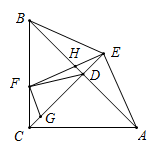

# Mathematics - 题目 3849

**ID**: deb6114e40b34357b7c218214f5f900a
**年级**: Grade 9
**难度**: Medium-Hard
**题型**: Calculation

## 题目
如图，在等腰Rt△ABC中，∠ACB＝90°，AC＝BC，CD⊥AB于点D，点E为CD延长线上一点，连接BE，AE，在BC上取一点F，使EF＝AE，过F点作FG⊥EF交CD于点G．（1）求证：AE⊥EF；​​​​​​​‌（2）连接DF，当DF＝GF时．求证：①DF∥BE；②求 $\frac {DH}{BH}$ 的值．

## 解答

1. 证明：（1）如图，过 $E$ 作 $EM\bot AC$ 于 $M,$  作 $EN\bot BC$ 于 $N,$
2. $\therefore \angle ENF=\angle EMA=90{}^\circ ,$
3. $\because AC=BC,\angle ACB=90{}^\circ ,CD\bot AB,$
4. $\therefore CD$ 平分 $\angle ACB,$   $EN=EM,$  四边形 $CNEM$ 为正方形，
5. $\therefore \angle NEM=90{}^\circ ,$
6. $\because EF=AE,$
7. $\therefore Rt\vartriangle ENF≌Rt\vartriangle EMA\left ({HL}\right )$
8. $\therefore \angle NEF=\angle MEA,$
9. 
10. $\because \angle NEM=90{}^\circ =\angle NEF+\angle FEM,$
11. $\therefore \angle FEM+\angle MEA=90{}^\circ =\angle FEA,$
12. $\therefore EF\bot EA.$
13. （2）①如图， $\because AC=BC,\angle ACE=\angle BCE,CE=CE,$
14. $\therefore \vartriangle ACE≌\vartriangle BCE,$
15. $\therefore \angle BEC=\angle AEC,BE=AE,$
16. $\because EF\bot FG,EF\bot AE,$
17. $\therefore FG{\rm{/}}{\rm{/}}AE,$
18. $\therefore \angle FGE=\angle AEC,$
19. 
20. $\therefore \angle BEG=\angle FGE,$
21. $\because DF=GF,$
22. $\therefore \angle FGE=\angle FDG,$
23. $\therefore \angle FDG=\angle BEC,$
24. $\therefore FD{\rm{/}}{\rm{/}}BE.$
25. ②如图，过 $E$ 作 $EM\bot AC$ 于 $M,$  作 $EN\bot BC$ 于 $N,$
26. 由（1）得：四边形 $ENCM$ 为正方形， $Rt\vartriangle ENF≌Rt\vartriangle EMA\left ({HL}\right )$ ，
27. $\therefore NC=CM=EM=EN,NF=AM,$
28. 由①得： $BE=AE,$  而 $EF=AE,$
29. $\therefore BN=NF=AM,$
30. 设 $BN=NF=AM=x,AC=BC=a,$
31. 则 $CM=EM=a-x,CE=\sqrt {2}\left ({a-x}\right ),CD=\frac {1}{2}AB=\frac {\sqrt {2}}{2}a,CF=a-2x,$
32. 
33. $\therefore DE=\sqrt {2}\left ({a-x}\right )-\frac {\sqrt {2}}{2}a=\frac {\sqrt {2}}{2}a-\sqrt {2}x,$
34. $\because FD{\rm{/}}{\rm{/}}BE,$
35. $\therefore \frac {CF}{BF}=\frac {CD}{DE},\vartriangle DFH∽\vartriangle BEH,$
36. $\therefore \frac {a-2x}{2x}=\frac {\frac {\sqrt {2}}{2}a}{\frac {\sqrt {2}}{2}a-\sqrt {2}x},$
37. $\therefore 4x{^{2}}-6ax+a{^{2}}=0,$
38. $\therefore x{{}_{1}}=\frac {3-\sqrt {5}}{4}a,x{{}_{2}}=\frac {3+\sqrt {5}}{4}a$ ，
39. 经检验： $x{{}_{1}}=\frac {3-\sqrt {5}}{4}a,x{{}_{2}}=\frac {3+\sqrt {5}}{4}a$ 都是原方程的根，但 $x{{}_{2}}=\frac {3+\sqrt {5}}{4}a$ 舍去，
40. $\therefore CF=a-2x=\frac {\sqrt {5}-1}{2}a,$
41. $\because \vartriangle DFH∽\vartriangle BEH,$  $FG=DF,EF=BE,$
42. $\therefore \frac {DF}{BE}=\frac {DH}{BH}=\frac {FG}{EF}={\tan}\angle FEG,$
43. $\because \angle ACF=\angle AEF=90{}^\circ ,$  连接 $AF,$  取 $AF$ 的中点 $O,$  连接 $OC,OF,$
44. $\therefore OC=OF=OA=OE,$
45. $\therefore A,C,F,E$ 四点在同一个圆上，
46. $\therefore \angle FEG=\angle FAC,$
47. $\therefore {\tan}\angle FEG={\tan}\angle FAC=\frac {CF}{CA}=\frac {\frac {\sqrt {5}-1}{2}a}{a}=\frac {\sqrt {5}-1}{2}.$
48. $\therefore \frac {DH}{BH}=\frac {\sqrt {5}-1}{2}.$

## 知识点

**中文**:
  - 确定圆的条件

**English**:
  - Conditions to Determine a Circle

---
