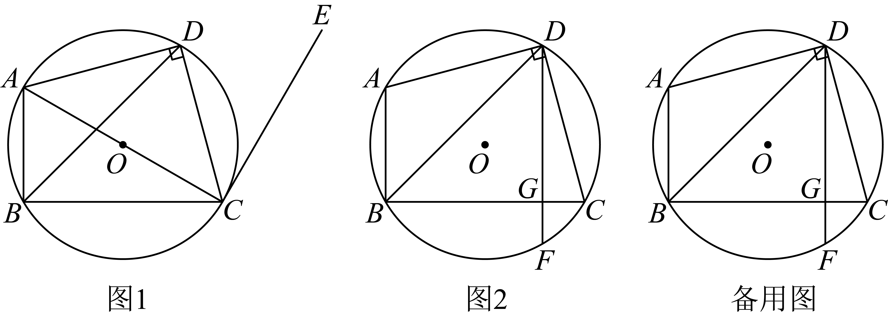

# Mathematics - 题目 2058

**ID**: df7574173c4f47839ea40c2bcc23a1cf
**年级**: Grade 9
**难度**: Medium-Hard
**题型**: Calculation

## 题目
已知四边形 $ABCD$ 内接于 $\odot O，∠ADC=90{^{\circ }}$ ，连接 $BD$ ．（1）如图，线段 $CB$ 绕点 $C$ 顺时针旋转 $α\left ({0{^{\circ }}<α<180{^{\circ }}}\right )$ 得到线段 $CE$ ，当 $\angle DCE=\angle DBC$ ，求证：直线 $CE$ 与 $\odot O$ 相切；​​​​​​​‌（2）如图，点 $F$ 为 $\odot O$ 上一点， $DF\bot BC$ 于 $G$ 点， $\odot O$ 的半径为 $3{\rm{c}}{\rm{m}}$ ，①求 $\overset{\frown}{{BF}}+\overset{\frown}{{CD}}$ ；②若 $\angle BDC=60{^{\circ }}$ ，过点 $B$ 作 $BM\bot CD$ ，垂足为 $M$ ， $BM$ 交 $FD$ 于点 $N$ ，连接 $ON$ ，补全图形，探究 $\angle NOC$ 和 $\angle BDF$ 之间的数量关系，并说明理由．

## 解答

1. （1）证明：∵ $\angle ADC=90{}\degree $ ，
2. ∴ $AC$ 为直径， $\angle DAC+\angle DCA=90{}\degree $ .
3. ∵ $\angle DBC=\angle DAC,\angle DCE=\angle DBC$ ，
4. ∴ $\angle DCE=\angle DAC$ ，
5. ∴ $\angle ACE=\angle DCE+\angle DCA=\angle DAC+\angle DCA=90{}\degree $ ，
6. ∴ $AC\bot CE$ ，
7. ∴ $CE$ 与 $\odot O$ 相切；
8. （2）解：①连接 $AC$ ， $OD$ ， $OB$ ， $OF$ ，如下图，
9. 
10. ∵ $\angle ADC=90{}\degree $ ，
11. ∴ $AC$ 为直径，
12. ∴ $A,O,C$ 在一条直线上.
13. ∵ $DF\bot BC$ ，
14. ∴ $\angle DGB=90{}\degree $ ，
15. ∴ $\angle CBD+\angle BDF=90{}\degree $ ，
16. ∵ $\angle COD=2\angle CBD,\angle BOF=2\angle BDF$ ，
17. ∴ $\angle COD+\angle BOF=2\angle CBD+2\angle BDF=2(\angle CBD+\angle BDF)=180{}\degree $ ，
18. ∴ $\overset{\frown}{{BF}}+\overset{\frown}{{CD}}=\frac {180}{180}\times \mathrm{π}\times 3=3\mathrm{π}\left ({{\rm{c}}{\rm{m}}}\right )$ ；
19. ② $\angle BDF=60{}\degree -\angle NOC$ .
20. 理由如下：
21. 连接 $AC$ 交 $DF$ 于 $H$ ，连接 $OD$ ，
22. 
23. ∵ $\angle ADC=\angle BMC=90{}\degree $ ，
24. ∴ $AD{\rm{/\mskip-4mu/}}BM$ .
25. ∵ $\angle ABC=90{}\degree {\rm{，}}\angle DGC=90{}\degree $ ，
26. ∴ $\angle ABC=\angle DGC$
27. ∴ $AB{\rm{/\mskip-4mu/}}DF$ .
28. ∵ $AD{\rm{/\mskip-4mu/}}BN,AB{\rm{/\mskip-4mu/}}DN$ ,
29. ∴四边形 $ABND$ 是平行四边形，
30. ∴ $AB=DN$ .
31. ∵ $\angle BAC=60{}\degree $ ，
32. ∴ $AB=AC·\cos \angle CAB=AC·\cos 60{}\degree =\frac {1}{2}AC=OA=OC=OD$ ，
33. ∴ $DN=OD$ ，
34. ∴ $\angle DON=\angle DNO$ .
35. ∵ $AB{\rm{/\mskip-4mu/}}DF$ ，
36. ∴ $\angle DHA=\angle BAC=60{}\degree $ ，
37. ∴ $\angle DNO=\angle NOH+\angle NHO=\angle NOC+\angle DHA=\angle NOC+60{}\degree $ ，
38. ∴ $\angle DON=\angle NOC+60{}\degree $ ，
39. ∴ $\angle DOC=\angle DON+\angle NOC=2\angle NOC+60{}\degree $ .
40. ∵ $\angle COD+\angle BOF=180{}\degree $ ，
41. ∴ $\angle BOF=180{}\degree -\angle COD=180{}\degree -(2\angle NOC+60{}\degree )=120{}\degree -2\angle NOC$ ，
42. ∴ $\angle BDF=\frac {1}{2}\angle BOF=\frac {1}{2}\times (120{}\degree -2\angle NOC)=60{}\degree -\angle NOC$ .

## 知识点

**中文**:
  - 90°的圆周角所对的弦是直径
  - 切线的判定定理
  - 弧长公式

**English**:
  - Chord of 90° Inscribed Angle is Diameter
  - Tangent Determination Theorem
  - Arc Length Formula

---
