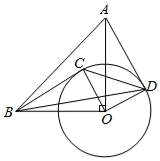

# Mathematics - 题目 731

**ID**: e1ce5e0a810846798af84a7450179c85
**年级**: Grade 9
**难度**: Medium-Hard
**题型**: Calculation

## 题目
如图，在Rt△OAB中，∠AOB＝90°，OA＝OB＝4，以点O为圆心、2为半径画圆，点C是⊙O上任意一点，连接BC，OC．将OC绕点O按顺时针方向旋转90°，交⊙O于点D，连接AD．（1）当AD与⊙O相切时，①求证：BC是⊙O的切线；​​​​​​​‌②求点C到OB的距离．（2）连接BD，CD，当△BCD的面积最大时，点B到CD的距离为．

## 解答

1. （1）①证明：∵AD与⊙O相切，
2. ∴∠ADO＝90°，
3. ∵∠AOB＝∠COD＝90°，
4. ∴∠AOB﹣∠AOC＝∠COD﹣∠AOC，即∠COB＝∠AOD，
5. ∵OB＝OA，OC＝OD，
6. ∴△BOC≌△AOD（SAS）．
7. ∴∠BCO＝∠ADO＝90°．
8. ∴BC是⊙O的切线；
9. ②如图：
10. 
11. 过点C作CE⊥OB，垂足为E，则CE即为点C到OB的距离，
12. 在Rt△BOC中，∵OB＝4，OC＝2，
13. ∴BC= ${\rm \sqrt {OB{^{2}}-OC{^{2}}}=\sqrt {4{^{2}}-2{^{2}}}=2\sqrt {3}}$ ，
14. ∴OB▪CE＝BC▪OC，即4CE＝2×2 $\sqrt {3}$ ，CE＝ $\sqrt {3}$ ．
15. ∴点C到OB的距离是 $\sqrt {3}$ ；
16. （2）当点C在⊙O上运动到△BCD是等腰三角形，且BO的延长线与CD垂直位置时，
17. △BCD的面积最大（如图2），
18. 
19. 此时OB＝4，OC＝OD＝2，
20. ∵△COD是等腰直角三角形，
21. ∴ ${\rm OF=OC\cdot {\sin}45{^{0}}=2\times \frac {\sqrt {2}}{2}=\sqrt {2}}$ ，
22. ∴ ${\rm BF=4+\sqrt {2}}$ ．
23. 故答案为4+ $\sqrt {2}$ ．

## 知识点

**中文**:
  - 三角函数综合
  - 圆的综合问题

**English**:
  - Comprehensive Trig Problems
  - Comprehensive Circle Problems

---
