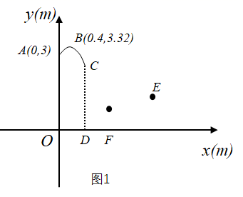
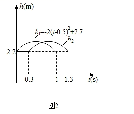

# Mathematics - 题目 1890

**ID**: e43a4c927a22441b98705ada74e1a0c4
**年级**: Grade 9
**难度**: Medium-Hard
**题型**: Calculation

## 题目
在篮球比赛中，东东投出的球在点A处反弹，反弹后球运动的路线为抛物线的一部分（如图1所示建立直角坐标系），抛物线顶点为点B．（1）求该抛物线的函数表达式．（2）当球运动到点C时被东东抢到，CD⊥x轴于点D，CD＝2.​​​​​​​‌6m．①求OD的长．②东东抢到球后，因遭对方防守无法投篮，他在点D处垂直起跳传球，想将球沿直线快速传给队友华华，目标为华华的接球点E（4，1.3）．东东起跳后所持球离地面高度h_{1}（m）（传球前）与东东起跳后时间t（s）满足函数关系式h_{1}＝﹣2（t﹣0.5）^{2}+2.7（0⩽t⩽1）；小戴在点F（1.5，0）处拦截，他比东东晚0.3s垂直起跳，其拦截高度h_{2}（m）与东东起跳后时间t（s）的函数关系如图2所示（其中两条抛物线的形状相同）．东东的直线传球能否越过小戴的拦截传到点E？若能，东东应在起跳后什么时间范围内传球？若不能，请说明理由（直线传球过程中球运动时间忽略不计）．

## 解答

1. 解：（1）设y＝a（x﹣0.4）^{2}+3.32（a≠0），
2. 把x＝0，y＝3代入，解得a＝﹣2，
3. ∴抛物线的函数表达式为y＝﹣2（x﹣0.4）^{2}+3.32．
4. （2）①把y＝2.6代入y＝﹣2（x﹣0.4）^{2}+3.32，
5. 化简得（x﹣0.4）^{2}＝0.36，
6. 解得x_{1}＝﹣0.2（舍去），x_{2}＝1，
7. ∴OD＝1m．
8. ②东东的直线传球能越过小戴的拦截传到点E．
9. 由图1可得，当0⩽t⩽0.3时，h_{2}＝2.2．
10. 
11. 当0.3＜t⩽1.3时，h_{2}＝﹣2（t﹣0.8）^{2}+2.7．
12. 当h_{1}﹣h_{2}＝0时，t＝0.65，
13. 东东在点D跳起传球与小戴在点F处拦截的示意图如图2，
14. 设MD＝h_{1}，NF＝h_{2}，
15. 当点M，N，E三点共线时，过点E作EG⊥MD于点G，交NF于点H，过点N作NP⊥MD于点P，
16. 
17. ∴MD∥NF，PN∥EG，
18. ∴∠M＝∠HEN，∠MNP＝∠NEH，
19. ∴△MPN∽△NEH，
20. ∴ $\frac {MP}{PN}=\frac {NH}{HE}$ ，
21. ∵PN＝0.5，HE＝2.5，
22. ∴NH＝5MP．
23. （Ⅰ）当0⩽t⩽0.3时，
24. MP＝﹣2（t﹣0.5）^{2}+2.7﹣2.2＝﹣2（t﹣0.5）^{2}+0.5，
25. NH＝2.2﹣1.3＝0.9．
26. ∴5[﹣2（t﹣0.5）^{2}+0.5]＝0.9，
27. 整理得（t﹣0.5）^{2}＝0.16，
28. 解得 $t{{}_{1}}=\frac {9}{10}$ （舍去）， $t{{}_{1}}=\frac {1}{10}$ ，
29. 当0⩽t⩽0.3时，MP随t的增大而增大，
30. ∴ $\frac {1}{10}<t\leqslant \frac {3}{10}$ ．
31. （Ⅱ）当0.3＜t⩽0.65时，MP＝MD﹣NF＝﹣2（t﹣0.5）^{2}+2.7﹣[﹣2（t﹣0.8）^{2}+2.7]＝﹣1.2t+0.78，
32. NH＝NF﹣HF＝﹣2（t﹣0.8）^{2}+2.7﹣1.3＝﹣2（t﹣0.8）^{2}+1.4，
33. ∴﹣2（t﹣0.8）^{2}+1.4＝5×（﹣1.2t+0.78），
34. 整理得t^{2}﹣4.6t+1.89＝0，
35. 解得， $t{{}_{1}}=\frac {23+2\sqrt {85}}{10}$ （舍去）， $t{{}_{2}}=\frac {23-2\sqrt {85}}{10}$ ，
36. 当0.3＜t⩽0.65时，MP随t的增大而减小，
37. ∴ $\frac {3}{10}<t<\frac {23-2\sqrt {85}}{10}$ ．
38. （Ⅲ）当0.65＜t⩽1时，h_{1}＜h_{2}，不可能．
39. 给上所述，东东在起跳后传球的时间范围为 $\frac {1}{10}<t<\frac {23-2\sqrt {85}}{10}$ ．

## 知识点

**中文**:
  - 待定系数法求二次函数解析式
  - 投球问题

**English**:
  - Finding Quadratic Expressions by Undetermined Coefficients
  - Projectile Problems

---
