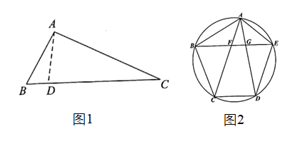

# Mathematics - 题目 2335

**ID**: e5213d96aa694677bb2e56348edc2817
**年级**: Grade 9
**难度**: Medium-Hard
**题型**: Calculation

## 题目
定义：若一个三角形存在两个内角之差是第三个内角的两倍，则称这个三角形为关于第三个内角的“差倍角三角形”．例如，在 $ΔABC$ 中， $\angle A=100{}^\circ $ ， $\angle B=60{}^\circ $ ， $\angle C=20{}^\circ $ ，满足 $\angle A-\angle B=2\angle C$ ，所以 $ΔABC$ 是关于 $\angle C$ 的“差倍角三角形”．（1）若等腰 $ΔABC$ 是“差倍角三角形”，求等腰三角形的顶角 $\angle A$ 的度数；​​​​​​​‌（2）如图1， $ΔABC$ 中， $AB=3$ ， $AC=8$ ， $BC=9$ ，小明发现这个 $ΔABC$ 是关于 $\angle C$ 的“差倍角三角形”．他的证明方法如下：证明：在 $BC$ 上取点 $D$ ，使得 $BD=1$ ，连结 $AD$ ，（请你完成接下去的证明）（3）如图2，五边形 $ABCDE$ 内接于圆，连结 $AC$ ， $AD$ 与 $BE$ 相交于点 $F$ ， $G$ ， $\overset ⌢{{AB}}=\overset ⌢{{BC}}=\overset ⌢{{DE}}$ ， $\Delta ABE$ 是关于 $\angle AEB$ 的“差倍角三角形”．①求证：四边形 $CDEF$ 是平行四边形；②若 $BF=1$ ，设 $AB=x$ ， $y=\frac {S{{}_{四边形CDEF}}}{S{{}_{ΔAEG}}}$ ，求 $y$ 关于 $x$ 的函数关系式．

## 解答

1. 解：（1）设等腰三角形的顶角∠A为2x，则等腰三角形的底角为90°-x，
2. ∵等腰△ABC是“差倍角三角形”，
3. ∴90°-x-2x=2×2x，
4. ∠A=2x=108°，
5. ∴顶角∠A的度数为108°；
6. （2）∵ $AB=3$ ， $BD=1$ ， $BC=9$ ，
7. ∴ $\frac {AB}{BC}=\frac {BD}{AB}$ ．
8. 又∵ $\angle B=\angle B$ ，
9. ∴ $\Delta BAD∽\Delta BCA$ ．
10. ∴ $\angle BAD=\angle C$ ．
11. 设 $\angle BAD=\angle C=α$ ．
12. ∵ $CA=CD=8$ ，
13. ∴ $\angle DAC=\angle ADC=90{}^\circ -\frac {1}{2}α$ ．
14. ∴ $\angle B=90{}^\circ -\frac {3}{2}α$ ， $\angle BAC=90{}^\circ +\frac {1}{2}α$ ．
15. ∴ $\angle BAC-\angle B=2\angle C$ ．
16. ∴ $ΔABC$ 是差倍角三角形．
17. （3）①证明：连结 $CE$ ，
18. ∵ $\overset ⌢{{BC}}=\overset ⌢{{DE}}$ ，
19. ∴ $\angle ECD=\angle BEC$ ，
20. ∴ $BE\mathrm{/\mskip-4mu/}CD$ ．
21. ∵ $\overset ⌢{{AB}}=\overset ⌢{{BC}}=\overset ⌢{{DE}}$ ，
22. ∴ $\angle AEB=\angle BAC=\angle DAE$ ．
23. ∵ $\Delta ABE$ 是关于 $\angle AEB$ 的差倍角三角形，
24. ∴ $\angle FAG=\angle BAE-\angle BAC-\angle DAE=\angle BAE-2\angle AEB=\angle ABE$ ．
25. ∴ $\angle FAG=\angle ABE=\angle ADE$ ．
26. ∴ $AC//DE$ ．
27. ∴四边形 $CDEF$ 是平行四边形
28. ②∵∠BAF=∠AEB，∠ABF=∠EBA，
29. ∴△ABF∽△EBA，
30. ∴ $\frac {AB}{BE}=\frac {BF}{AB}=\frac {AF}{AE}$ ，
31. ∴ $BE=\frac {AB{^{2}}}{BF}=\frac {x{^{2}}}{1}=x{^{2}}$ ，
32. ∴EF=BE-BF=x^{2}-1，
33. ∵四边形CDEF是平行四边形，
34. ∴CD=EF=x^{2}-1，
35. ∵ $\overset ⌢{{AE}}=\overset ⌢{{CD}}$ ，
36. ∴AE=CD=x^{2}-1，
37. ∴ $AF=\frac {AB\cdot AE}{BE}=\frac {x(x{^{2}}-1)}{x{^{2}}}=\frac {x{^{2}}-1}{x}$ ，
38. 过点B作BM⊥AC于M，EN⊥AC于N，
39. 
40. ∴BM∥EN，
41. ∴△BFM∽△EFN，
42. ∴ $\frac {BM}{EN}=\frac {BF}{EF}=\frac {1}{x{^{2}}-1}$ ，
43. ∴ $BM=\frac {1}{x{^{2}}-1}EN$
44. 过点G作GH⊥AE于H，
45. ∵∠BAC=ACB=∠AEG=∠EAG，
46. ∴△ABC∽△AGE，
47. ∴ $\frac {BM}{GH}=\frac {AC}{AE}$ ，
48. ∴ $\frac {\frac {1}{x{^{2}}-1}EN}{GH}=\frac {x{^{2}}-1}{GH}=\frac {2x{^{2}}-1}{x{^{2}}-1}=\frac {x}{x(x{^{2}}-1)}$ ，
49. ∴ $\frac {EN}{GH}=\frac {2x{^{2}}-1}{x}$ ，
50. ∴ $y=\frac {S{{}_{四边形}}{{}_{CDEF}}}{S{{}_{ΔAEG}}}=\frac {DE\cdot EN}{\frac {1}{2}AE\cdot GH}=\frac {2DE}{AE}\cdot \frac {EN}{GH}=\frac {2x}{x{^{2}}-1}\cdot \frac {2x{^{2}}-1}{x}=\frac {4x{^{2}}-2}{x{^{2}}-1}$ ．

## 知识点

**中文**:
  - 图形问题
  - 平行四边形的判定与性质
  - 圆的综合问题
  - 相似三角形的判定与性质综合

**English**:
  - Geometric Problems
  - Determination and Properties
  - Comprehensive Circle Problems
  - Determination and Properties

---
