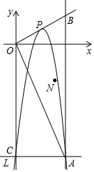

# Mathematics - 题目 1089

**ID**: e5ce611438aa43d5aad4fc210ffff8e3
**年级**: Grade 9
**难度**: Medium-Hard
**题型**: Calculation

## 题目
如图，点P为抛物线L：y＝a（x﹣2）（x﹣4）（其中a为常数，且a＜0）的顶点，L与y轴交于点C，过点C作x轴的平行线，与L交于点A，过点A作x轴的垂线，与射线OP交于点B，连接OA（1）a＝﹣2时，点P的坐标是，点B的坐标是；​​​​​​​‌（2）是否存在a的值，使OA＝OB？若存在，求出a的值；若不存在，请说明理由（3）若△OAB的外心N的坐标为（p，q），则①当点N在△OAB内部时，求a的取值范围；②用a表示外心N的横坐标p和纵坐标q，并求p与q的关系式（不写q的取值范围）．

## 解答

1. 解：（1）∵a＝﹣2
2. ∴抛物线L：y＝﹣2（x﹣2）（x﹣4）＝﹣2x^{2}+12x﹣16＝﹣2（x﹣3）^{2}+2
3. ∴顶点P（3，2），C（0，﹣16）
4. ∴直线OP解析式为：y＝ $\frac {2}{3}$ x
5. ∵AC∥x轴
6. ∴y_{A}＝y_{C}＝﹣16，A、C关于直线x＝3对称
7. ∴A（6，﹣16）
8. ∵AB⊥x轴
9. ∴x_{B}＝x_{A}＝6
10. ∴y_{B}＝ $\frac {2}{3}$ ×6＝4，即B（6，4）
11. 故答案为：（3，2）；（6，4）．
12. （2）不存在a的值使OA＝OB，理由如下：
13. ∵抛物线L：y＝a（x﹣2）（x﹣4）＝ax^{2}﹣6ax+8a＝a（x﹣3）^{2}﹣a
14. ∴顶点P（3，﹣a），C（0，8a）
15. ∴直线OP解析式为：y＝﹣ $\frac {{\rm{a}}}{3}$ x
16. ∴A（6，8a）
17. ∴y_{B}＝﹣ $\frac {{\rm{a}}}{3}$ ×6＝﹣2a
18. ∵a≠0
19. ∴|y_{A}|≠y_{B}，即x轴不平分AB
20. ∴OA≠OB
21. （3）①∵△OAB的外心N在其内部
22. ∴△OAB是锐角三角形
23. ∴∠AOB<90°
24. ∴OA^{2}+OB^{2}>AB^{2}
25. ∵A（6，8a），B（6，﹣2a）
26. ∴6^{2}+（8a）^{2}+6^{2}+（﹣2a）^{2}>（8a+2a）^{2}
27. 解得：﹣ $\frac {3}{2}$ <a<0
28. ②∵外心N在AB的垂直平分线上，AB⊥x轴
29. ∴q＝ $\frac {-2a+8a}{2}$ ＝3a
30. ∴N（p，3a），a＝ $\frac {q}{3}$
31. ∵ON＝AN，即ON^{2}＝AN^{2}
32. ∴p^{2}+（3a）^{2}＝（6﹣p）^{2}+（8a﹣3a）^{2}
33. 整理得：p＝ $\frac {4}{3}$ a^{2}+3
34. 把a＝ $\frac {q}{3}$ 代入得：p＝ $\frac {4}{27}$ q^{2}+3．

## 知识点

**中文**:
  - 三角形内切圆与外接圆综合
  - 图形问题
  - 几何问题

**English**:
  - Incircle and Circumcircle
  - Geometric Problems
  - Geometry Problems

---
