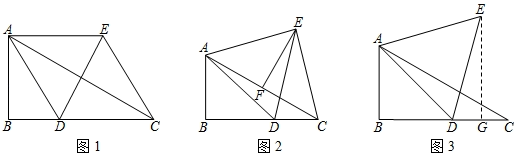

# Mathematics - 题目 1828

**ID**: e768d45feeea44b6b76aa6728be21d3b
**年级**: Grade 9
**难度**: Medium-Hard
**题型**: Calculation

## 题目
已知：在Rt△ABC中，∠B=90°，∠ACB=30°，点D为BC边上一动点，以AD为边，在AD的右侧作等边三角形ADE．（1）当AD平分∠BAC时，如图1，四边形ADCE是形；​​​​​​​‌（2）过E作EF⊥AC于F，如图2，求证：F为AC的中点；（3）若AB=2，①当D为BC的中点时，过点E作EG⊥BC于G，如图3，求EG的长；②点D从B点运动到C点，则点E所经过路径长为．(直接写出结果)

## 解答

1. 解：（1）在Rt△ABC中，∠B=90°，∠ACB=30°，
2. ∴∠BAC=60°．
3. ∵AD平分∠BAC，
4. ∴∠BAD=∠DAC=30°．
5. ∵△ADE为等边三角形，
6. ∴∠DAE=60°，
7. ∴∠EAC=30°，
8. ∴∠EAC=∠ACB，∠DAC=∠ACB，
9. ∴AE∥DC，AD=DC．
10. ∵AE=AD，∴AE=CD，
11. ∴四边形ADCE为平行四边形．
12. ∵AD=AE，
13. ∴平行四边形ADCE为菱形．
14. 
15. 故答案为：菱形；
16. （2） $\because \angle BAC=\angle DAE=60{}^\circ ,$
17. $\therefore \angle BAD=\angle FAE,$
18. 在△BAD和△FAE中，
19. $\begin{cases}\angle BAD=\angle FAE\\\angle ABD=\angle AFE=90{}^\circ \\AD=AE\end{cases}$ ，
20. ∴△BAD≌△FAE(AAS)，
21. ∴AB=AF，
22. 在Rt△ABC中，∠B=90°，∠ACB=30°，
23. ∴AC=2AB，
24. ∴AC=2AF，
25. ∴F为AC的中点；
26. 
27. （3）①如图3，作EF⊥AC于F，连接EC，
28. 
29. 在Rt△ABC中，∠B=90°，∠ACB=30°，
30. ∴AC=2AB=4，
31. ∴BC$=\sqrt {AC{^{2}}-AB{^{2}}}=$ 2 $\sqrt {3}$ ，
32. ∵D为BC的中点，
33. ∴BD$=\frac {1}{2}$BC$=\sqrt {3}$ ，
34. ∴AD$=\sqrt {AB{^{2}}+BD{^{2}}}=\sqrt {7}$ ，
35. ∵AF=FC，EF⊥AC，
36. ∴EC=AE=AD$=\sqrt {7}$ ，
37. ∵EC=EA=ED，EG⊥DC，
38. ∴CG$=\frac {1}{2}$CD$=\frac {\sqrt {3}}{2}$ ，
39. ∴EG$=\sqrt {EC{^{2}}-CG{^{2}}}=\frac {5}{2}$ ；
40. ②如图4，当点D与点B重合时，点E在E'处，点E'是AC中点；
41. 当点D与点C重合时，点E在E''处，其中△ACE''是等边三角形，
42. 由（1）得：AE=CE，∴点E始终落在线段AC的垂直平分线上，
43. ∴E'E''垂直平分AC，
44. ∴点E的运动路径是从AC的中点E'，沿着AC垂直平分线运动到E''处，
45. 在△E'AE''和△BAC中，
46. $\begin{cases}\angle CAB=\angle E^{′′}AE^{′}\\\angle ABC=\angle AE^{′}E^{′′}\\AC=AE^{′′}\end{cases}$ ，
47. ∴△E'AE''≌△BAC(AAS)，
48. ∴E'E''=BC=2 $\sqrt {3}$ ．
49. 故答案为：2 $\sqrt {3}$ ．
50. 

## 知识点

**中文**:
  - 等边三角形的判定与性质
  - 角角边(AAS)
  - 菱形的判定
  - 线段垂直平分线的性质

**English**:
  - Determination and Properties
  - AAS (Angle-Angle-Side)
  - Determination of Rhombuses
  - Properties of Perpendicular Bisectors

---
