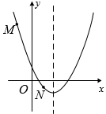

# Mathematics - 题目 1784

**ID**: e77e1827b8184c5b8e12f89708deb46c
**年级**: Grade 9
**难度**: Medium-Hard
**题型**: Calculation

## 题目
如图，已知点 $M\left ({x{{}_{1}},y{{}_{1}}}\right ),N\left ({x{{}_{2}},y{{}_{2}}}\right )$ 在二次函数 $y=a(x-2){^{2}}-1(a>0)$ 的图象上，且 $x{{}_{2}}-x{{}_{1}}=3$ ．（1）若二次函数的图象经过点 $(3,1)$ ．①求这个二次函数的表达式；​​​​​​​‌②若 $y{{}_{1}}=y{{}_{2}}$ ，求顶点到 $MN$ 的距离；（2）当 $x{{}_{1}}\leqslant x\leqslant x{{}_{2}}$ 时，二次函数的最大值与最小值的差为1，点M，N在对称轴的异侧，求a的取值范围．

## 解答

1. （1）解：①将点 $(3,1)$ 代入 $y=a(x-2){^{2}}-1(a>0)$ 中，
2. ∴ $1=a(3-2){^{2}}-1$ ，解得 $a=2$ ，
3. ∴二次函数的表达式为： $y=2(x-2){^{2}}-1=2x{^{2}}-8x+7$ ；
4. ②当 $y{{}_{1}}=y{{}_{2}}$ 时，此时 $MN$ 为平行x轴的直线，
5. 将 $M\left ({x{{}_{1}},y{{}_{1}}}\right )$ 代入二次函数中得到： $y{{}_{1}}=2x{{}_{1}}{^{2}}-8x{{}_{1}}+7$ ，
6. 将 $\mathbf{N}\left ({x{{}_{2}},y{{}_{2}}}\right )$ 代入二次函数中得到： $y{{}_{2}}=2x{{}_{2}}{^{2}}-8x{{}_{2}}+7$ ，
7. ∵ $y{{}_{1}}=y{{}_{2}}$ ，
8. ∴ $2x{{}_{1}}{^{2}}-8x{{}_{1}}+7{\rm =}$  $2x{{}_{2}}{^{2}}-8x{{}_{2}}+7$ ，
9. 整理得到： $(x{{}_{1}}+x{{}_{2}})(x{{}_{1}}-x{{}_{2}})-4(x{{}_{1}}-x{{}_{2}})=0$ ，
10. 又∵ $x{{}_{2}}-x{{}_{1}}=3$ ，代入上式得到： $x{{}_{2}}+x{{}_{1}}=4$ ，解出 $x{{}_{1}}=\frac {1}{2},x{{}_{2}}=\frac {7}{2}$ ，
11. ∴ $y{{}_{2}}=y{{}_{1}}=2\times (\frac {1}{2}){^{2}}-8\times \frac {1}{2}+7=\frac {7}{2}$ ，即直线 $MN$ 为： $y=\frac {7}{2}$ ，
12. 又 $\because $ 二次函数的顶点坐标为(2，−1)，
13. ∴顶点(2,−1)到 $MN$ 的距离为 $\frac {7}{2}+1=\frac {9}{2}$ ；
14. （2）解：若M，N在对称轴的异侧， $y{{}_{1}}\geqslant y{{}_{2}}$ ，
15. ∴x_{1}+3>2，
16. ∴x_{1}>−1，
17. ∵ $x{{}_{2}}-x{{}_{1}}=3$
18. ∴ $x{{}_{1}}\leqslant \frac {1}{2}$ ，
19. ∴−1< $x{{}_{1}}\leqslant \frac {1}{2}$ ，
20. ∵函数的最大值为y_{1}=a（x_{1}−2）^{2}−1，最小值为−1，
21. ∴y-（−1）=1，
22. ∴ ${\rm \mathit{a}=}\frac {1}{{\left({x{{}_{1}}-2}\right)^{2}}}$ ，
23. ∴ $\frac {9}{4}\leqslant {\left({x{{}_{1}}-2}\right)^{2}}<9$ ，
24. ∴ $\frac {1}{9}<a\leqslant \frac {4}{9}$ ；
25. 若M、N在对称轴的异侧， $y{{}_{1}}\leqslant y{{}_{2}}{\rm ，\mathit{x}\mathit{_{1}}}$ <2，
26. ∵ $x{{}_{1}}>\frac {1}{2}$ ，
27. ∴ $\frac {1}{2}<x{{}_{1}}<2$ ，
28. ∵函数的最大值为y=a（x_{2}−2）^{2}−1，最小值为−1，
29. ∴y-（−1）=1，
30. ∴ ${\rm \mathit{a}=}\frac {1}{{\left({x{{}_{1}}+1}\right)^{2}}}$ ，
31. ∴ $\frac {9}{4}<{\left({x{{}_{1}}+1}\right)^{2}}<9$ ，
32. ∴ $\frac {1}{9}<a<\frac {4}{9}$ ，
33. 综上所述，a的取值范围为 $\frac {1}{9}<a\leqslant \frac {4}{9}$ ．

## 知识点

**中文**:
  - y=a（x-h）²+k的图象与性质
  - 二次函数的最值
  - 待定系数法求二次函数解析式

**English**:
  - Graph and Properties of y=a(x-h)²+k
  - Maximum/Minimum of Quadratic Functions
  - Finding Quadratic Expressions by Undetermined Coefficients

---
