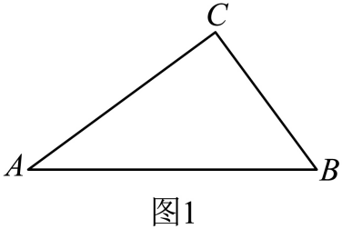
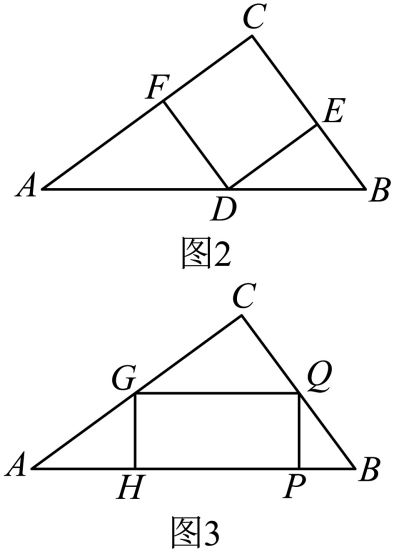
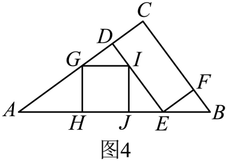

# Mathematics - 题目 3525

**ID**: e904ff0a6bee4066ab32045be8b4da46
**年级**: Grade 9
**难度**: Medium-Hard
**题型**: Calculation

## 题目
探究不同裁剪方式的面积大小问题素材1图1是一张直角三角形纸板，两直角边分别为 $BC=15{\rm{c}}{\rm{m}}$ ， $AC=20{\rm{c}}{\rm{m}}$ ，小华、小明、小富同学分别用这样的纸板裁剪出不一样的矩形，并使矩形的四个顶点都在三角形的边上．素材2小华同学按图2的方式裁剪出一个正方形；小明同学按图3的方式裁剪，且 $AH=8{\rm{c}}{\rm{m}}$ ．素材3小富同学对纸板的裁剪按如下步骤：如图4，步骤1：在直角 $\vartriangle ABC$ 纸板上裁下一个矩形 $CDEF$ ，矩形的四个顶点都在 $\vartriangle ABC$ 的边上；步骤2：取剩下的纸板 $\vartriangle ADE$ 裁下一个正方形 $GHJI$ ，正方形的四个顶点都在 $\vartriangle ADE$ 边上；且满足矩形 $CDEF$ 的 $CF$ 边长是正方形 $GHJI$ 边长的两倍小 $0.​​​​​​​‌9{\rm{c}}{\rm{m}}$ ．问题解决任务1请比较小华、小明同学裁处的两种矩形的面积大小，通过计算说明．任务2请求出小富同学裁下的矩形 $CDEF$ 各边长．

## 解答

1. 解：任务一：小华：设正方形的边长为x， $AF=20-x$ ，
2. 由题意得 $\mathrm{△}AFD∽\mathrm{△}ACB$ ，
3. $\frac {x}{15}=\frac {20-x}{20}$ ，得 $x=\frac {60}{7}$ ，
4. $S{{}_{小华}}={\left({\frac {60}{7}}\right)^{2}}=\frac {3600}{49}$ ，
5. 小明：由题意得 $AB=\sqrt {20{^{2}}+15{^{2}}}=25$ ，
6. ∵ $\mathrm{△}AHG\mathrm{∽}\mathrm{△}ACB$ ，
7. $\therefore $  $\frac {8}{20}=\frac {GH}{15}$ ，得 $GH=6$ ，
8. ∵ $\mathrm{△}BPQ∽\mathrm{△}BCA$ ，
9. $\frac {PB}{15}=\frac {6}{20}$ ，得 $PB=\frac {9}{2}$ ，
10. $HP=25-8-\frac {9}{2}=\frac {25}{2}$ ，
11. $S{{}_{小明}}=6\times \frac {25}{2}=75$ ，
12. ∵ $75>\frac {3600}{49}$   ，
13. $\therefore $  $S{{}_{小明}}>S{{}_{小华}}$ ．
14. 任务二：由题意得 $\mathrm{△}AHG\mathrm{∽}\mathrm{△}ACB$ ，
15. $HG:AH:AG=3:4:5$ ，
16. 设： $AH=4x$ ， $HG=3x$ ， $AG=5x$ ，
17. 同理： $\mathrm{△}GDI∽\mathrm{△}ACB$ ，
18. $\therefore $  $\frac {GD}{20}=\frac {3x}{25}$ ，得 $GD=\frac {12}{5}x$ ，
19. $DE=CF=6x-0.9$ ，
20. $\therefore $  $AD=\frac {37}{5}x$ ，
21. ∵ $\vartriangle ADE∽\vartriangle ACB$ ，
22. $\frac {\frac {37}{5}x}{20}=\frac {6x-0.9}{25}$ ，得 $x=2$ ，
23. $AD=\frac {37}{5}\times 2=\frac {74}{5}$ ，
24. $\therefore $ 矩形 $CDEF$ 的边长为 $DE=6\times 2-0.9=\frac {111}{10}$ ； $CD=20-\frac {74}{5}=\frac {26}{5}$ ．

## 知识点

**中文**:
  - 相似三角形的实际应用

**English**:
  - Applications of Similar Triangles

---
