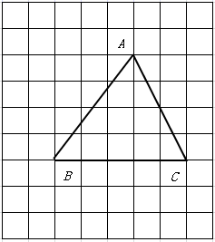

# Mathematics - 题目 3767

**ID**: e9127051771e417d99727d3734c04a01
**年级**: Grade 9
**难度**: Medium-Hard
**题型**: Calculation

## 题目
如图，在每个小正方形的边长为1的网格中，有 $\vartriangle ABC$ ，点 $A,B,C$ 都在格点上（I） $\vartriangle ABC$ 的面积等于；​​​​​​​‌（Ⅱ）求作其内接正方形，使其一边在 $BC$ 上，另两个顶点各在 $AB,AC$ 上在如图所示的网格中，请你用无刻度的直尺画出该正方形，并简要说明画图的方法（不要求证明）

## 解答

1. 解：（Ⅰ） $S{{}_{�ABC}}$ = $\frac {1}{2}\times 5\times 4=10$ ；
2. 故答案为 $10$ ；
3. （Ⅱ）首先计算此三角形中内接的最大的正方形的边长，然后找到AB，AC上分界点的比例关系，在构造相似三角形即可.然后再找到垂直与底边的两个边即可.
4. 设正方形边长为x，∵MN∥BC，则有 $\frac {MN}{PQ}{\rm{=}}\frac {AI}{AD}$  即 $\frac {x}{5}=\frac {4-x}{4}$  解得： $x=\frac {20}{9}$  ，则有 $\frac {AM}{AB}=\frac {AN}{AC}=\frac {4}{9}$  ,即  $\frac {AM}{MB}=\frac {AN}{NC}=\frac {4}{5}$
5. 
6. ∵AD=4,则在取B的正上方取E点使得BE=5，连接DE交AB于M，则M为所求,同理取格点F，连接 $DF$ 分别交 $AC$ 于点 $N$ .下面只需过M,N点作BC的垂线即可.可把A,B,C,D,E,F,M,N都向下平移一个单位长度得到点S,T,O,K,G,U,Q,V则易知MQ⊥MN，NV⊥MN, 连接 $MQ$ 并延长 $MQ$ 交 $BC$ 于点 $P$ ，同理得到点 $R$ ，四边形 $MPRN$ 即为所求的正方形.
7. 

## 知识点

**中文**:
  - 利用平移、轴对称、旋转、中心对称设计图案
  - 相似三角形的判定与性质综合

**English**:
  - Designing Patterns with Transformations
  - Determination and Properties

---
