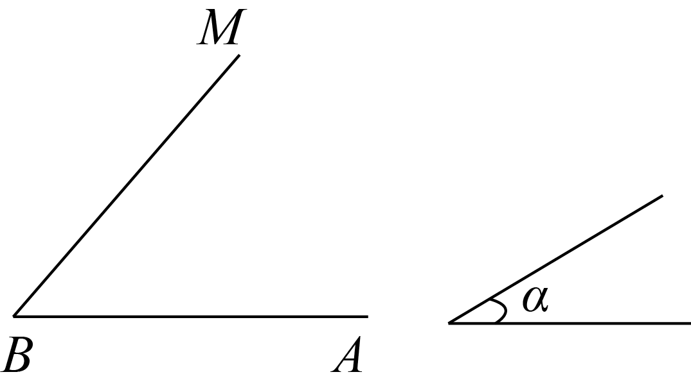

# Mathematics - 题目 3153

**ID**: e956d4f259004c88ad0682490ac300a2
**年级**: Grade 9
**难度**: Medium-Hard
**题型**: Calculation

## 题目
如图，已知线段AB， $\angle ABM=50{}^\circ $ 及 $\angle α=30{}^\circ $ ．(1)求作线段CE，使得点C在射线BM上，且 $\angle CAB=\angle α$ ，点E在线段AB上，且 $EC=EB$ ；​​​​​​​‌（要求：尺规作图，不写作法，保留作图痕迹）(2)在（1）的条件下，求证： $AC{^{2}}=AE\cdot AB$ ．

## 解答

1. (1)解：①以点O为圆心，任意长为半径交 $\angle α$ 与点P，Q；
2. 
3. ②以点A为圆心，OP为半径交AB于点F，
4. ③以点F为圆心，PQ的长为半径画弧交②中的弧与点H，
5. ④作射线AH交BM于点C，此时 $\angle CAB=30{}^\circ $
6. ∵ $EC=EB$ ，
7. ∴点E在线段BC的垂直平分线上，作线段BC的垂直平分线即可，
8. ⑤分别以B、C为圆心，大于 $\frac {1}{2}BC$ 为半径画弧交点G，K，
9. ⑥过点G，K作直线交AB于点E，连接CE即可．
10. 
11. (2)证明：∵ $\angle CAB=30{}^\circ $ ， $\angle ABM=50{}^\circ $ ，
12. ∴ $\angle BCA=180{}^\circ -30{}^\circ -50{}^\circ =100{}^\circ $ ，
13. ∵ $EC=EB$ ，
14. ∴ $\angle BCE=\angle ABM=50{}^\circ $ ，
15. ∴ $\angle CEA=\angle BCE+\angle ABM=100{}^\circ $ ，
16. ∴ $\angle CEA=\angle BCA$ ，
17. ∵ $\angle CAB=30{}^\circ $ 为公共角，
18. ∴ $△ACB∽△AEC$ ，
19. ∴ $\frac {AC}{AE}=\frac {AB}{AC}$ ，
20. ∴ $AC{^{2}}=AB\centerdot AE$ ．

## 知识点

**中文**:
  - 尺规作图——作垂线
  - 尺规作图——作角
  - 相似三角形的判定与性质综合

**English**:
  - Construction: Perpendicular Line
  - Construction: Drawing an Angle
  - Determination and Properties

---
