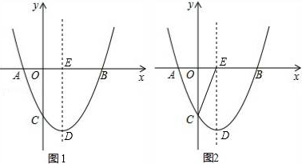

# Mathematics - 题目 1396

**ID**: e9f29c85082d4d99ab87cdf6dd514c87
**年级**: Grade 9
**难度**: Medium-Hard
**题型**: Calculation

## 题目
如图1，已知二次函数y＝ax^{2}+bx+c(a≠0)的图象与x轴交于A(﹣1，0)，B(3，0)两点，与y轴交于点C(0，﹣2)，顶点为D，对称轴交x轴于点E．(1)求该二次函数的解析式；​​​​​​​‌(2)设M为该抛物线对称轴左侧上的一点，过点M作直线MN∥x轴，交该抛物线于另一点N．是否存在点M，使四边形DMEN是菱形？若存在，请求出点M的坐标；若不存在，请说明理由；(3)连接CE(如图2)，设点P是位于对称轴右侧该抛物线上一点，过点P作PQ⊥x轴，垂足为Q．连接PE，请求出当△PQE与△COE相似时点P的坐标．

## 解答

1. 解：(1)设抛物线解析式为y＝a(x+1)(x﹣3)，
2. 将点C(0，﹣2)代入，得：﹣3a＝﹣2，
3. 解得a＝ $\frac {2}{3}$ ，
4. 则抛物线解析式为 $y=\frac {2}{3}\left ({x+1}\right )(x-3)=\frac {2}{3}x{^{2}}-\frac {4}{3}x-2；$
5. (2)∵y＝ $\frac {2}{3}$ x^{2}﹣ $\frac {4}{3}$ x﹣2＝ $\frac {2}{3}$ (x﹣1)^{2}﹣ $\frac {8}{3}$ ，
6. ∴顶点D(1，﹣ $\frac {8}{3}$ )，即DE＝ $\frac {8}{3}$ ，
7. ∵四边形DMEN是菱形，
8. ∴点M的纵坐标为﹣ $\frac {4}{3}$ ，
9. 则 $\frac {2}{3}$ x^{2}﹣ $\frac {4}{3}$ x﹣2＝﹣ $\frac {4}{3}$ ，
10. 解得x＝1± $\sqrt {3}$ ，
11. ∵M为该抛物线对称轴左侧上的一点，
12. ∴x＜1，
13. 则x＝1﹣ $\sqrt {3}$ ，
14. ∴点M坐标为(1﹣ $\sqrt {3}$ ，﹣ $\frac {4}{3}$ )；
15. (3)∵C(0，﹣2)，E(1，0)，
16. ∴OC＝2，OE＝1，
17. 如图，设P(m， $\frac {2}{3}$  m^{2}﹣ $\frac {4}{3}$ m﹣2)(m＞1)，
18. 
19. 则PQ＝| $\frac {2}{3}$ m^{2}﹣ $\frac {4}{3}$ m﹣2|，EQ＝m﹣1，
20. ①若△COE∽△PQE，则 $\frac {OC}{OE}=\frac {QP}{QE},$  即 $\frac {2}{1}=\frac {\left |{\frac {2}{3}m{^{2}}-\frac {4}{3}m-2}\right |}{m-1},$
21. 解得m＝0(舍)或m＝5或m＝2或m＝﹣3(舍)，
22. 此时点P坐标为(5，8)或(2，﹣2)；
23. ②若△COE∽△EQP，则 $\frac {OC}{OE}=\frac {QE}{QP},$ 即 $\frac {2}{1}=\frac {m-1}{\left |{\frac {2}{3}m{^{2}}-\frac {4}{3}m-2}\right |},$
24. 解得m＝ $\frac {11+\sqrt {265}}{8}$ (负值舍去)或m＝ $\frac {5+\sqrt {265}}{8}$ ，
25. 此时点P的坐标为( $\frac {11+\sqrt {265}}{8}$ ， $\frac {3+\sqrt {265}}{16}$ )或( $\frac {5+\sqrt {265}}{8}$ ， $\frac {3-\sqrt {265}}{16}$ )；
26. 综上，点P的坐标为(5，8)或(2，﹣2)或( $\frac {11+\sqrt {265}}{8}$ ， $\frac {3+\sqrt {265}}{16}$ )或( $\frac {5+\sqrt {265}}{8}$ ， $\frac {3-\sqrt {265}}{16}$ )．

## 知识点

**中文**:
  - 待定系数法求二次函数解析式
  - 菱形的性质
  - 相似三角形的判定与性质综合

**English**:
  - Finding Quadratic Expressions by Undetermined Coefficients
  - Properties of Rhombuses
  - Determination and Properties

---
