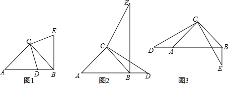

# Mathematics - 题目 88

**ID**: ea0d6bbf85574fed9e847a77fb8b27cf
**年级**: Grade 9
**难度**: Medium-Hard
**题型**: Calculation

## 题目
已知：在Rt△ABC中，∠ACB＝90°，AC＝BC，点D在直线AB上，连接CD，并把CD绕点C逆时针旋转90°到CE．（1）如图1，点D在AB边上，线段BD、BE、CD的数量关系为．（2）如图2，点D在点B右侧，请猜想线段BD、BE、CD的数量关系，并证明你的结论．（3）如图3，点D在点A左侧，BC＝ $\sqrt {2}$ ，AD＝BE＝1，请直接写出线段EC的长．​​​​​​​‌

## 解答

1. 解：（1）结论：BE^{2}+BD^{2}＝2CD^{2}．
2. 理由：如图1中，连接DE．
3. 
4. ∵∠ACB＝∠DCE＝90°，
5. ∴∠ACD＝∠BCE，
6. ∵CA＝CB，CD＝CE，
7. ∴△ACD≌△BCE（SAS），
8. ∴AD＝BE，∠CAD＝∠CBE，
9. ∵CA＝CB，∠ACB＝90°，
10. ∴∠A＝∠CBA＝45°，
11. ∴∠CBE＝∠A＝45°，
12. ∴∠ABE＝90°，
13. ∴DE^{2}＝BD^{2}＝BE^{2}，
14. ∵DE＝ $\sqrt {2}$ CD，
15. ∴BE^{2}+BD^{2}＝2CD^{2}．
16. （2）结论：BE^{2}+BD^{2}＝2CD^{2}．
17. 理由：如图2中，连接DE．
18. 
19. ∵∠ACB＝∠DCE＝90°，
20. ∴∠ACD＝∠BCE，
21. ∵CA＝CB，CD＝CE，
22. ∴△ACD≌△BCE（SAS），
23. ∴AD＝BE，∠CAD＝∠CBE，
24. ∵CA＝CB，∠ACB＝90°，
25. ∴∠A＝∠CBA＝45°，
26. ∴∠CBE＝∠A＝45°，
27. ∴∠ABE＝∠EBD＝90°，
28. ∴DE^{2}＝BD^{2}+BE^{2}，
29. ∵DE＝ $\sqrt {2}$ CD，
30. ∴BE^{2}+BD^{2}＝2CD^{2}．
31. （3）如图3中，连接DE．
32. 
33. ∵AC＝BC＝ $\sqrt {2}$ ，∠ACB＝90°，
34. ∴AB＝ $\sqrt {2}$ BC＝2，
35. ∴AD＝BE＝1，
36. ∴BD＝3，
37. 由（2）可知：BD^{2}+BE^{2}＝2EC^{2}，
38. ∴9+1＝2EC^{2}，
39. ∴EC＝ $\sqrt {5}$ ．

## 知识点

**中文**:
  - 全等三角形的综合问题
  - 勾股定理的应用

**English**:
  - Comprehensive Problems
  - Applications of Pythagorean Theorem

---
