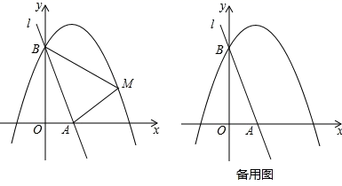

# Mathematics - 题目 2849

**ID**: ec7a546aa33943b4b9c42b40d0b140b2
**年级**: Grade 9
**难度**: Medium-Hard
**题型**: Calculation

## 题目
如图，直线l：y=﹣3x+3与x轴、y轴分别相交于A、B两点，抛物线y=ax^{2}﹣2ax+a+4（a＜0）经过点B．（1）求该抛物线的函数表达式；​​​​​​​‌（2）已知点M是抛物线上的一个动点，并且点M在第一象限内，连接AM、BM，设点M的横坐标为m，△ABM的面积为S，求S与m的函数表达式，并求出S的最大值；（3）在（2）的条件下，当S取得最大值时，动点M相应的位置记为点M′．①写出点M′的坐标；②将直线l绕点A按顺时针方向旋转得到直线l′，当直线l′与直线AM′重合时停止旋转，在旋转过程中，直线l′与线段BM′交于点C，设点B、M′到直线l′的距离分别为d_{1}、d_{2}，当d_{1}+d_{2}最大时，求直线l′旋转的角度（即∠BAC的度数）．

## 解答

1. （1）令x=0代入y=﹣3x+3，
2. ∴y=3，
3. ∴B（0，3），把B（0，3）代入y=ax^{2}﹣2ax+a+4，
4. ∴3=a+4，
5. ∴a=﹣1，
6. ∴二次函数解析式为：y=﹣x^{2}+2x+3；
7. （2）当y=0时，0=﹣x^{2}+2x+3，
8. ∴x=﹣1或3，
9. ∴抛物线与x轴的交点横坐标为﹣1和3，
10. ∴0＜m＜3，
11. 令y=0代入y=−3x+3，
12. ∴x=1，
13. ∴A的坐标为(1,0)，
14. 由题意知：M的坐标为（m，﹣m^{2}+2m+3），
15. S=S_{四边形}_{OAMB}−S_{△AOB}=S_{△OBM}+S_{△OAM}−S_{△AOB}= $\frac {1}{2}$ ×m×3+ $\frac {1}{2}$ ×1×(﹣m^{2}+2m+3)− $\frac {1}{2}$ ×1×3=− $\frac {1}{2}$  (m− $\frac {5}{2}$ )^{2}+ $\frac {25}{8}$
16. ∴当m= $\frac {5}{2}$ 时,S取得最大值 $\frac {25}{8}$ .
17. （3）①由（2）可知：M′的坐标为（ $\frac {5}{2}$ ， $\frac {7}{4}$ ）；
18. ②过点M′作直线l_{1}∥l′，过点B作BF⊥l_{1}于点F根据题意知：d_{1}+d_{2}=BF，
19. ∵∠BFM′=90°，
20. ∴点F在以BM′为直径的圆上，设直线AM′与该圆相交于点H，
21. ∵点C在线段BM′上，
22. ∴F在优弧BM′H上，
23. ∴当F与M′重合时，BF可取得最大值，此时BM′⊥l_{1}，
24. ∵A（1，0），B（0，3），M′（ $\frac {5}{2}$ ， $\frac {7}{4}$ ），
25. ∴由勾股定理可求得：AB= $\sqrt {10}$ ，M′B= $\frac {5\sqrt {5}}{4}$ ，M′A= $\frac {\sqrt {85}}{4}$ ，
26. 过点M′作M′G⊥AB于点G，设BG=x，
27. ∴由勾股定理可得：M′B^{2}﹣BG^{2}=M′A^{2}﹣AG^{2}，
28. ∴ $\frac {85}{16}$ ﹣（ $\sqrt {10}$ ﹣x）^{2}= $\frac {125}{16}$ ﹣x^{2}，
29. ∴x= $\frac {5\sqrt {10}}{8}$ ，
30. cos∠M′BG= $\frac {\sqrt {2}}{2}$ ，
31. ∵l_{1}∥l′，
32. ∴∠BCA=90°，∠BAC=45°.
33. 
34. 考点：1二次函数综合题；2一次函数；3勾股定理；4圆.

## 知识点

**中文**:
  - 一次函数的实际应用
  - 二次函数的综合
  - 勾股定理的应用
  - 几何变换——旋转综合题
  - 余弦

**English**:
  - Applications of Linear Functions
  - Comprehensive Quadratic Function Problems
  - Applications of Pythagorean Theorem
  - Rotation Comprehensive Problems
  - Cosine

---
