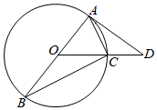

# Mathematics - 题目 1228

**ID**: ece6cadaeb124c539dda27230d29a9b3
**年级**: Grade 9
**难度**: Medium-Hard
**题型**: Calculation

## 题目
如图，AB是⊙O的直径，OC是半径，延长OC至点D．连接AD，AC，BC．使∠CAD＝∠B．（1）求证：AD是⊙O的切线；​​​​​​​‌（2）若AD＝4，tan∠CAD＝ $\frac {1}{2}$ ，求BC的长．

## 解答

1. （1）证明：∵AB是⊙O的直径，
2. ∴∠ACB＝90°，
3. ∴∠B＋∠BAC＝90°，
4. ∵∠CAD＝∠B，
5. ∴∠CAD＋∠BAC＝90°，
6. 即∠BAD＝90°，
7. ∴AD⊥OA，
8. ∴AD是⊙O的切线；
9. （2）解：过点D作DM⊥AD交AC的延长线于点M，
10. 
11. ∵tan∠CAD＝ $\frac {1}{2}$ ＝ $\frac {DM}{AD}$ ，AD＝4，
12. ∴DM＝2，
13. ∵OA＝OC，
14. ∴∠OAC＝∠OCA，
15. ∵AD⊥OA，DM⊥AD，
16. ∴OA∥DM，
17. ∴∠M＝∠OAC，
18. ∵∠OCA＝∠DCM，
19. ∴∠DCM＝∠M，
20. ∴DC＝DM＝2，
21. 在Rt△OAD中，OA^{2}＋AD^{2}＝OD^{2}，
22. 即OA^{2}＋4^{2}＝（OC＋2）^{2}＝（OA＋2）^{2}，
23. ∴OA＝3，
24. ∴AB＝6，
25. ∵∠CAD＝∠B，tan∠CAD＝ $\frac {1}{2}$ ，
26. ∴tanB＝tan∠CAD＝ $\frac {AC}{BC}$ ＝ $\frac {1}{2}$ ，
27. ∴BC＝2AC，
28. 在Rt△ABC中，AB^{2}＝AC^{2}＋BC^{2}，
29. ∴6^{2}＝5AC^{2}，
30. ∴AC＝ $\frac {6\sqrt {5}}{5}$ ，
31. ∴BC＝ $\frac {12\sqrt {5}}{5}$ ．

## 知识点

**中文**:
  - 切线的性质和判定的综合应用
  - 勾股定理
  - 解直角三角形

**English**:
  - Tangent Applications
  - Pythagorean Theorem
  - Solving Right Triangles

---
