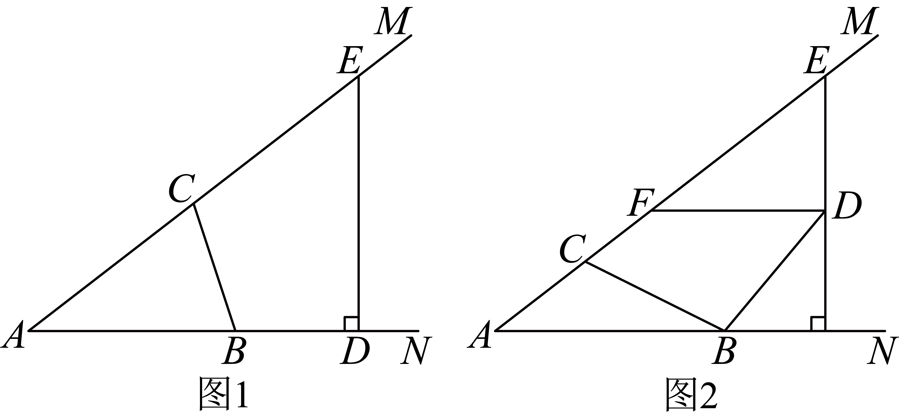

# Mathematics - 题目 3497

**ID**: ed4b9c18db694e35ab97c3860bd8ebcb
**年级**: Grade 9
**难度**: Medium-Hard
**题型**: Calculation

## 题目
已知 $\angle MAN=α\left ({0{}\degree <α<45{}\degree }\right )$ ，点 $B$ ， $C$ 分别在射线 $AN$ ， $AM$ 上，将线段 $BC$ 绕点 $B$ 顺时针旋转 $180{}\degree -2α$ 得到线段 $BD$ ，过点 $D$ 作 $AN$ 的垂线交射线 $AM$ 于点 $E$ .​​​​​​​‌（1）如图1，当点 $D$ 在射线 $AN$ 上时，求证： $C$ 是 $AE$ 的中点；（2）如图2，当点 $D$ 在 $∠MAN$ 内部时，作 $DF\mathrm{/\mskip-4mu/}AN$ ，交射线 $AM$ 于点 $F$ ，用等式表示线段 $EF$ 与 $AC$ 的数量关系，并证明.

## 解答

1. （1）证明：连接 $CD$ ，
2. 
3. 由题意得： $BC=BD$ ， $\angle CBD=180{}\degree -2α$ ，
4. ∴ $\angle BDC=\angle BCD$ ，
5. ∵ $\angle BDC+\angle BCD+\angle CBD=180{}\degree $ ，
6. ∴ $\angle BDC=\frac {180{}\degree -\left ({180{}\degree -2α}\right )}{2}=α$ ，
7. ∴ $\angle BDC=\angle A$ ，
8. ∴ $CA=CD$ ，
9. ∵ $DE\bot AN$ ，
10. ∴ $\angle 1+\angle A=\angle 2+\angle BDC=90{}\degree $ ，
11. ∴ $\angle 1=\angle 2$ ，
12. ∴ $CD=CE$ ，
13. ∴ $CA=CE$ ，
14. ∴点 $C$ 是 $AE$ 的中点；
15. （2）解： $EF=2AC$ ，
16. 在射线 $AM$ 上取点H，使得 $BH=BA$ ，取 $EF$ 的中点G，连接 $DG$ ，
17. 
18. ∵ $BH=BA$ ，
19. ∴ $\angle BAH=\angle BHA=α$ ，
20. ∴ $\angle ABH=180{}\degree -2α=\angle CBD$ ，
21. ∴ $\angle ABC=\angle HBD$ ，
22. 又∵ $BC=BD$ ，
23. ∴ $\vartriangle ABC≌\vartriangle HBD$ ，
24. ∴ $AC=DH$ ， $\angle BHD=\angle A=α$ ，
25. ∴ $\angle FHD=\angle BHA+\angle BHD=2α$ ，
26. ∵ $DF\mathrm{/\mskip-4mu/}AN$ ，
27. ∴ $\angle EFD=\angle A=α$ ， $\angle EDF=\angle 3=90{}\degree $ ，
28. ∵ $G$ 是 $EF$ 的中点，
29. ∴ $GF=GD$ ， $EF=2GD$ ，
30. ∴ $\angle GFD=\angle GDF=α$ ，
31. ∴ $\angle HGD=2α$ ，
32. ∴ $\angle HGD=\angle FHD$ ，
33. ∴ $DG=DH$ ，
34. ∵ $AC=DH$ ，
35. ∴ $\mathrm{D}\mathrm{G}=\mathrm{A}\mathrm{C}$ ，
36. ∴ $EF=2AC$ ．

## 知识点

**中文**:
  - 两直线平行同位角相等
  - 等腰三角形的判定与性质
  - 全等三角形的判定与性质

**English**:
  - Parallel Lines have Equal Corresponding Angles
  - Determination and Properties
  - Determination and Properties

---
