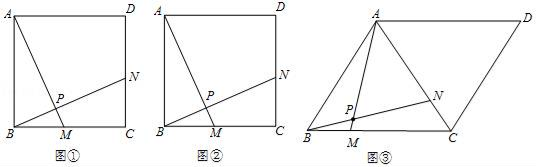

# Mathematics - 题目 2024

**ID**: edf6d2c5f98e42e0a610782f90d73457
**年级**: Grade 9
**难度**: Medium-Hard
**题型**: Calculation

## 题目
问题探究（1）如图①，已知正方形ABCD的边长为4．点M和N分别是边BC、CD上两点，且BM＝CN，连接AM和BN，交于点P．猜想AM与BN的位置关系，并证明你的结论．（2）如图②，已知正方形ABCD的边长为4．点M和N分别从点B、C同时出发，以相同的速度沿BC、CD方向向终点C和D运动．连接AM和BN，交于点P，求△APB周长的最大值；​​​​​​​‌问题解决（3）如图③，AC为边长为2 $\sqrt {3}$ 的菱形ABCD的对角线，∠ABC＝60°．点M和N分别从点B、C同时出发，以相同的速度沿BC、CA向终点C和A运动．连接AM和BN，交于点P．求△APB周长的最大值．

## 解答

1. 试题分析：根据全等三角形的判定SAS证明△ABM≌△BCN，即可证得AM⊥BN；
2. （2）如图②，以AB为斜边向外作等腰直角△AEB，∠AEB=90°，作EF⊥PA于E，作EG⊥PB于G，连接EP，证明PA+PB=2EF，求出EF的最大值即可；
3. （3）如图③，延长DA到K，使得AK=AB，则△ABK是等边三角形，连接PK，取PH=PB，证明PA+PB=PK，求出PK的最大值即可.
4. 试题解析：（1）结论：AM⊥BN．
5. 理由：如图①中，
6. 
7. ∵四边形ABCD是正方形，
8. ∴AB=BC，∠ABM=∠BCN=90°，
9. ∵BM=CN，
10. ∴△ABM≌△BCN，
11. ∴∠BAM=∠CBN，
12. ∵∠CBN+∠ABN=90°，
13. ∴∠ABN+∠BAM=90°，
14. ∴∠APB=90°，
15. ∴AM⊥BN．
16. （2）如图②中，以AB为斜边向外作等腰直角三角形△AEB，∠AEB=90°，作EF⊥PA于E，作EG⊥PB于G，连接EP．
17. 
18. ∵∠EFP=∠FPG=∠G=90°，
19. ∴四边形EFPG是矩形，
20. ∴∠FEG=∠AEB=90°，
21. ∴∠AEF=∠BEG，
22. ∵EA=EB，∠EFA=∠G=90°，
23. ∴△AEF≌△BEG，
24. ∴EF=EG，AF=BG，
25. ∴四边形EFPG是正方形，
26. ∴PA+PB=PF+AF+PG﹣BG=2PF=2EF，
27. ∵EF⩽AE，
28. ∴EF的最大值=AE=2，
29. ∴△APB周长的最大值=4+4．
30. （3）如图③中，延长DA到K，使得AK=AB，则△ABK是等边三角形，连接PK，取PH=PB．
31. 
32. ∵AB=BC，∠ABM=∠BCN，BM=CN，
33. ∴△ABM≌△BCN，
34. ∴∠BAM=∠CBN，
35. ∴∠APN=∠BAM+∠ABP=∠CBN+∠ABN=60°，
36. ∴∠APB=120°，
37. ∵∠AKB=60°，
38. ∴∠AKB+∠APB=180°，
39. ∴A、K、B、P四点共圆，
40. ∴∠BPH=∠KAB=60°，
41. ∵PH=PB，
42. ∴△PBH是等边三角形，
43. ∴∠KBA=∠HBP，BH=BP，
44. ∴∠KBH=∠ABP，∵BK=BA，
45. ∴△KBH≌△ABP，
46. ∴HK=AP，
47. ∴PA+PB=KH+PH=PK，
48. ∴PK的值最大时，△APB的周长最大，
49. ∴当PK是△ABK外接圆的直径时，PK的值最大，最大值为4，
50. ∴△PAB的周长最大值=2+4．

## 知识点

**中文**:
  - 四边形综合

**English**:
  - Comprehensive Quadrilateral Problems

---
