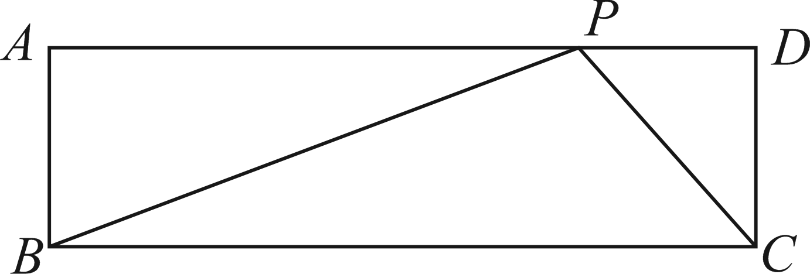

# Mathematics - 题目 2353

**ID**: ee34841f221f40f293be1ebdcdcf054f
**年级**: Grade 9
**难度**: Medium-Hard
**题型**: Calculation

## 题目
【阅读材料】求解一元一次方程，根据等式的基本性质，把方程转化为 $x=a$ 的形式．求解二元一次方程组，把它转化为一元一次方程来解；​​​​​​​‌类似的，求解三元一次方程组，把它转化为解二元一次方程组；求解一元二次方程，把它转化为两个一元一次方程来解；求解分式方程，把它转化为整式方程来解，由于“去分母”可能产生增根，所以解分式方程必须检验．各类方程的解法不尽相同，但是它们有一个共同的基本数学思想——转化，把未知转化为已知．用“转化”的数学思想，我们还可以解一些新的方程．例如，一元三次方程 $x{^{3}}-6x{^{2}}+8x=0$ ，可以通过因式分解把它转化为 $x\left ({x{^{2}}-6x+8}\right )=0$ ，解方程 $x=0$ 和 $x{^{2}}-6x+8=0$ ，可得方程 $x{^{3}}-6x{^{2}}+8x=0$ 的解．【直接应用】方程 $x{^{3}}-6x{^{2}}+8x=0$ 的解是 $x{{}_{1}}=0$ ， $x{{}_{2}}=$， $x{{}_{3}}=$．【类比迁移】解方程： $\sqrt {x+2}=x$ ．【问题解决】如图，在矩形 $ABCD$ 中， $AD=8$ ， $AB=2$ ，点 $P$ 在 $AD$ 上，若 $PB+PC=10$ ，求 $AP$ 的长．

## 解答

1. （1） $x{^{3}}-6x{^{2}}+8x=0$ ，
2. $x\left ({x{^{2}}-6x+8}\right )=0$ ，
3. $x\left ({x-4}\right )\left ({x-2}\right )=0$ ，
4. ∴ $x{{}_{1}}=0$ 或 $x{{}_{2}}=4$ 或 $x{{}_{3}}=2$ .
5. （2） $\sqrt {x+2}=x$ ，
6. 方程的两边平方，得 $x+2=x{^{2}}$ ，
7. 即 $x{^{2}}-x-2=0$ ，
8. $(x-2)(x+1)=0$ ，
9. $x{{}_{1}}=2$ 或 $x{{}_{2}}=-1$ ，
10. 当 $x=2$ 时， $\sqrt {x+2}=\sqrt {4}=2$ ，
11. $\therefore x=2$ 是原方程的解，
12. 当 $x=-1$ 时，原方程无意义，故舍去，
13. $\therefore \sqrt {x+2}=x$ 的解是 $x=2$ ；
14. （3）因为四边形 $ABCD$ 是矩形，
15. $\therefore \angle A=\angle D=90{}\degree $ ， $AB=CD=2$ ，
16. 设 $AP=x$ ，则 $PD=8-x$ ，
17. 在 $Rt\mathrm{△}BAP$ 中， $BP=\sqrt {AP{^{2}}+AB{^{2}}}=\sqrt {x{^{2}}+4}$ ，
18. 在 $Rt△CDP$ 中， $CP=\sqrt {CD{^{2}}+PD{^{2}}}=\sqrt {4+(8-x){^{2}}}$ ，
19. $\because PB+PC=10$ ，
20. $\therefore \sqrt {x{^{2}}+4}+\sqrt {4+{\left({8-x}\right)^{2}}}=10$ ，
21. $\therefore \sqrt {4+{\left({8-x}\right)^{2}}}=10-\sqrt {x{^{2}}+4}$ ，
22. 两边平方得： $4+{\left({8-x}\right)^{2}}=100-20\sqrt {x{^{2}}+4}+x{^{2}}+4$ ，
23. 整理得： $5\sqrt {x{^{2}}+4}=4x+9$ ，
24. 两边平方并整理得： $9x{^{2}}-72x+19=0$ ，
25. 解得： $x=4+\frac {5\sqrt {5}}{3}$ 或 $x=4-\frac {5\sqrt {5}}{3}$ ，
26. $\therefore AP$ 的长为 $4+\frac {5\sqrt {5}}{3}$ 或 $4-\frac {5\sqrt {5}}{3}$ ．

## 知识点

**中文**:
  - 因式分解法解一元二次方程

**English**:
  - Solving by Factorization

---
