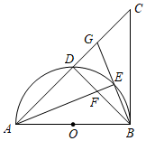

# Mathematics - 题目 2355

**ID**: eebd07146dc54cf0950f724706d5fcd6
**年级**: Grade 9
**难度**: Medium-Hard
**题型**: Calculation

## 题目
如图，在 $ΔABC$ 中， $BA=BC$ ， $\angle ABC=90^\circ $ ，以AB为直径的半圆O交AC于点D，点E是 $\widehat {BD}$ 上不与点B，D重合的任意一点，连接AE交BD于点F，连接BE并延长交AC于点G．（1）求证： $\Delta ADF\cong \Delta BDG$ ；​​​​​​​‌（2）填空：①若 $AB{\rm{=}}{\rm{4}}$ ，且点E是 $\widehat {BD}$ 的中点，则DF的长为；②取 $\widehat {AE}$ 的中点H，当 $\angle EAB$ 的度数为时，四边形OBEH为菱形．

## 解答

1. 
2. 解：（1）证明：如图1， $\because BA=BC$ ， $\angle ABC=90^\circ $ ，
3. $\therefore \angle BAC=45^\circ $
4. $\because $ AB是 $\odot O$ 的直径，
5. $\therefore \angle ADB=\angle AEB=90^\circ $ ，
6. $\therefore \angle DAF+\angle BGD=\angle DBG+\angle BGD=90^\circ $
7. $\therefore \angle DAF=\angle DBG$
8. $\because \angle ABD+\angle BAC=90^\circ $
9. $\therefore \angle ABD=\angle BAC=45^\circ $
10. $\therefore AD=BD$
11. $\therefore \Delta ADF\cong \Delta BDG\quad (ASA)$ ；
12. 
13. （2）①如图2，过F作 $FH\bot AB$ 于H， $\because $ 点E是 $\widehat {BD}$ 的中点，
14. $\therefore \angle BAE=\angle DAE$
15. $\because FD\bot AD$ ， $FH\bot AB$
16. $\because FH=FD$
17. $\because \frac {FH}{BF}={\sin}\angle ABD={\sin}45^\circ =\frac {\sqrt {2}}{2}$ ，
18. $\therefore \frac {FD}{BF}=\frac {\sqrt {2}}{2}$ ，即 $BF=\sqrt {2}FD$
19. $\because AB=4$ ，
20. $\therefore BD=4{\cos}45^\circ =2\sqrt {2}$ ，即 $BF+FD=2\sqrt {2}$ ， $(\sqrt {2}+1)FD=2\sqrt {2}$
21. $\therefore FD=\frac {2\sqrt {2}}{\sqrt {2}+1}=4-2\sqrt {2}$
22. 故答案为 $4-2\sqrt {2}$ ．
23. 
24. ②连接OE，EH， $\because $ 点H是 $\widehat {AE}$ 的中点，
25. $\therefore OH\bot AE$ ，
26. $\because \angle AEB=90^\circ $
27. $\therefore BE\bot AE$
28. $\therefore BE/\mskip-4mu/OH$
29. $\because $ 四边形OBEH为菱形，
30. $\therefore BE=OH=OB=\frac {1}{2}AB$
31. $\therefore {\sin}\angle EAB=\frac {BE}{AB}=\frac {1}{2}$
32. $\therefore \angle EAB=30^\circ $ ．
33. 故答案为 $30^\circ $

## 知识点

**中文**:
  - 圆的基本认识
  - 菱形的性质
  - 垂径定理的应用
  - 特殊角的三角函数值
  - 解直角三角形
  - 等腰直角三角形的性质

**English**:
  - Basic Concepts of Circles
  - Properties of Rhombuses
  - Applications of Perpendicular Chord Theorem
  - Trigonometric Values of Special Angles
  - Solving Right Triangles
  - Properties of Isosceles Right Triangles

---
