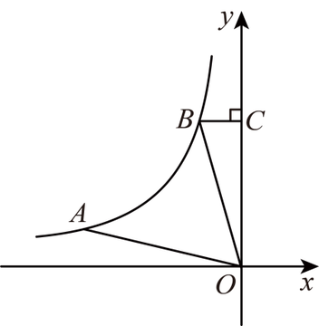

# Mathematics - 题目 1239

**ID**: f0ed84c6afb54bab98b5a81a7e3447a9
**年级**: Grade 9
**难度**: Medium-Hard
**题型**: Calculation

## 题目
如图，点A和B在反比例函数 $y=\frac {k}{x}\left ({x<0}\right )$ 的图象上，  $BC\bot y$ 轴于点C，且 $\vartriangle BOC$ 的面积为2，点A的纵坐标为1， $OA$ 与x轴负半轴的夹角为α．(1)求反比例函数的解析式和点A的坐标；​​​​​​​‌(2)请用无刻度的直尺和圆规作出 $∠AOB$ 的平分线 $OM$ （要求：不写作法，保留作图痕迹）；(3)过点A作 $DA\bot AO$ 垂足为A，交 $∠AOB$ 的平分线 $OM$ 于点D，若 $\angle AOD=α$ ，直接写出线段 $AD$ 的长．

## 解答

1. （1）∵ $BC\bot y$ 轴于点C，且 $\vartriangle BOC$ 的面积为2，
2. ∴ $S{{}_{\vartriangle BOC}}=\frac {1}{2}\left |{k}\right |=2$ ，
3. ∵ $k<0$ ，
4. ∴ $k=-4$ ，
5. 故反比例函数的解析式为 $y=-\frac {4}{x}$ ，
6. ∵点A的纵坐标为1，
7. ∴ $1=-\frac {4}{x}$ ，
8. ∴ $x=-4$ ，
9. ∴ $A\left ({-4,1}\right )$ ；
10. （2）以点O为圆心，适当长为半径画弧，交 $OA$ 、 $OB$ 于点P、Q，
11. 分别以点P、Q为圆心，以大于 $\frac {1}{2}PQ$ 长为半径画弧，两弧交于点M，
12. 作射线 $OM$ ，
13. 射线 $OM$ 即为所求作；
14. 
15. （3）如图，过点A作 $AH\bot x$ 轴于H，
16. ∵ $A\left ({-4,1}\right )$ ，
17. ∴ $AH=1$ ， $OH=4$ ，
18. ∴ $AO=\sqrt {{\left({-4}\right)^{2}}+1{^{2}}}=\sqrt {17}$ ，
19. ∵ $\angle AOH=\angle AOD=a$ ，
20. ∵ $DA\bot AO$
21. ∴ $\angle DAO=\angle AHO=90{}^\circ $ ，
22. ∴ $\vartriangle AHO∽\vartriangle DAO$ ，
23. ∴ $\frac {AD}{AH}=\frac {AO}{HO}$ ，
24. ∴ $\frac {AD}{1}=\frac {\sqrt {17}}{4}$ ，
25. ∴ $AD=\frac {\sqrt {17}}{4}$ ．
26. 

## 知识点

**中文**:
  - 反比例函数系数k的几何意义及应用
  - 反比例函数综合
  - 尺规作图——作角平分线
  - 相似三角形的判定与性质综合

**English**:
  - Geometric Meaning and Application of Coefficient k
  - Comprehensive Inverse Proportionality Problems
  - Construction: Angle Bisector
  - Determination and Properties

---
