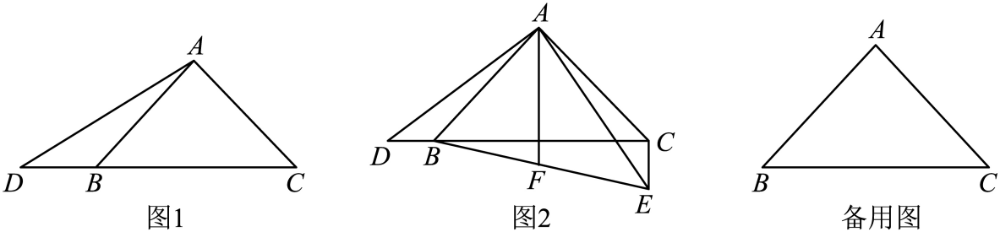

# Mathematics - 题目 902

**ID**: f2ac7b4fc39746a9949968d4b2d2d9a5
**年级**: Grade 9
**难度**: Medium-Hard
**题型**: Calculation

## 题目
在 ${\rm{R}}{\rm{t}}\mathrm{△}ABC$ 中， $AB=AC$ ，点 $D$ 为 $CB$ 延长线上任一点，连接 $AD$ ．(1)如图 $1$ ，若 $AD=\sqrt {34}$ ， $BD=2$ ，求线段 $BC$ 的长；​​​​​​​‌(2)如图 $2$ ，将线段 $AD$ 绕着点 $A$ 逆时针旋转 $90{}^\circ $ 得到线段 $AE$ ，连接 $BE，CE$ ．点 $F$ 为 $BE$ 的中点，连接 $AF$ ．求证： $DC=2AF$ ；(3)在（ $2$ ）的条件下，设点 $K$ 为直线 $CE$ 上的点， $AE$ 交 $BC$ 于点 $P$ ．点 $D$ 在 $CB$ 延长线上运动的过程中，当 $AB\bot BE$ 时，将 $\vartriangle ABE$ 沿直线 $AE$ 翻折到 $\vartriangle ABE$ 所在平面内得到 $\vartriangle ANE$ ，同时将 $\mathrm{△}PCK$ 沿直线 $PK$ 翻折到 $\mathrm{△}PCK$ 所在平面内得到 $\vartriangle PKM$ ．在 $MN$ 取得最大值时，请直接写出 $\frac {MN}{BN}$ 的值．

## 解答

1. （1）解：如图，将 $\mathrm{△}ABD$ 绕点 $A$ 逆时针旋转 $90{}^\circ $ ，使得 $AB$ 与 $AC$ 重合，得到 $△ACE$ ，连接 $DE$ ，
2. 
3. ∵ $\vartriangle ABC$ 是等腰直角三角形，
4. ∴ $\angle ABC=\angle ACB=45{}^\circ $ ，
5. ∴ $\angle ABD=180{}^\circ -\angle ABC=135{}^\circ $ ，
6. 由旋转得 $\mathrm{△}ABD≌\mathrm{△}ACE$ ， $∠DAE{\rm{=}}{\rm{9}}{\rm{0}}{}^\circ $ ，
7. ∴ $\angle ABD=\angle ACE=135{}^\circ $ ， $AD=AE=\sqrt {34}$ ， $BD=CE=2$ ，
8. ∵ $∠DAE{\rm{=}}{\rm{9}}{\rm{0}}{}^\circ $ ， $AD=AE$ ，
9. ∴ $\vartriangle ADE$ 是等腰直角三角形，
10. ∴ $DE=\sqrt {AD{^{2}}+AE{^{2}}}=2\sqrt {17}$ ，
11. ∵ $\angle ACE=135{}^\circ $ ， $\angle ACB=45{}^\circ $ ，
12. ∴ $\angle DCE=90{}^\circ $ ，
13. 在 ${\rm{R}}{\rm{t}}\vartriangle DCE$ 中，
14. ∵ $DE=2\sqrt {17}$ ， $CE=2$ ，
15. ∴ $CD=\sqrt {DE{^{2}}-CE{^{2}}}=8$ ，
16. ∴ $BC=CD-BD=6$ ；
17. （2）证明：连接 $DE$ ，
18. 由线段 $AD$ 绕着点 $A$ 逆时针旋转 $90{}^\circ $ 得到线段 $AE$ ，得 $∠DAE{\rm{=}}{\rm{9}}{\rm{0}}{}^\circ $ ， $AD=AE$ ，
19. ∵ $\angle DAE=\angle BAC=90{}^\circ $ ，
20. ∴ $\angle DAB=\angle EAC$ ，
21. ∵ $AD=AE$ ， $AB=AC$ ，
22. ∴ $\vartriangle ABD≌\vartriangle ACE\left ({{\rm{S}}{\rm{A}}{\rm{S}}}\right )$ ，
23. ∴ $BD=CE$ ，
24. 取 $BC$ 的中点 $G$ ，连接 $AG，GF$ ，
25. ∵ $AB=AC$ ，点 $G$ 是 $BC$ 中点，
26. ∴ $AG\bot BC$ ，
27. ∵点 $G，F$ 是 $BC，BE$ 中点，
28. ∴ $GF$ 是 $\vartriangle BCE$ 的中位线，
29. ∴ $GF{\rm{/\mskip-4mu/}}CE$ ， $GF=\frac {1}{2}CE$ ，
30. ∵ $CE\bot BC$ ，
31. ∴ $GF\bot BC$ ，
32. ∵ $AG\bot BC$ ，
33. ∴点 $A、G、F$ 三点共线，
34. ∵ $\vartriangle ABC$ 是等腰直角三角形，
35. ∴ $AG=\frac {1}{2}BC$ ，
36. ∴ $AF=AG+GF=\frac {1}{2}BC+\frac {1}{2}CE=\frac {1}{2}BC+\frac {1}{2}BD=\frac {1}{2}CD$ ，
37. ∴ $CD=2AF$ ；
38. 
39. （3）解：由题可知，点 $M$ 在以点 $P$ 为圆心， $PC$ 的长度为半径的圆上运动，
40. 得点 $P$ 在线段 $MN$ 上时， $MN$ 取得最大值，
41. ∵ $\angle ABE=90{}^\circ $ ， $∠ABC{\rm{=}}{\rm{4}}{\rm{5}}{}^\circ $ ，
42. ∴ $\angle CBE=45{}^\circ $ ，
43. ∵ $\angle BCE=90{}^\circ $ ，
44. ∴ $\vartriangle BCE$ 是等腰直角三角形，
45. 设 $AG=x$ ，则 $BG=CG=x$ ， $AB=\sqrt {2}x$ ， $BC=CE=2x$ ，
46. ∵ $AG/\mskip-4mu/CE$ ，
47. ∴ $\vartriangle AGP∽\vartriangle ECP$ ，
48. ∴ $\frac {PG}{PC}=\frac {AG}{CE}=\frac {1}{2}$ ，
49. ∴ $PG=\frac {1}{3}CG=\frac {1}{3}x$ ， $PC=\frac {2}{3}CG=\frac {2}{3}x$ ，
50. 由折叠可知 $PB=PN$ ，
51. ∴ $MN=NP+MP=BP+CP=BC=2x$ ，
52. ∵ $\vartriangle ABC$ 和 $\vartriangle BCE$ 是等腰直角三角形，
53. ∴ $AB=\frac {\sqrt {2}}{2}BC=\sqrt {2}x$ ， $BE=\sqrt {2}BC=2\sqrt {2}x$ ，
54. 在 ${\rm{R}}{\rm{t}}△ABE$ 中，
55. ∵ $AB=\sqrt {2}x$ ， $BE=2\sqrt {2}x$ ，
56. ∴ $AE=\sqrt {AB{^{2}}+BE{^{2}}}=\sqrt {10}x$ ，
57. ∴ ${\sin}\angle AEB=\frac {AB}{AE}=\frac {\sqrt {5}}{5}$ ，
58. ∵ $B，N$ 关于 $AE$ 对称，
59. ∴ $BN=2BH$ ， $AE\bot BN$ ，
60. ∴ $\angle ABH=90{}^\circ -\angle BAH=\angle AEB$ ，
61. ∴ ${\sin}\angle ABH=\frac {AH}{AB}=\frac {\sqrt {5}}{5}$ ，
62. ∴ $AH=\frac {\sqrt {5}}{5}\cdot \sqrt {2}x=\frac {\sqrt {10}}{5}x$ ，
63. ∴ $BH=\sqrt {AB{^{2}}-AH{^{2}}}=\frac {2\sqrt {10}}{5}x$ ，
64. ∴ $BN=2BH=\frac {4\sqrt {10}}{5}x$ ，
65. ∴ $\frac {MN}{BN}=\frac {\sqrt {10}}{4}$ ．
66. 

## 知识点

**中文**:
  - 全等三角形的综合问题
  - 几何变换——旋转综合题
  - 相似三角形的判定与性质综合
  - 等腰直角三角形的性质

**English**:
  - Comprehensive Problems
  - Rotation Comprehensive Problems
  - Determination and Properties
  - Properties of Isosceles Right Triangles

---
