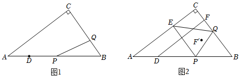

# Mathematics - 题目 3874

**ID**: f3d78ca2a902499e9f9f8f657b91eecc
**年级**: Grade 9
**难度**: Medium-Hard
**题型**: Calculation

## 题目
如图1，已知，在 ${\rm{R}}{\rm{t}}\mathrm{△}ABC$ 中， $\angle C=90{}\degree $ ， $AC=4$ ， $BC=3$ ，点D在AB上且 $BD=\frac {15}{4}$ ，点P，Q分别从点D，B出发沿线段 $DB$ ， $BC$ 向终点B，C匀速移动，P，Q两点同时出发，同时到达终点．设 $BQ=x$ ， $AP=y$ ．(1)求 $AD$ 的值．(2)求y关于x的函数表达式．(3)如图2，过点P作 $PE\bot AC$ 于点E，连接 $PQ$ ， $EQ$ ．①当 $\vartriangle PEQ$ 为等腰三角形时，求x的值．②过D作 $DF\bot BC$ 于点F，作点F关于 $EQ$ 的对称点 $F^{′}$ ，当点 $F^{′}$ 落在 $\mathrm{△}PQB$ 的内部（不包括边界）时，则x的取值范围为．​​​​​​​‌

## 解答

1. （1）解： $\because \angle C=90{}\degree $ ，
2. $\therefore AB=\sqrt {AC{^{2}}+BC{^{2}}}=\sqrt {4{^{2}}+3{^{2}}}=5$ ， $AD=AB-BD=5-\frac {15}{4}=\frac {5}{4}$ ；
3. （2）由题意得： $\frac {DP}{BQ}=\frac {BD}{BC}$ ，
4. $\therefore \frac {DP}{x}=\frac {\frac {15}{4}}{3}$ ，
5. $\therefore DP=\frac {5}{4}x$ ，
6. $\therefore AP=AD+DP=\frac {5}{4}x+\frac {5}{4}$ ，
7. $\therefore y=\frac {5}{4}x+\frac {5}{4}$ ；
8. （3）①如图1，
9. 
10. 作 $QG\bot AB$ 于G，
11. 在 $Rt\vartriangle APE$ 中，
12. $PE=AP\cdot \sin A=AP\cdot \frac {3}{5}=\frac {3}{5}\left ({\frac {5}{4}x+\frac {5}{4}}\right )=\frac {3}{4}\left ({x+1}\right )$ ，
13. $AE=AP\cdot {\cos}A=\frac {4}{5}AP=x+1$ ，
14. $\therefore CE=AC-AE=4-\left ({x+1}\right )=3-x$ ，
15. $\because CQ=BC-BQ=3-x$ ，
16. $\therefore EQ=\sqrt {2}\left ({3-x}\right )$ ，
17. 在 $RT\vartriangle BQG$ 中，
18. $BG=BQ\cdot {\cos}B=\frac {3}{5}x$ ，
19. $QG=BQ\cdot \sin B=\frac {4}{5}x$ ，
20. $\therefore PG=AB-AP-BG=5-\frac {5}{4}\left ({x+1}\right )-\frac {3}{5}x=\frac {15}{4}-\frac {37}{20}x$ ，
21. $\therefore PQ{^{2}}={\left({\frac {4}{5}x}\right)^{2}}+{\left({\frac {15}{4}-\frac {37}{20}x}\right)^{2}}$ ，
22. 当 $EQ=PQ$ 时，
23. $\left [\sqrt {2}\left ({3-x}\right )\right ]{^{2}}={\left({\frac {4}{5}x}\right)^{2}}+{\left({\frac {15}{4}-\frac {37}{20}x}\right)^{2}}$ ，
24. 化简得：
25. $11x{^{2}}-10x-21$ ，
26. 解得： $x{{}_{1}}=\frac {21}{11},x{{}_{2}}=-1$ （舍去），
27. 当 $PE=PQ$ 时，
28. $\left [\frac {3}{4}\left ({x+1}\right )\right ]{^{2}}={\left({\frac {4}{5}x}\right)^{2}}+{\left({\frac {15}{4}-\frac {37}{20}x}\right)^{2}}$ ，
29. 化简得：
30. $7x{^{2}}-30x+27=0$ ，
31. 解得： $x{{}_{3}}=\frac {9}{7},x{{}_{4}}=3$ （舍去），
32. 当 $EQ=PE$ 时，
33. $\sqrt {2}\left ({3-x}\right )=\frac {3}{4}\left ({x+1}\right )$
34. $\therefore x=\frac {105-48\sqrt {2}}{23}$ ，
35. 综上所述： $x=\frac {21}{11}$ 或 $\frac {9}{7}$ 或 $\frac {105-48\sqrt {2}}{23}$ ；
36. ② $\because BF=BD\cdot {\cos}B=\frac {15}{4}\times \frac {3}{5}=\frac {9}{4}$ ，
37. $\therefore x<\frac {9}{4}$ ，
38. 由（2）得：
39. $CE=CQ$
40. $\because \angle C=90{}\degree $ ，
41. $\therefore \angle CQE=\angle CEQ=45{}\degree $ ，
42. $\therefore $ 当 $\angle EQP>\angle CQE$ ，且 $FQ<PQ$ 时，点 $F^{′}$ 在 $△EPQ$ 的内部，
43. 此时 $\angle PQB<90{}\degree $ ，
44. $\therefore \begin{cases}\frac {5}{3}x>\frac {15}{4}-\frac {5}{4}x\\\frac {9}{4}-x<\sqrt {{\left({\frac {4}{5}x}\right)^{2}}+{\left({\frac {15}{4}-\frac {37}{20}x}\right)^{2}}}\end{cases}$ ,
45. $\therefore x>\frac {9}{7}$ ，
46. 又 $\because x<\frac {9}{4}$ ，
47. $\therefore \frac {9}{7}<x<\frac {9}{4}$ ．

## 知识点

**中文**:
  - 列一次函数解析式
  - 等腰三角形的性质
  - 解直角三角形
  - 等腰直角三角形的性质

**English**:
  - Writing Linear Function Expressions
  - Properties of Isosceles Triangles
  - Solving Right Triangles
  - Properties of Isosceles Right Triangles

---
