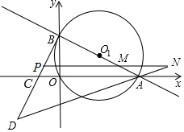

# Mathematics - 题目 1249

**ID**: f4a8ba8ac8494d9381c751fb30a52254
**年级**: Grade 9
**难度**: Medium-Hard
**题型**: Calculation

## 题目
如图，在直角坐标系中，直线 $y=-\frac {1}{2}x+4$ 与 $x$ 轴交于 $A$ 点，与 $y$ 轴交于 $B$ 点，以 $AB$ 为直径作圆 $O{{}_{1}}$ ，过 $B$ 作圆 $O{{}_{1}}$ 的切线交 $x$ 轴于点 $C$ ．（1）求 $C$ 点的坐标；​​​​​​​‌（2）设点 $D$ 为 $BC$ 延长线上一点， $CD=BC$ ， $P$ 为线段 $BC$ 上的一个动点（异于 $B$ ， $C$ ），过 $P$ 点作 $x$ 轴的平行线交 $AB$ 于 $M$ ，交 $DA$ 的延长线于 $N$ ，试判断 $PM+PN$ 的值是否为定值，如果是，则求出这个值；如果不是，请说明理由．

## 解答

1. 解：（1） $\because $ 直线 $AB$ 的解析式为 $y=-\frac {1}{2}x+4$ ，
2. 令x=0，则y=4，令y=0，则x=8，
3. ∴A（8，0），B（0，4），
4. $\because BC$ 是 $\odot O{{}_{1}}$ 的切线，
5. $\therefore BC\bot AB$ ，即∠CBO+∠ABO=90°，
6. 又∠OAB+∠ABO=90°，
7. ∴∠CBO=∠OAB，
8. ∴△BOC∽△AOB，
9. ∴ $\frac {OB}{OA}=\frac {OC}{OB}$ ，即 $\frac {4}{8}=\frac {OC}{4}$ ，
10. 解得：OC=2，
11. $\therefore C(-2,0)$ ；
12. （2） $PM+PN$ 的值是定值，定值为20，
13. 理由：针对于直线 $y=-\frac {1}{2}x+4$ ，
14. 令 $x=0$ ，
15. $\therefore y=4$ ，
16. $\therefore B(0,4)$ ，
17. 令 $y=0$ ，则 $-\frac {1}{2}x+4=0$ ，
18. $\therefore x=8$ ，
19. $\therefore A(8,0)$ ，
20. 由（1）知， $C(-2,0)$ ，
21. $\because CD=BC$ ，
22. $\therefore D(-4,-4)$ ，
23. $\because A(8,0)$ ，
24. $\therefore $ 直线 $AD$ 的解析式为 $y=\frac {1}{3}x-\frac {8}{3}$ ，
25. $\because $ 点 $P$ 在线段 $BC$ 上，
26. 设 $P(m$ ， $2m+4)(-2<m<0)$ ，
27. $\because PM//x$ 轴，
28. $\therefore M(-4m,2m+4)$ ， $N(6m+20,2m+4)$ ，
29. $\therefore PM+PN=-4m-m+(6m+20-m)=20$ ，
30. 即： $PM+PN$ 的值是定值，定值为20．

## 知识点

**中文**:
  - 一次函数的实际应用
  - 切线的性质定理
  - 相似三角形的判定与性质综合

**English**:
  - Applications of Linear Functions
  - Tangent Properties Theorem
  - Determination and Properties

---
