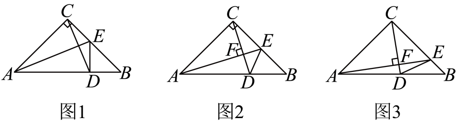

# Mathematics - 题目 741

**ID**: f4fc032e2fc3402a98d4fdd37f790705
**年级**: Grade 9
**难度**: Medium-Hard
**题型**: Calculation

## 题目
在 $\vartriangle ABC$ 中， $AC=BC$ ， $\angle ACB=90{}^\circ $ ，点 $D$ 和点 $E$ 分别是 $AB$ 和 $BC$ 上的点，连接 $AE$ ， $CD$ ， $DE$ ．(1)如图1，若 $\vartriangle ABE∽\vartriangle CBD$ ，求证： $BD=DE$ ；​​​​​​​‌(2)若 $CD\bot AE$ 于点 $F$ ．（ⅰ）如图2，求证： $\frac {BD}{AD}=\frac {CF}{AF}$ ；（ⅱ）如图3，若 $\frac {BE}{BC}=\frac {BD}{BA}$ ， $AC=1$ ，求 ${\tan}\angle CAF$ 的值．

## 解答

1. （1）证明：∵ $\vartriangle ABE∽\vartriangle CBD$ ，
2. ∴ $\frac {BE}{BD}=\frac {AB}{CB}$ ，
3. ∴ $\frac {BE}{AB}=\frac {BD}{CB}$ ，
4. ∵ $\angle CBA=\angle DBE$ ，
5. ∴ $\mathrm{△}BCA∽\mathrm{△}BDE$ ，
6. ∴ $\angle BCA=\angle BDE=90{}^\circ $ ．
7. ∵ $AC=BC$ ， $\angle ACB=90{}^\circ $ ，
8. ∴ $\angle B=45{}^\circ $ ，
9. ∴ ${\rm{△}}BDE$ 是等腰直角三角形，
10. ∴ $BD=DE$ ．
11. （2）（ⅰ）证明：如图，过点 $B$ 作 $BG\bot CD$ 交 $CD$ 的延长线于点 $G$ ，则 $\angle CGB=90{}^\circ $ ，
12. 
13. ∵ $CD\bot AE$ ，
14. ∴ $AE\mathrm{/\mskip-4mu/}BG$ ，
15. ∴ $\mathrm{△}BDG∽\mathrm{△}ADF$ ，
16. ∴ $\frac {BD}{AD}=\frac {BG}{AF}$ ，
17. ∵ $CD\bot AE$ ， $\angle ACB=90{}^\circ $ ，
18. ∴ $\angle CAF=\angle BCG$ ，
19. 又∵ $AC=CB$ ， $\angle AFC=\angle CGB$ ，
20. ∴ $\vartriangle ACF≌\vartriangle CBG\left ({{\rm{A}}{\rm{A}}{\rm{S}}}\right )$ ，
21. ∴ $CF=BG$ ，
22. ∴ $\frac {BD}{AD}=\frac {CF}{AF}$ ．
23. （ⅱ）解：∵ $\frac {BE}{BC}=\frac {BD}{BA}$ ， $\angle DBE=\angle ABC$ ，
24. ∴ $\mathrm{△}BDE\mathrm{∽}\mathrm{△}BAC$ ，
25. ∴ $\frac {BE}{BC}=\frac {DE}{AC}$ ， $\angle BED=\angle ACB=90{}^\circ $ ，
26. ∵ $BC=AC$ ，
27. ∴ $BE=DE$ ，
28. ∴ ${\rm{△}}BDE$ 是等腰直角三角形．
29. 设 $CE=a$ ，则 $BE=DE=1-a$ ， $BD=\sqrt {2}\left ({1-a}\right )$ ，
30. ∴ $AD=AB-BD=\sqrt {2}-\sqrt {2}\left ({1-a}\right )=\sqrt {2}a$ ，
31. $\because \angle CAF=\angle CAE$ ， $\angle AFC=90{}^\circ =\angle ACE$ ，
32. ∴ $\mathrm{△}CAF∽\mathrm{△}EAC$ ，
33. ∴ $\frac {CF}{AF}=\frac {CE}{AC}$ ，
34. 由（ⅰ）可知 $\frac {BD}{AD}=\frac {CF}{AF}$ ，
35. ∴ $\frac {BD}{AD}=\frac {CE}{AC}$ ，即 $\frac {\sqrt {2}\left ({1-a}\right )}{\sqrt {2}a}=\frac {a}{1}$ ，整理得 $a{^{2}}+a-1=0$ ，
36. 解得 $a=\frac {-1+\sqrt {5}}{2}$ 或 $a=\frac {-1-\sqrt {5}}{2}$ （舍去），
37. ∴ $CE=\frac {\sqrt {5}-1}{2}$ ，
38. $\therefore {\tan}\angle CAF={\tan}\angle EAC=\frac {CE}{AC}=\frac {\sqrt {5}-1}{2}$ ，
39. ∴ ${\tan}\angle CAF=\frac {\sqrt {5}-1}{2}$ ．

## 知识点

**中文**:
  - 正切
  - 相似三角形的判定与性质综合
  - 等腰直角三角形的性质

**English**:
  - Tangent
  - Determination and Properties
  - Properties of Isosceles Right Triangles

---
