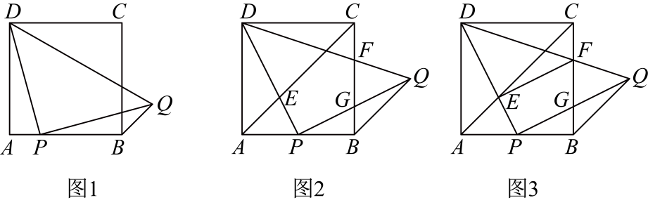

# Mathematics - 题目 3881

**ID**: f66ed236096745a6aec10508aa934912
**年级**: Grade 9
**难度**: Medium-Hard
**题型**: Calculation

## 题目
在正方形 $ABCD$ 中，P是 $AB$ 边上的一个动点，已知 $DP=PQ$ ，且 $DP\bot PQ$ ，连接 $DQ，BQ$ ．(1)如图1，证明： $\frac {AP}{DP}=\frac {BQ}{DQ}$ ；​​​​​​​‌(2)连接 $AC$ 交 $DP$ 于点 $E，DQ$ 和 $PQ$ 分别交 $BC$ 于点F，G．①如图2，若P是 $AB$ 的中点，证明： $PG=QG$ ；②如图3，连接 $EF$ ，判断 $EF$ 与 $PQ$ 之间的位置关系并加以证明．

## 解答

1. （1）证明：如图1，连接 $BD$ ．
2. 
3. $\because DP=PQ$ 且 $DP\bot PQ$ ，
4. $\therefore \mathrm{△}DPQ$ 是等腰直角三角形，
5. ∴ $\angle PDQ=45{}\degree $ ， $DQ=\sqrt {2}DP$ ，
6. ∵四边形 $ABCD$ 是正方形， $BD$ 是对角线，
7. $\therefore \vartriangle DAB$ 是等腰直角三角形，
8. ∴ $\angle ADB=45{}\degree $ ， $BD=\sqrt {2}AD$ ，
9. $\therefore \frac {AD}{BD}=\frac {PD}{QD},\angle ADB-\angle PDB=\angle PDQ-\angle PDB$ ，
10. $\therefore \angle ADP=\angle BDQ$ ，
11. $\therefore \mathrm{△}ADP∽\mathrm{△}BDQ$ ，
12. $\therefore \frac {AP}{DP}=\frac {BQ}{DQ}$ ；
13. （2）证明：①如图2，连接 $BD$ ，过点Q作 $QH\bot AB$ 于点H，则 $BG{\rm{/\mskip-4mu/}}QH$ ，
14. 
15. 由（1）可知 $\mathrm{△}ADP∽\mathrm{△}BDQ$ ，
16. $\therefore \angle DBQ=\angle DAP=90{}\degree $ ，
17. $\therefore \angle QBH=180{}\degree -\angle DBQ-\angle ABD=45{}\degree $ ，
18. $\therefore \vartriangle BHQ$ 是等腰直角三角形，
19. ∴ $BH=QH$ ，
20. 由（1）可知 $\angle QPH=\angle PDA$ ，
21. 又∵ $PD=PQ,\angle DAP=\angle PHQ=90{}\degree $ ，
22. $\therefore \vartriangle DAP≌\vartriangle PHQ\left ({{\rm{A}}{\rm{A}}{\rm{S}}}\right )$ ，
23. $\therefore AP=QH=BH$ ，
24. 又∵P是 $AB$ 的中点，
25. ∴ $AP=PB=BH$ ，
26. ∵ $BG{\rm{/\mskip-4mu/}}QH$ ，
27. ∴ $\frac {PB}{BH}=\frac {PG}{GQ}=1$ ，
28. $\therefore PG=QG$ ；
29. ② $EF{\rm{/\mskip-4mu/}}PQ$ ．
30. 证明：连接 $BD$ ，如图3，
31. 
32. 由（1）可知 $\angle ADP=\angle BDF$ ，
33. 又∵ $\angle DAE=\angle DBF=45{}\degree $ ，
34. $\therefore \vartriangle ADE∽\vartriangle BDF$ ，
35. $\therefore \frac {AD}{BD}=\frac {ED}{FD}$ ，
36. 又∵ $\angle ADB=\angle EDF=45{}\degree $ ，
37. $\therefore △ADB∽△EDF$ ，
38. $\therefore \angle DEF=\angle DAB=90{}\degree $ ，
39. 又∵ $\angle DPQ=90{}\degree $ ，
40. ∴ $EF{\rm{/\mskip-4mu/}}PQ$ ．

## 知识点

**中文**:
  - 正方形的性质
  - 相似三角形的判定与性质综合
  - 等腰直角三角形的性质

**English**:
  - Properties of Squares
  - Determination and Properties
  - Properties of Isosceles Right Triangles

---
