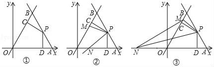

# Mathematics - 题目 285

**ID**: f81acccce96744aeb8a5c414531f05ff
**年级**: Grade 9
**难度**: Medium-Hard
**题型**: Calculation

## 题目
如图①，直线y=﹣ $\sqrt {3}$ x+8 $\sqrt {3}$ 与x轴交于点A，与直线y= $\sqrt {3}$ x交于点B，点P为AB边的中点，作PC⊥OB与点C，PD⊥OA于点D．（1）填空：点A坐标为，点B的坐标为，∠CPD度数为；​​​​​​​‌（2）如图②，若点M为线段OB上的一动点，将直线PM绕点P按逆时针方向旋转，旋转角与∠AOB相等，旋转后的直线与x轴交于点N，试求MB•AN的值；（3）在（2）的条件下，当MB＜2时（如图③），试证明：MN=DN﹣MC；（4）在（3）的条件下，设MB=t，MN=s，直接写出s与t的函数表达式．

## 解答

1. （1）如图①中，
2. 
3. 对于直线y=﹣ $\sqrt {3}$ x+8 $\sqrt {3}$ ，令y=0，解得x=8，可得A（8，0），
4. 由 $\begin{cases}y=-\sqrt {3}x+8\sqrt {3}\\y=\sqrt {3}x\end{cases}$ ，解得 $\begin{cases}x=4\\y=4\sqrt {3}\end{cases}$ ，
5. ∴B（4，4 $\sqrt {3}$ ），
6. ∴tan∠BOA= $\frac {4\sqrt {3}}{4}{\rm{=}}\sqrt {3}$ ，
7. ∴∠BOA=60°，
8. ∵PC⊥OB与点C，PD⊥OA于点D，
9. ∴∠PCO=∠PDO=90°，
10. ∴∠CPD=120°，
11. 故答案为（8，0），（4，4 $\sqrt {3}$ ），120°．
12. （2）如图②中，
13. 
14. ∵OA=OB=8，∠AOB=60°，
15. ∴△AOB是等边三角形，
16. ∴AB=OA=OB=8，∠OBA=∠OAB=60°，
17. ∴PA=PB=4，
18. ∵∠APM=∠APN+∠MPN=∠PMB+∠PBM，
19. ∵∠MPN=∠PBM=60°，
20. ∴∠APN=∠PMB，
21. ∴△PAN∽△MBP，
22. ∴ $\frac {AN}{BP}=\frac {PA}{BM}$ ，
23. ∴MB•AN=4×4=16．
24. （3）如图③中，在DO上截取DK=MC，连接OP．
25. 
26. ∵OB=OA，PB=PA，
27. ∴∠POB=∠POA，
28. ∵PC⊥OB与点C，PD⊥OA于点D，
29. ∴PC=PD，∵∠PCM=∠PDK=90°，MC=DK，
30. ∴△PCM≌△PDK，
31. ∴PM=PK，∠CPM=∠DPK，
32. ∴∠MPK=∠CPD=120°，
33. ∵∠MPN=60°，
34. ∴∠MPN=∠KPN=60°，∵PN=PN，
35. ∴△PNM≌△PNK，
36. ∴MN=KN=DN﹣DK=DN﹣CM．
37. （4）如图③中，由（2）可知：AN= $\frac {16}{t}$ ，易知BC=AD=2，
38. ∵MN=DN﹣CM，
39. ∴MN=（AN﹣AD）﹣（BC﹣BM），
40. ∴S= $\frac {16}{t}$ ﹣2﹣（2﹣t）= $\frac {16}{t}$ +t﹣4（0＜t＜2）．

## 知识点

**中文**:
  - 列一次函数解析式
  - 相似三角形的判定与性质综合
  - 相似三角形的综合问题

**English**:
  - Writing Linear Function Expressions
  - Determination and Properties
  - Comprehensive Similar Triangle Problems

---
