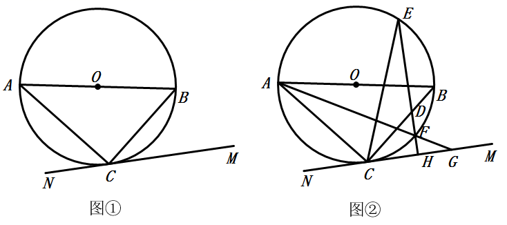

# Mathematics - 题目 277

**ID**: f847ae0849384a3cbf8a3d4a79050d6b
**年级**: Grade 9
**难度**: Medium-Hard
**题型**: Calculation

## 题目
AB是 $\odot O$ 的直径，点C是 $\odot O$ 上一点，连接AC、BC，直线MN过点C，满足 $\angle BCM=\angle BAC=α$ ．（1）如图①，求证：直线MN是 $\odot O$ 的切线；​​​​​​​‌（2）如图②，点D在线段BC上，过点D作 $DH\bot MN$ 于点H，直线DH交 $\odot O$ 于点E、F，连接AF并延长交直线MN于点G，连接CE，且 $CE=\frac {5}{3}$ ，若 $\odot O$ 的半径为1， ${\cos}α=\frac {3}{4}$ ，求 $AG\cdot ED$ 的值．

## 解答

1. 解：（1）证明：连接OC，如图，
2. ∵AB是 $\odot O$ 的直径，
3. ∴ $\angle ACB=90{}^\circ $ ，
4. ∴ $\angle A+\angle B=90{}^\circ $ ，
5. ∵ $OC=OB$ ，
6. ∴ $\angle B=\angle OCB$ ，
7. ∵ $\angle BCM=\angle A$ ，
8. ∴ $\angle OCB+\angle BCM=90{}^\circ $ ，即 $OC\bot MN$ ，
9. ∴MN是 $\odot O$ 的切线；
10. 
11. （2）如图②，∵ ${\cos}α=\frac {AC}{AB}=\frac {3}{4}$ ，即 $\frac {AC}{2}=\frac {3}{4}$ ，∴ $AC=\frac {3}{2}$ ，
12. ∵∠2=∠3，∠1=∠2，
13. ∴∠1=∠3，
14. ∵ $DH\bot MN$ ，2
15. ∴∠1+∠AGC=90°，
16. ∵∠3+∠ECD=90°，
17. ∴ $\angle ECD=\angle AGC$ ，
18. 又∵ $\angle DEC=\angle CAG$ ，
19. ∴ $\mathrm{△}EDC$ ∽ $\vartriangle ACG$ ，
20. ∴ $\frac {ED}{AC}=\frac {EC}{AG}$ ，
21. ∴ $AG\cdot DE=AC\cdot CE=\frac {3}{2}\times \frac {5}{3}=\frac {5}{2}$ ．
22. 

## 知识点

**中文**:
  - 圆的综合问题

**English**:
  - Comprehensive Circle Problems

---
